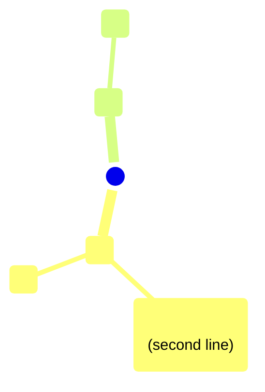
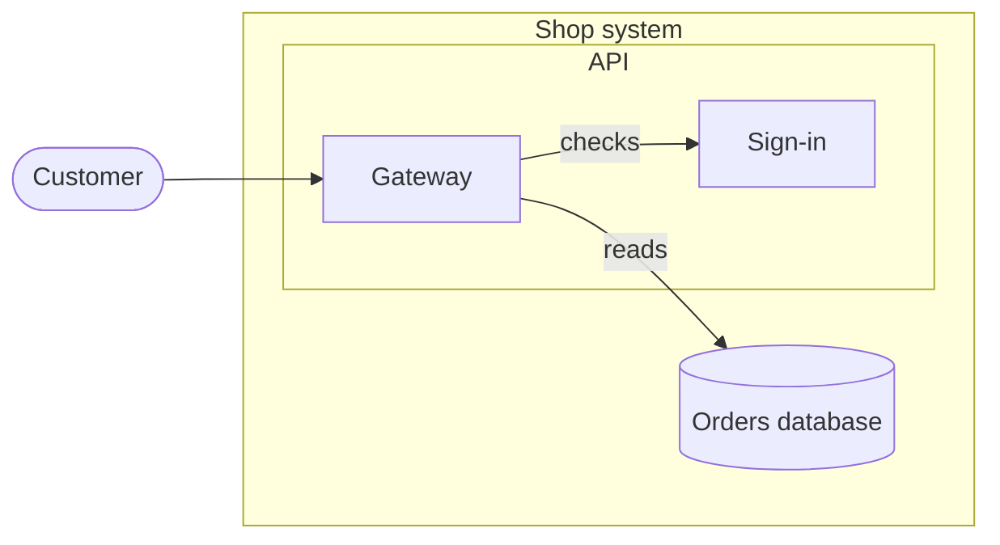
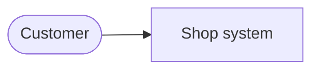
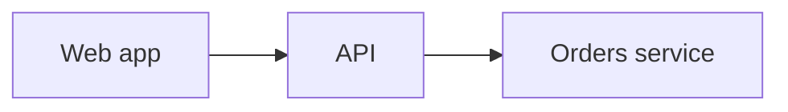
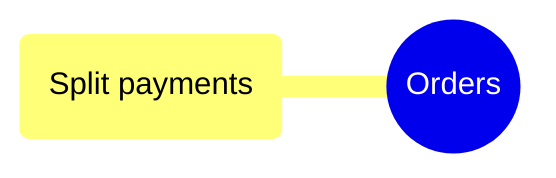
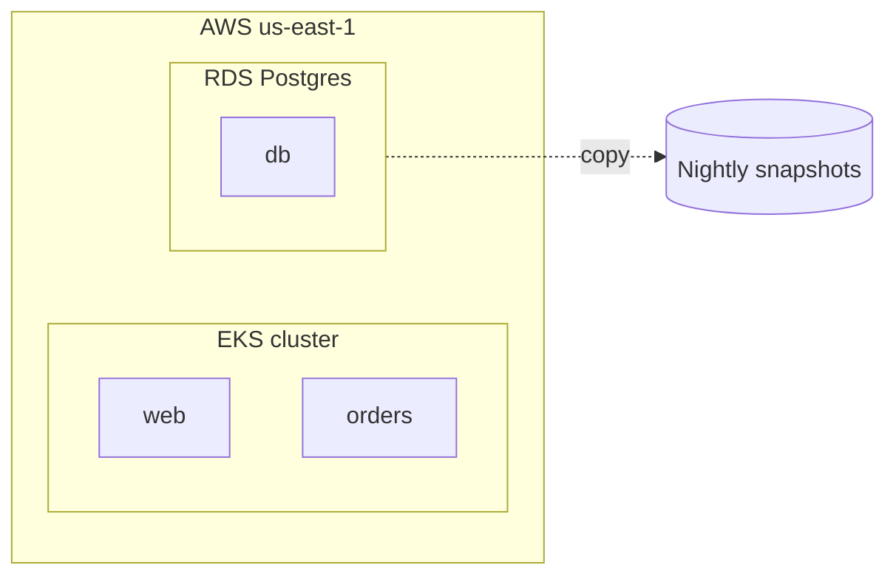
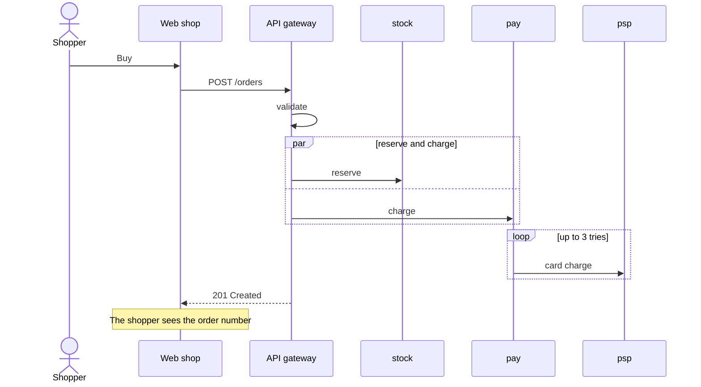
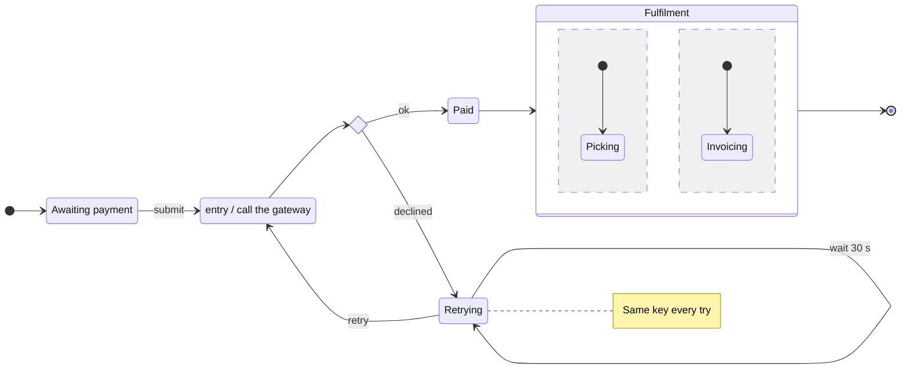
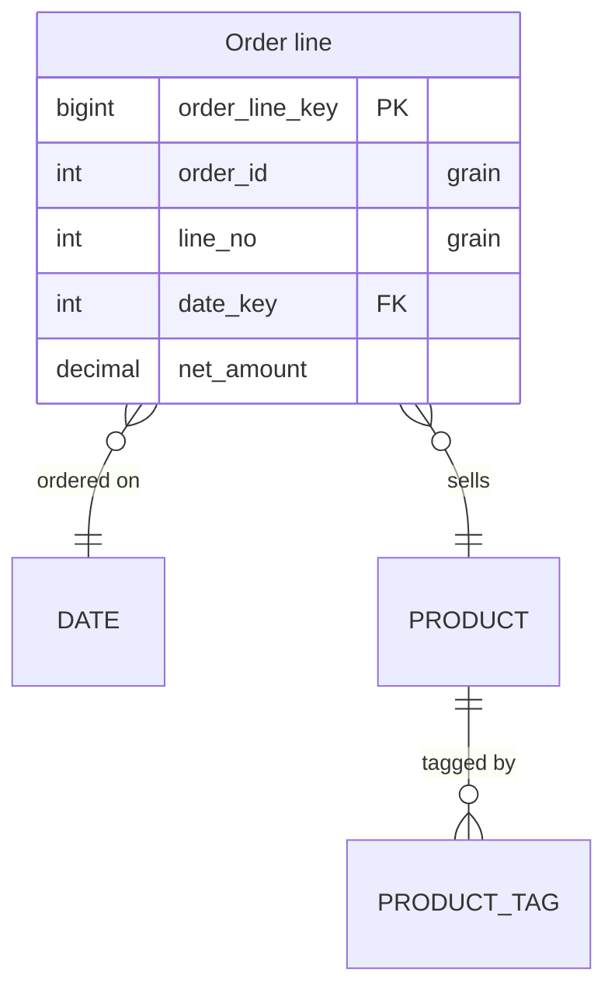

# Map format

A map is one Markdown file (`.md`, or `.mmd`): a title, a Mermaid block, and
optional sections for an icon legend, notes and relations. A file may hold further
diagrams, each a Mermaid block under its own heading (see "Several diagrams in one
file"). It is plain text, so an
agent can write it and a person can read it without the viewer.

The block's first line says what the map is: `mindmap` (a mind map: a tree, shown as
mind map, org chart or list), `flowchart` (a box diagram: boxes inside boxes with
arrows between them, shown as boxes, layers or list; see "Box diagrams" below) or
`sequenceDiagram` (a sequence: messages between participants in order, shown as
lifelines or a list, and played over a box diagram's view; see "Sequences" below). All
read into one model, so notes and icons work the same in each.

Changes to this file are contract changes: note them in `CHANGELOG.md`.
`format/check_map.py` checks a map against these rules; the map viewer reports the same
problems as a fallback.

## Shape of a file

````markdown
# <Title>



## Icons

- ph lightning : #E69F00 : Speed

## Details

### <a id="n3"></a><Idea>

- Note text, markdown allowed
- [link text](<https://example.com>)

## Relations

- n3 --> n6 : depends on
- n4 --> Topic/Other map.md#n12 : see also
````

- **Title**: the first `# ` heading. Without one, the file name is the title.
- Sections after the diagram are found by their `## ` heading and may come in any order.

## The diagram

- Exactly one fenced ` ```mermaid ` block; its first line is `mindmap` (this section)
  or `flowchart` ("Box diagrams" below).
- One node per line. Indentation sets the tree: each level is indented more than its
  parent (two spaces per level by convention). The first node is the centre; its
  children are the main branches.
- Lines starting `%%` are comments.

### Nodes

`<id><open>"<label>"<close>`

- **Id**: a letter, then letters, digits, `_` or `-`. Unique in the map. Convention:
  `n1`, `n2`, … in file order.
- **Shapes**: `(("…"))` circle (the centre), `("…")` rounded (default), `["…"]` square,
  `{{"…"}}` hexagon, `))"…"((` bang, `)"…"(` cloud. These are Mermaid's mindmap shapes.
  The viewer also draws Mermaid's flowchart shapes (`{"…"}` rhombus, `(["…"])` stadium,
  `[["…"]]` subroutine, `[("…")]` database, `((("…")))` double circle, `>"…"]` flag,
  `[/"…"/]` and `[\"…"\]` parallelograms, `[/"…"\]` and `[\"…"/]` trapezoids); they are
  Mermaid's own mindmap does not have them, but the viewer and the checker accept them
  (see `map-viewer/test/fixtures/node-shapes.txt`). Brackets that are no Mermaid shape draw a plain
  node; the checker rejects them.
- **Label**: plain text. `**bold**` is allowed (main branches are bold by convention),
  `<br>` breaks a line. No other markup, no emoji, no links: a URL in a label is plain text.
  An underscore inside a word is just an underscore (`ORDER_SUPERVISION_TRIGGER`), so code
  names, constants and release ids need no escaping; `\_` and `\*` also keep the mark.
- **Length**: at most 150 characters a line (between `<br>`s) and 1,000 in all. A longer
  line is shown as its first 147 characters and `...`, a longer label as its first 997
  and `...`, with a warning. Put more in the node's note.
- **Size**: no limit on the number of nodes. Over 5,000 the viewer warns that drawing
  may be slow and still draws them all; drill-down and zoom keep it readable.

### Lines under a node

These apply to the node on the line above.

- `::icon(<code> <code> …)`: icons, see below.
- `:::right` or `:::left`: pins a **main branch** to that side. Other main branches
  balance around pinned ones. Not both on one branch; not on deeper nodes.

## Icons

An icon code is one of:

- a **named code** from `map-viewer/icons.json` (`codes` keys), coloured by the theme
  (each code names a swatch: red, orange, yellow, green, blue, purple or grey): `idea`, `favorite`,
  `done`, `warning`, `question`, `info`, `star`, `flag-red`, `flag-orange`,
  `flag-yellow`, `flag-green`, `flag-blue`, `flag-purple`, `priority-1`,
  `priority-2`, `priority-3`, `status-red`, `status-amber`, `status-green`, `no`,
  `pin`, `link`, `lock`, `date`, `money`, `person`, `people`, `target`, `hot`, `up`,
  `down`, and the trust marks below;
- `ph <name>`: any icon in the bundled Phosphor duotone set (e.g. `ph database`,
  `ph cloud`, `ph users-three`), drawn in the branch colour;
- `aws <name>`, `azure <name>`, `gcp <name>`: an official cloud architecture icon
  (below);
- a **legend name** defined in the map's `## Icons` section.

### Cloud icons

`aws <name>`, `azure <name>` and `gcp <name>` draw the vendors' official architecture
icons, bundled under `map-viewer/vendor/` and listed in `map-viewer/vendor-icons.json`
(each set's `icons`: name -> [file, product name, file for dark appearances when the
vendor made one]; `aliases`: a short name -> name).
A name is the product's name in lower-case words joined by hyphens, without the
vendor's prefix: `aws lambda`, `aws api-gateway`, `azure virtual-machine`,
`gcp bigquery`. Familiar short names are aliases: `aws s3`, `aws sqs`, `aws eks`,
`azure aks`, `azure vm`, `gcp gke`, `gcp gcs`.

- They are drawn as the vendor made them, in their own colours, never recoloured; the
  product's name is the icon's title (shown on hover).
- In a node they sit centred above its name. On an open box (a subgraph drawn with
  what is inside it) they sit at the top right of its title strip. In a figure they
  join its icon row; on an arrow they follow its label.
- The checker rejects a name the set does not have (`unknown-cloud-icon`) and names
  the nearest one. The viewer leaves such an icon out, without a warning.
- Use them for the infrastructure a diagram is about, not to decorate every node.

### Trust marks

Four named codes say how sure the map is about a node or an arrow, one Phosphor seal
family so they read as one set:

| Code | Key label | Means |
|---|---|---|
| `verified` | Checked in the source | read in the code, seen in a log or trace, tested |
| `inferred` | Reasoned from what was read | follows from what was read, not seen directly |
| `hypothesis` | A guess to test | a guess, to be checked next |
| `unsourced` | Source not found / not reviewed | heard or assumed; no source found, or not reviewed |

They are icons like any other (filter, key, export). They say how sure, not what a node
is: a node whose class brings an icon keeps it, with the marks after it. Why something
is verified goes in its note (`## Details`). Arrows take them by arrow id (below).

### `## Icons` legend (optional)

Gives icons a fixed colour and a label, so a tag looks the same everywhere in the map
and is named in the icon filter. One line per icon:

```
- <code> : #rrggbb[ / #rrggbb] : <Label>
- <name> = <code> : #rrggbb[ / #rrggbb] : <Label>
```

- The colour after `/` is for dark themes; without it the first colour is used in both.
- A colour should be at least 3:1 against the theme's background; give a dark-theme
  colour when the light one is too dark.
- The second form makes a new icon from an existing code, so one image can carry two
  meanings (`- thinking = ph brain : #a23c8a : Thinking`). The name is lowercase
  letters, digits and hyphens, must not be a named code and must not use a namespace or start with the removed `ph-` prefix.
  Nodes then use the name: `::icon(thinking)`. Each name is its own entry in the filter.
- Colours are `#rgb` or `#rrggbb`.

## `## Details`: notes

One note per node:

```
### <a id="<node id>"></a><label>

<markdown>
```

- The anchor must name a node in the map, or an arrow by its id (below). A `###`
  heading without an anchor is an error.
- A note keyed by an arrow id is the note of every relation with that id, in any view.
  The arrow shows a note mark after its label; clicking the arrow or the mark shows the
  note. An arrow that stands for several relations (merged) says how many it holds and
  shows no notes.
- The body is Markdown. Links go here, as `[title](<url>)`; only `http`, `https` and
  `mailto` links are clickable. A node with a link should carry `::icon(link)` so the
  link shows on the map.
- A link to a map on the server's own host
  (`http://127.0.0.1:<port>/#/<folder>/<file>.md?focus=<id>`) opens that map in the viewer.

### Icon namespaces

A Phosphor asset is written as two words: `ph database`, `ph gear-six`.
Use this spelling everywhere: `::icon(ph database)`, `- db : ph database verified`
in `## Node icons`, `- storage : ph hard-drives : Storage` in `## Classes`, and
`- thinking = ph brain : #a23c8a : Thinking` in `## Icons`.
Each namespace consumes exactly one following asset name; several qualified icons
can share a list (`ph database ph cloud verified`). Built-in semantic codes and legend
aliases remain single words. Whitespace inside a qualified code is normalized.
The old `ph-name` syntax is unsupported: the checker rejects it and the viewer
reports a warning and draws the unknown icon. `aws`, `azure` and `gcp` are the cloud
icon sets (above).

## `## Relations`

Links that are not parent and child. In a mind map they are drawn dashed; in a box
diagram they are its arrows.

```
- <from> --> <to> : <label>
```

- The arrow is one of Mermaid's: `-->` solid, `-.->` dotted, `==>` thick, `---` no
  head, `<-->` both ends, `--o` circle, `--x` cross. It is drawn as written in a box
  diagram.

- `<from>` and `<to>` are node ids in this map. The `: <label>` is optional.
- An arrow may carry an id, written as in Mermaid 11 just before the arrow:
  `- <from> e7@--> <to> : <label>` (in a box diagram's block too: `a e7@--> b`). The id
  keys a note under `## Details`, and a class in the block (`class e7 <name>`). An id
  that is also a node's id is a warning.
- `<to>` may be another map's node, `<folder>/<file>.md#<id>` (path relative to the
  maps root). Such a relation is not drawn; it is listed in the node's popover and opens
  that map drilled into that node.

## Relation views: `## Relations: <name>`

A map can have several sets of relations over the same nodes ("calls", "data flow",
"ownership"). `## Relations` is the default view; each `## Relations: <name>` section
is a named view, in file order. In a box diagram, the arrows inside the block are the
default view. Readers see the default view as **Overview** (the view picker, the atlas
bar); its heading stays `## Relations`, and links and `setState` may name it either way.

```
## Relations: Data flow
- cart --> gw : order
- psp --> payh : payment result
```

- The viewer shows a view picker when a map has more than one view. Picking one shows
  its relations; a box diagram is laid out again for it, showing only the boxes its
  arrows use and the boxes round them. Search looks through the whole map: a hit the
  current view leaves out opens the first view that shows it (a node no view shows is
  added to the current one).
- Two sections with the same name are read as one view, with a warning. A named view
  with no relations is a warning.
- A relation whose end is hidden (inside a closed box or branch, or outside the part
  drilled into) is drawn to the nearest box that is shown. Several that land on one
  pair merge into one arrow with a count; clicking it lists them.

## Box diagrams: a `flowchart` block

A Mermaid flowchart, read as boxes inside boxes. A C4 container diagram is one.

````markdown
# Shop system


````

- **Direction**: `flowchart LR` (left to right), `RL`, `TB` / `TD` (top to bottom) or
  `BT`. The top level follows it; the inside of its boxes (the main system) runs left
  to right whatever the map's line; each level further in turns 90 degrees (the
  system's boxes stack their contents top to bottom, the boxes inside those run left
  to right, and so on). A box can set its own with a `direction TB` line inside it; the boxes
  inside it turn from there.
- **Boxes**: `subgraph <id> [<Title>]` ... `end`, nested to any depth. `subgraph
  "<Title>"` and `subgraph <Title words>` also work. Arrows may start or end at a box.
- **Nodes**: `<id>` followed by any shape from the list above (`["…"]`, `[("…")]`, …);
  a bare `<id>` is a node labelled with its id. A node belongs to the box it is first
  named in.
- **Arrows**: Mermaid's (see `## Relations`), with a label as `-->|label|` or
  `-- label -->`; chains (`a --> b --> c`) and `&` (`a & b --> c`). They are the
  map's default relation view.
- **Coloured lines**: give an arrow an id with Mermaid's `<from> <id>@--> <to>` and a
  class with `class <id> <name>` (Mermaid 11). A line class with a meaning (built in, or
  a line in `## Classes`) colours the line and its ends from the theme and is listed
  under "Lines" in the key; a `classDef` shapes it (dashes, width). Lines without a
  class keep the default colour. In a `## Relations: <name>` view, end a line with
  `:::<name>`: `- orders --> payments : charge :::money`. `<id>@{ … }` lines are skipped.
- **Classes**: `class <ids> <name>` (or `<id>:::<name>`) gives a node a meaning; see
  "Classes" below. A `classDef` may shape the outline of the nodes and boxes that name
  the class themselves: `stroke-dasharray` (as written, e.g. `6 4` dashed, `2 3`
  dotted), `stroke-width` and `opacity` (0 to 1). Plain numbers only; a later class
  wins, as in Mermaid. Every other style (`fill`, `stroke`, `color`, `font-*`) is
  ignored: the theme picks colours. `stroke-width: 0` removes the box: no border and
  no fill (a box that only groups, its title kept).
  A class that only a `classDef` names (not built in, not in `## Classes`) is a style
  alone: it has no meaning, colour or colour-key row.
- **Links**: `click <id> "https://…"` is a link on the node. `click` with a callback is
  ignored (a map never runs code).
- `style` and `linkStyle` lines are ignored: a map names meanings, the theme picks
  colours. The checker warns.
- **Icons**: a flowchart has no `::icon` line, so icons go in a section outside the
  block (Mermaid would not render the block otherwise):

```
## Node icons

- db : ph database
- psp : ph credit-card status-amber
- e7 : hypothesis
```

- **Icons on arrows**: a line in `## Node icons` may name an arrow id instead of a node
  (`a e7@--> b` in the block, or `- a e7@--> b : label` in a `## Relations` view; in
  any diagram type). The icons go on every relation with that id, in every view, drawn
  after the arrow's label and before its note mark. An arrow that stands for several
  relations (merged) shows only the icons all of them carry; clicking it lists each
  with its icons. The icon filter finds arrows too (a merged arrow when any of its
  relations carries a picked icon). A line naming neither a node nor an arrow id is a
  problem.
- The map's title is the top of the tree; boxes and nodes hang below it. Notes
  (`## Details`) work by id, as in a mind map.

## Classes: what a node is

A class names a meaning (a person, an external system, a database), never a colour: the
theme picks the colour, the same one for that class in every view, when drilled in, and
on every map. A box diagram is coloured by class when its map uses classes, and by its
top-level boxes when it does not (there is no "colour by" choice: the map decides); the
info panel shows a colour key. A class can also bring an icon, used when the node has
none.

- In a flowchart: `class psp external` or `psp:::external`; in a mind map: `:::external`.
- Built in: `person` (icon `ph user`), `database` (`ph database`), `external`
  (`ph globe`, drawn in the theme's muted colour, as C4 tools draw external systems);
  and the planned-change classes `added`, `changed`, `removed` (below), which are not a
  node's class.
- `person` and `external` nodes are drawn as **figures**: no border, a large icon with
  the label under it, in both diagram types, whatever bracket shape the node has. Only
  nodes that name the class themselves (an open box stays a box). A map may change
  their icon (`## Classes`, or `## Node icons` for one node); the figure stays.
- A map defines or changes classes in a section outside the block:

```
## Classes

- queue : ph tray : Message queue
- external : ph cloud : Partner system
- draft : - : Not built yet
```

  Each line: the class, its icon codes (`-` for none) and its label for the colour key.
- A class flows down: everything inside a box (or under a branch) has the box's class,
  until a node names its own. The colour flows down; the class's icon goes only on
  nodes that name the class themselves (a box shows it in its title strip).
- A node with several classes takes the first that has a meaning. Nodes with no class
  share one neutral colour. A mind map's `:::left` / `:::right` pins are not classes.

## Planned changes: `added`, `changed`, `removed`

A plan (a proposal, before it is made: a refactor, a migration) marks what it adds,
changes and removes with three built-in classes, on nodes and on arrows by their id:

```
class charge,ledger added
class payh,e1 removed
class ord changed
```

(In a mind map: `n9("Compost"):::added`; on a relation view line: `- a --> b :::added`.)

- Each stays on the node or arrow that names it: nothing flows down or up. A new box
  and the new things in it are marked one by one (`class pay,charge,ledger added`); a
  box marked `removed` does not remove what is inside it (its children may move to
  another box: say where in the box's note). A move is told in a note; there is no
  moved state.
- They stay apart from a node's own class: `class ledger database` and
  `class ledger added` both hold (its icon and colour key stay the database's).
- What is removed stays in the text, so it can be drawn.
- The viewer always draws them, in any colouring, in print and in exported pictures: a
  ringed +, ~ or − at a node's top-left corner, and on an arrow before its label or at its
  middle (List mode puts it before the row's label). A closed box, a collapsed branch or a closed List row that
  hides marks says so. The info panel's legend names the marks ("Planned changes") and the
  icon filter lists Added, Changed and Removed first.
- They also colour the **Changes** colour-by (the viewer's Colour by menu offers it when
  the diagram has planned changes): added in the theme's good colour, changed in warn,
  removed in bad, the rest muted. A plan map opens in its usual colouring; a link with
  `colourBy=changes` (or `show.py --colour-by changes`) opens it in Changes.
- Problems: two different change classes on one node or arrow (`plan-class-twice`, the
  later is used); a `## Classes` line or `classDef` named `added`, `changed` or
  `removed` (`plan-class-reserved`, ignored). Both are warnings.
- The checker keeps a plan's marks consistent: an arrow marked added ending on a removed
  node, or marked removed between two added nodes (`plan-arrow-contradicts`, an error);
  an unmarked arrow touching a removed node (`plan-arrow-to-removed`); a box marked
  removed whose children are not all removed and that has no note (`plan-removed-keeps`);
  everything inside a box removed and the box not marked (`plan-all-removed`). The last
  three are warnings.
- Sequence diagrams have no classes, so no planned changes.

What changed since a reader last looked is not written in the map: the viewer works it
out on its own (`docs/map-viewer-api.md`, "Changes since you looked").

## Several diagrams in one file

Every Mermaid block stays valid Mermaid on its own; Mermaid cannot put one kind of
diagram inside another, so a file holds several blocks and links them.

````markdown
# Shop



## Shop system containers



## Relations: Data flow
- web --> ord : orders

## Order ideas


````

- The file opens to its first block, whatever its type (a file may be only a
  sequence). Each further block is a diagram of its own, named by the
  heading right above it (any of `##` to `######`, not a section name such as
  `## Relations`). A further block with no heading right above it is not read (a
  warning).
- The sections after a diagram's block, up to the next diagram's heading, belong to
  that diagram (its own relation views, notes, node icons). `## Classes` of the first
  diagram hold for all of them.
- A flowchart node links into another diagram with Mermaid's own
  `click <id> "#<anchor>"`, the anchor of the diagram's heading as GitHub makes it
  (lower case, punctuation dropped, spaces to hyphens). On GitHub it is a working link
  to that heading. A link to no diagram of the file is a warning.
- Every further diagram must be reachable from the first by links: a `click`, a link in
  a note (`[t](#anchor)`, below), or a sequence's `## Plays over` (from the diagram it
  plays over). Chains count (context, then containers, then components). One that is
  not reachable is a problem (`diagram-unreachable`); the viewer still lists it in the
  first diagram's view picker under "Not linked".
- A node may link to several diagrams: one `click` line each. Links are grouped by
  diagram type, preserving the authored order within each type.
  Mermaid itself keeps only the last, so the block still renders.
- A state diagram has no `click`: there, a link in a state's note to another diagram
  of the file (`[Payment retry ideas](#payment-retry-ideas)`, in `## Details` or the
  state's own note) links the state to it as a `click` does. In other diagram types a
  note's link stays a link in the note.
- The viewer draws an individual quick-link icon for each linked diagram, using
  that diagram type's icon. Boxed nodes place these on a second row beneath the
  label, with content icons on the left and the note icon on the right, vertically
  centered. Clicking a diagram icon opens that diagram directly; the crumbs lead
  back to the drawing. The note icon opens the node's page (below), which also shows
  the linked diagrams as thumbnails.

## Deployments: `## Deployment: <env>`

Where a box diagram runs, per environment. Only the deployment differs between
environments, so the diagram and its relation views stay single and each environment
is one more placement of the same nodes. Each is a flowchart block of its own (valid
Mermaid) under a `## Deployment: <env>` heading after the diagram it places; one heading
may name several environments that are the same (`## Deployment: Staging, Test`).

````markdown
## Deployment: Production


````

- A bare id that is a node of the diagram is that node; what is inside it comes with it
  (code inside a service runs where the service runs). A part of it named on its own
  elsewhere in the block moves there.
- A new id is infrastructure, owned by that deployment: a subgraph, or a node with a
  label. A new id with no label is a warning (a stale id), not a box.
- What the block does not name stays where the diagram has it (people and outside
  systems need no listing); a box the block empties goes.
- Arrows between infrastructure are drawn (replication, a backup). Arrows touching the
  diagram's nodes are ignored with a warning: the diagram's own arrows hold.
- `class`, `## Classes` and `## Details` notes work for infrastructure ids as for nodes.
- So the same things look the same in every view: a box keeps the direction it has in
  the diagram, and a new box holding the diagram's nodes runs the way the box they came
  from runs. New boxes at the top take the place of the first diagram node they hold;
  those holding none go last.
- Warnings keep environments in step: a bare id that is no node, and a node placed in
  some environments but not in others.
- The viewer lists the environments in the view picker under "Where it runs". A
  deployment shows the diagram's own arrows and every node it places; switching
  glides the same nodes to their new places. A node's page says where it runs in each
  environment.
- Deployments are for box diagrams; under a mind map they are not read (a warning).

## Sequences: a `sequenceDiagram` block

How something moves through a system, step by step: Mermaid's own sequence diagram. A
file may hold only a sequence (it opens as its lifelines), or a sequence may be a
further diagram that plays over a box diagram's view.

````markdown
## Checkout



## Plays over

- #shop-platform : Checkout (synchronous)

## Details

### <a id="m-post"></a>POST /orders

The basket id and the delivery slot, with an idempotency key.
````

- **Participants**: `participant id as Label`, `actor id as Label` (drawn as a person);
  an id used in a message and declared nowhere is a participant labelled with its id.
  `box Name` ... `end` groups participants (the colour Mermaid allows there is left to
  the theme).
- **Messages**: `->>` (a call), `-->>` (a reply), `->` and `-->` (no arrow head), `-x`
  and `--x` (a cross), `-)` and `--)` (async), `<<->>` and `<<-->>` (both ways); a label
  after `:`. A dotted message is a reply. `+` / `-` activations, `activate`,
  `deactivate`, `autonumber`, `title` and `destroy` are read and ignored.
- **Numbers**: calls are numbered in order; a reply takes the number of the call it
  answers (the nearest earlier call the other way between the same two that no reply
  has taken), shown `3↩`. A reply that answers nothing gets a number of its own.
- **Blocks**: `loop`, `alt` ... `else`, `opt`, `par` ... `and`, `critical` ... `option`,
  `break`, `rect` ... `end`. Each message is a step; the branches of a `par` play
  together (their first messages one step, their second the next, ...); every branch of
  an `alt` plays, in file order, with its condition as the caption; a `loop` plays once
  and ends in a "repeat" step.
- **Notes**: `Note over a,b: text` (also `left of`, `right of`) is a caption of the step
  before it (of the first step when none comes before).
- **Message ids**: a comment line `%% id: <id>` right before a message names it; its
  details are a `## Details` entry keyed by that id, as for nodes and arrows. Mermaid
  ignores the comment. An id used twice, or one with no message after it, is a problem.
- `## Details` and `## Icons` work as for any diagram; relation views and deployments do
  not apply.

### `## Plays over`: the views a sequence plays over

After a sequence's block, one line per view: `- #<diagram anchor> : <view name>`. The
anchor is that diagram's heading's (the first diagram's is its `# Title`'s); the view
is one of its relation views (`Relations` is the block's own arrows). The first line is
the default. A line that names no box diagram or no view of it, or a section after a
diagram that is no sequence, is a problem.

The checker (and the viewer) hold a linked sequence to its view: every participant is a
node the view shows (`sequence-not-in-view`) and every message runs along one of the
view's arrows, either way (`sequence-no-arrow`); a message to itself needs none. So
playing needs no layout of its own: it plays on the view the reader knows. A line that
fails is not used.

The viewer (docs/map-viewer-api.md, "Playing a sequence"): a play button beside the view
picker while a linked view is shown; the sequence played over it step by step, numbered,
calls and replies in their own colours, what is not reached yet grey; a timeline, step
controls and a side panel with each step's details; the same sequence as lifelines.

## State diagrams: a `stateDiagram-v2` block

How one thing changes over its life: Mermaid's own state diagram, drawn as a box
diagram (states are boxes, composite states boxes holding boxes, transitions the arrows,
its own default relation view).

````markdown

````

- **States**: an id (`Pending`), labelled with `state "Label" as Id`. `Id : text` adds a
  description line, drawn under the name below a rule (UML's internal behaviour).
- **Start and end**: `[*]` is a filled dot as a source, a ringed dot as a target; one of
  each per composite state (or region), as in Mermaid.
- **Marks**: `state x <<choice>>` a small rhombus, `<<fork>>` and `<<join>>` a bar
  across the flow. Other `<<...>>` are a problem (`state-mark-unknown`).
- **Composite states**: `state X { ... }`; `--` inside splits it into concurrent
  regions, drawn as dashed parts of the box. `direction` inside a composite sets its
  flow; otherwise it flows as its parent does.
- **Transitions**: `a --> b : label`; a transition to itself is a loop round the state's
  top-right corner.
- **Notes**: `note left of X : text` or `note right of X` ... `end note`: the state's
  note (a `## Details` entry for the same id wins).
- **Classes**: `classDef`, `class a,b name`, `a:::name`, as in a flowchart. `style`
  lines are ignored (a warning in the checker).
- **Paths**: when the diagram has a start dot at the top, a state no path from it
  reaches is a warning (`state-unreachable`); a state no transition leaves (nor a
  composite round it) that is no end is a warning too (`state-dead-end`). The viewer
  marks such a state with a red "!" at its bottom-left corner.
- Mermaid has no history, entry or exit points, junction, terminate or signal states;
  nor does Avagahana. Mermaid's state diagrams have no `click`: a state links to another
  diagram (a sub-machine, say) through a link in its note (see "Several diagrams in one
  file").

## ER diagrams: an `erDiagram` block

A data model: Mermaid's own entity-relationship diagram, drawn as tables laid out hub
and spoke, with straight lines behind them.

````markdown

````

- **Relationships**: `A <left><line><right> B : label`. Ends: `|o` zero or one, `||`
  exactly one, `}o` zero or more, `}|` one or more (mirrored on the right: `o|`, `||`,
  `o{`, `|{`). `--` is identifying (a solid line), `..` not (dotted). The label may be
  `""`. Each end is drawn with its crow's-foot mark; the line's hover and popover say it
  in words ("Each Customer places zero or more Order. Each Order goes with exactly one
  Customer."). Mermaid's word forms (`one or more`, ...) are not read.
- **Entities**: an id, labelled with `ID["Label"]`; columns in `{ ... }`, one per line:
  `type name [PK, FK, UK] ["comment"]`.
- **Grain**: the comment `"grain"` marks the columns that together say what one row is
  (others call it the alternate or composite key; Mermaid has no such mark, so the
  comment carries it). Selecting a table with a grain says it: "One row per order and
  line no".
- **What a table shows**: its name (the mind map's level-1 type), its primary key
  columns (a gold key) and its grain columns (a diamond; `FK` when also a foreign key)
  always. With up to 15 columns, every column is visible and there is no expand control.
  Above 15, PK, grain, FK and explicitly connected columns stay visible; remaining
  columns sit behind a `+ N columns` row that opens the table. Zoomed far
  out, rows too small to read are bars. The node's page lists every column.
- **Looks**: Flat uses a uniform fill with subtle row dividers; Zebra alternates
  row fills. These are the ER names for the shared look preferences.
- **Role**: each table is a fact, a dimension, a bridge or another table, for the Role
  colouring. A class `fact`, `dimension` or `bridge` says so; otherwise the viewer infers
  it from the relationships (the many side of more than half, with a grain or three or
  more relationships: a fact; no grain, two relationships, the many side of both: a
  bridge; the one side of at least half: a dimension). The Class colouring uses the
  map's classes (subject areas, say), as in a box diagram.
- **Layout**: the tables with most relationships are hubs; a table joined to one hub
  rings it, one joined to several sits between them, and places are then refined so
  lines cross as little as possible, pass behind no table and have room for their
  labels. All tables in the current view use the width needed by its widest table.
  Endpoint channels are allocated across all connections on each table side, and
  layout reserves their space. Tables line up where they can. Not set in the map.
- Problems: `er-line-syntax`, `er-attr-syntax`, `er-not-closed`, `er-attr-twice`.

## ER column relationships and join views

Mermaid blocks stay valid Mermaid. Define column connections in Markdown after the
block; use each definition once. Existing Mermaid relationships remain table-level,
attached at the header rather than suggesting a particular column.

```markdown
## Relations
- ORDER.tenant_id order-tenant@}o--|| TENANT.id : belongs to
- ORDER.billing_address_id billing@}o--|| ADDRESS.id : billed to
- ORDER.shipping_address_id shipping@}o--|| ADDRESS.id : shipped to

## Joins: Order details
- order-tenant
- ORDER_LINE.(tenant_id,order_id) line-order@--- ORDER.(tenant_id,id) : order details
```

- Declare all tables and referenced columns in the Mermaid block. A column endpoint
  is `TABLE.column` or `TABLE.(column1,column2)`. Lists must be nonempty, contain no
  repeated columns, and have matching lengths; columns pair by position.
- Column relationships under `## Relations[: name]` require a stable `id@` and ER
  cardinalities, as in Mermaid's table relationships. Composite relationships are
  allowed when explicitly declared; no relationship is inferred from names or joins.
  The unnamed section adds to the default Relations view without repeating native
  Mermaid relationships. Named relationship sections define other model views.
- `## Joins: <name>` defines a named equality view. Use `- <connection-id>` to reuse
  an existing connection, or define a new column connection with `id@---`. References
  may precede definitions. A new join does not add a model relationship, cardinality,
  or role inference. No SQL block, join execution order, LEFT or RIGHT is implied.
  Fan-out is known only when reusing a relationship with declared cardinality.
- Definition IDs are unique within their diagram, independent of labels and file order.
  Reusing an ID in another view refers to the original object; it does not redefine it.
  Use existing `## Details` anchors (`### <a id="billing"></a>Billing address`) and
  `## Node icons` to annotate connection IDs. Names of views must be distinct,
  ignoring case. Empty join views are reported.
- Each mapped line leaves and enters its column row horizontally, normally in three
  segments. Parallel connections keep separate routes. Composite connections draw
  each column pair, sharing the connection's identity and one label. Self connections
  use an outside return; ordinary middle segments remain straight and may pass
  behind other tables. Label spacing, end clearance and collision placement are
  shared with flowcharts; ER does not use their full router.
- Invalid connection syntax, duplicate IDs, unknown tables/columns/references and
  unequal column-list lengths are checker errors (`relation-syntax`). The viewer skips
  invalid definitions and reports problems while drawing valid content.

## Walks: `## Walks: <name>`

A path through a state or ER diagram that an agent writes to tell a story: how an order
gets stuck, how a query joins its tables. Played over the diagram like a sequence.

````markdown
## Walks: Payment fails twice

- [*] --> Pending : The order is placed and waits for payment.
- Pending --> Charging : The shopper submits the card.
- Charging --> check : The gateway answers.
- check --> Retrying : Declined. The order waits and tries again.
````

- After a state or ER diagram's block, one section per walk, a step per line:
  `- A --> B : what happens`. In a state diagram a step is a transition, its way round
  (`[*]` for a start or end dot); in an ER diagram, a relationship, either way (a join).
  A step not in the diagram is a problem (`walk-not-step`); a step that does not start
  where the last ended is a warning (`walk-gap`).
- Select a specific connection with `- A connection-id@--> B : explanation`.
  A table-only step must identify exactly one connection; missing or ambiguous
  selections are checker errors (`walk-not-step`), never a first-match fallback.
  Use `## Walks: <name> | <view name>` to walk a named relationship or join view;
  otherwise the default Relations view is used. The viewer skips invalid steps and
  reports problems. Join-only equalities do not claim a known fan-out.
- The viewer offers each walk on the play button. Playing greys the diagram and lights
  each step's states or tables and its line in turn (a numbered step, the transition's
  event or the relationship's label), with the step's words in the side panel. A step
  in an ER walk that reaches the many side of a relationship adds "Rows multiply here".
- A walk is a further diagram of the file, anchored `<diagram anchor>-walk-<walk name
  anchor>` (`seq=` in links and `POST /api/show`).

## The node's page

Clicking a node's note icon grows the node into a page, in the node's own outline,
over the faded drawing. Double-clicking a leaf node with linked diagrams also opens
its page. Its label, class and note, then pictures:

- **Connections**: the node in the middle, drawn as on the map, what reaches it on the
  left and what it reaches on the right, with the arrows' labels, lines and note marks
  (a mark opens that arrow's note under the strip). A box's arrows are the ones crossing
  its border; its parts are drawn inside it and the arrows land on them. A mind map node
  has its parent on the left, its children on the right, related links as arrows. One
  box per far end; past five a side, "+N more". On a phone the strip runs top to
  bottom. A click on a neighbour goes to it; on a part, opens its page.
- **Opens**: a thumbnail of each diagram it links to; a click grows it into that diagram.
- **In views**: each relation view the node takes part in, drawn small with the node
  marked (the rest faded) and the shown one outlined; a click shows it there.
- **Runs on**: where it runs, environment by environment side by side, as nested
  frames; a click shows that environment.
- **In sequences**: each sequence linked to this diagram that the node (or something
  inside it) sends or receives in, drawn small as lifelines, with the steps it is in; a
  click plays the sequence over its view from the first of them.

The page does not zoom or pan. It is a step of the crumbs; Escape, a click outside it
or an earlier crumb closes it. A diagram opened from the page is the next step, after
`#` (as its link is written); going back from it stops at the page. Hovering the note
icon shows the note alone, for a quick look. A node with neither icon has no page;
double-click still drills into a box.

## Box diagram modes

- **Boxes**: the layout above. Drilled into a box, the outside ends of the view's
  arrows into it are drawn round it, faded, as they are: each inside its outer boxes
  (up to the outermost that does not hold the drilled box), and those boxes show only
  the ends the arrows reach. They sit along its parent's line, their arrows crossing
  its border; arrows between two outside things are not drawn. Drilling into a system
  reads as its container diagram, into a container as its component diagram.
- **Layers**: the top level as bands stacked top to bottom, ranked by their arrows as in
  Boxes (bands with no arrows between them share a row), every row as wide as the
  widest (a row's bands share the room), each band running left to right (inside, the
  direction turns as usual). A group with `stroke-width: 0` in its `classDef` has no
  box at all (no border, no fill), e.g. a row of people across the top.
- **List**: as for mind maps.
