# Map format

A map is one Markdown file (`.md`, or `.mmd`): a title, a Mermaid block, and
optional sections for an icon legend, notes and relations. A file may hold further
diagrams, each a Mermaid block under its own heading (see "Several diagrams in one
file"). It is plain text, so an
agent can write it and a person can read it without the viewer.

The block's first line says what the map is: `mindmap` (a mind map: a tree, shown as
mind map, org chart or list), `flowchart` (a box diagram: boxes inside boxes with
arrows between them, shown as boxes, layers or list; see "Box diagrams" below) or
`sequenceDiagram` (a sequence: messages between participants in order, shown as
lifelines or a list, and played over a box diagram's view; see "Sequences" below). All
read into one model, so notes and icons work the same in each.

Changes to this file are contract changes: note them in `CHANGELOG.md`.
`format/check_map.py` checks a map against these rules; the map viewer reports the same
problems as a fallback.

## Shape of a file

````markdown
# <Title>

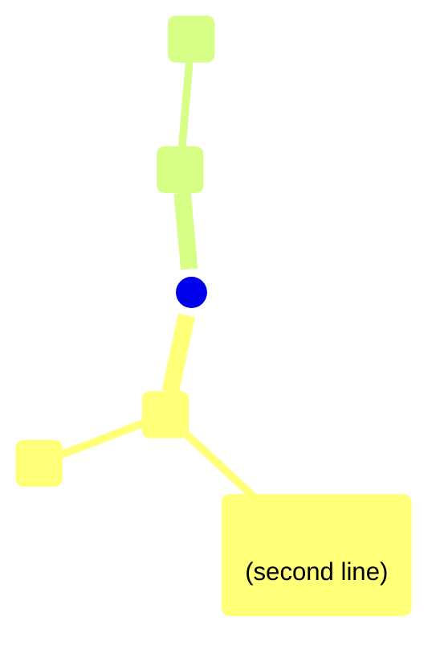

## Icons

- ph lightning : #E69F00 : Speed

## Details

### <a id="n3"></a><Idea>

- Note text, markdown allowed
- [link text](<https://example.com>)

## Relations

- n3 --> n6 : depends on
- n4 --> Topic/Other map.md#n12 : see also
````

- **Title**: the first `# ` heading. Without one, the file name is the title.
- Sections after the diagram are found by their `## ` heading and may come in any order.

## The diagram

- Exactly one fenced ` ```mermaid ` block; its first line is `mindmap` (this section)
  or `flowchart` ("Box diagrams" below).
- One node per line. Indentation sets the tree: each level is indented more than its
  parent (two spaces per level by convention). The first node is the centre; its
  children are the main branches.
- Lines starting `%%` are comments.

### Nodes

`<id><open>"<label>"<close>`

- **Id**: a letter, then letters, digits, `_` or `-`. Unique in the map. Convention:
  `n1`, `n2`, … in file order.
- **Shapes**: `(("…"))` circle (the centre), `("…")` rounded (default), `["…"]` square,
  `{{"…"}}` hexagon, `))"…"((` bang, `)"…"(` cloud. These are Mermaid's mindmap shapes.
  The viewer also draws Mermaid's flowchart shapes (`{"…"}` rhombus, `(["…"])` stadium,
  `[["…"]]` subroutine, `[("…")]` database, `((("…")))` double circle, `>"…"]` flag,
  `[/"…"/]` and `[\"…"\]` parallelograms, `[/"…"\]` and `[\"…"/]` trapezoids); they are
  Mermaid's own mindmap does not have them, but the viewer and the checker accept them
  (see `map-viewer/test/fixtures/node-shapes.txt`). Brackets that are no Mermaid shape draw a plain
  node; the checker rejects them.
- **Label**: plain text. `**bold**` and `*italic*` are allowed (main branches are bold
  by convention), `<br>` breaks a line. No other markup, no emoji, no links: a URL in a label is plain text.
  An underscore inside a word is just an underscore (`ORDER_SUPERVISION_TRIGGER`), so code
  names, constants and release ids need no escaping; `\_` and `\*` also keep the mark.
- **Length**: at most 150 characters a line (between `<br>`s) and 1,000 in all. A longer
  line is shown as its first 147 characters and `...`, a longer label as its first 997
  and `...`, with a warning. Put more in the node's note.
- **Size**: no limit on the number of nodes. Over 5,000 the viewer warns that drawing
  may be slow and still draws them all; drill-down and zoom keep it readable.

### Lines under a node

These apply to the node on the line above.

- `::icon(<code> <code> …)`: icons, see below.
- `:::right` or `:::left`: pins a **main branch** to that side. Other main branches
  balance around pinned ones. Not both on one branch; not on deeper nodes.

## Icons

An icon code is one of:

- a **named code** from `map-viewer/icons.json` (`codes` keys), coloured by the theme
  (each code names a swatch: red, orange, yellow, green, blue, purple or grey): `idea`, `favorite`,
  `done`, `warning`, `question`, `info`, `star`, `flag-red`, `flag-orange`,
  `flag-yellow`, `flag-green`, `flag-blue`, `flag-purple`, `priority-1`,
  `priority-2`, `priority-3`, `status-red`, `status-amber`, `status-green`, `no`,
  `pin`, `link`, `lock`, `date`, `money`, `person`, `people`, `target`, `hot`, `up`,
  `down`, and the trust marks below;
- `ph <name>`: any icon in the bundled Phosphor duotone set (e.g. `ph database`,
  `ph cloud`, `ph users-three`), drawn in the branch colour;
- `aws <name>`, `azure <name>`, `gcp <name>`: an official cloud architecture icon
  (below);
- a **legend name** defined in the map's `## Icons` section.

### Cloud icons

`aws <name>`, `azure <name>` and `gcp <name>` draw the vendors' official architecture
icons, bundled under `map-viewer/vendor/` and listed in `map-viewer/vendor-icons.json`
(each set's `icons`: name -> [file, product name, file for dark appearances when the
vendor made one]; `aliases`: a short name -> name).
A name is the product's name in lower-case words joined by hyphens, without the
vendor's prefix: `aws lambda`, `aws api-gateway`, `azure virtual-machine`,
`gcp bigquery`. Familiar short names are aliases: `aws s3`, `aws sqs`, `aws eks`,
`azure aks`, `azure vm`, `gcp gke`, `gcp gcs`.

- They are drawn as the vendor made them, in their own colours, never recoloured; the
  product's name is the icon's title (shown on hover).
- A node's first cloud icon is its **main icon** (below): centred above its name, or in
  the Poster look the node itself. Further cloud icons are tags, drawn small beside the
  name like Phosphor icons. On an open box (a subgraph drawn with what is inside it) the
  main icon sits at the top right of its title strip (in Poster, the top-left corner). In
  a figure they join its icon row; on an arrow they follow its label.
- The checker rejects a name the set does not have (`unknown-cloud-icon`) and names
  the nearest one. The viewer leaves such an icon out, without a warning.
- Use them for the infrastructure a diagram is about, not to decorate every node.
- For a box, use the vendor's group icon where there is one (`aws
  virtual-private-cloud-vpc`, `aws private-subnet`, `aws public-subnet`, `aws region`,
  `aws account`, `aws auto-scaling-group`, ...), not a service's.

### Main icon

**Contract** (WO-38). A node's main icon is the one picture that stands for it.

- It is the node's first cloud icon; when the node has none, its class's first cloud
  icon (even when the node has Phosphor icons of its own: the class's cloud icon is then
  added in front of them).
- With no cloud icon, the map may mark one other icon main with the reserved word
  `main` before it, in `## Node icons` or `## Classes`: `- sched : main ph clock`,
  `- queue : main ph tray : Message queue`. A node's own mark wins over its class's.
  Marking is never required: with no main icon a node simply has none.
- Mermaid never reads those sections, so the word cannot break a diagram. `main` is a
  reserved word: an `## Icons` legend name `main` is an error (`icon-legend-name`).
- Problems: `main` with no icon after it (`main-icon-alone`), before a cloud icon
  (`main-icon-cloud`: a cloud icon is main by its place), before a trust mark or a
  `status-` code (`main-icon-mark`), twice for one node or class (`main-icon-twice`), on
  a node that has a cloud icon, its own or its class's (`main-icon-with-cloud`), on an
  arrow id (`main-icon-arrow`), in a mind map's `::icon` (`main-icon-mind-map`: a mind
  map has no main icon).
- Outline draws the main icon above the name (a Phosphor one in the node's colour);
  Poster draws it as the node (`## Look: poster`, under Box diagrams).
- In Poster an AWS main icon gives its box its colour (each AWS icon is one colour). This
  is the one place a map's icon, not the theme, picks a colour; Azure and Google icons
  have several colours, so their boxes keep the theme's.

### Trust marks

Four named codes say how sure the map is about a node or an arrow, one Phosphor seal
family so they read as one set:

| Code | Key label | Means |
|---|---|---|
| `verified` | Checked in the source | read in the code, seen in a log or trace, tested |
| `inferred` | Reasoned from what was read | follows from what was read, not seen directly |
| `hypothesis` | A guess to test | a guess, to be checked next |
| `unsourced` | Source not found / not reviewed | heard or assumed; no source found, or not reviewed |

Trust marks keep their existing icon assignments. In the drawing, they occupy the
final position on the right, after the note icon, separate from identity icons.
Their space is reserved even when the map opens with marks hidden, so showing or
hiding them does not move labels or notes. The Verification button beside
Info holds their legend and a Show / Hide control, independently of other icons.
Click/tap a node or arrow mark to open that claim's Evidence section. Keyboard focus
alone and hover do not open it; Enter/Space activates it. Repeating the click,
clicking outside or Escape closes it (Escape returns focus to the mark).

The evidence remains in the full note when diagram marks are hidden. A node page
shows its trust marks and expanded, foldable evidence directly below the title,
then the rest of its note and its diagrams. Evidence is not duplicated on that page.
Trust marks and a nonempty Evidence section must occur together for each node or
named arrow. The checker errors if either half is missing. The viewer warns and
continues drawing, retaining independently authored marks and notes. No automatic source validation or freshness check is implied.

### `## Icons` legend (optional)

Gives icons a fixed colour and a label, so a tag looks the same everywhere in the map
and is named in the icon filter. One line per icon:

```
- <code> : #rrggbb[ / #rrggbb] : <Label>
- <name> = <code> : #rrggbb[ / #rrggbb] : <Label>
```

- The colour after `/` is for dark themes; without it the first colour is used in both.
- A colour should be at least 3:1 against the theme's background; give a dark-theme
  colour when the light one is too dark.
- The second form makes a new icon from an existing code, so one image can carry two
  meanings (`- thinking = ph brain : #a23c8a : Thinking`). The name is lowercase
  letters, digits and hyphens, must not be a named code and must not use a namespace or start with the removed `ph-` prefix.
  Nodes then use the name: `::icon(thinking)`. Each name is its own entry in the filter.
- Colours are `#rgb` or `#rrggbb`.

## `## Details`: notes

One note per node:

```
### <a id="<node id>"></a><label>

<markdown>
```

- The anchor must name a node in the map, or an arrow by its id (below). A `###`
  heading without an anchor is an error.
- A note keyed by an arrow id is the note of every relation with that id, in any view.
  The arrow shows a note mark after its label; clicking the arrow or the mark shows the
  note. An arrow that stands for several relations (merged) says how many it holds and
  shows no notes.
- The body is Markdown (the subset below). Links go here, as `[title](<url>)`; only
  `http`, `https` and `mailto` links are clickable. A node with a link should carry
  `::icon(link)` so the link shows on the map.
- A link to a map on the server's own host
  (`http://127.0.0.1:<port>/#/<folder>/<file>.md?focus=<id>`) opens that map in the viewer.

### Markdown in notes

The same subset applies wherever a map holds prose: notes, walkthrough text, Sources
descriptions and evidence.

| Written | Shown as |
|---|---|
| `####`, `#####`, `######` | Three heading levels. `#` to `###` belong to the map's structure: `##` starts a section and `###` starts the next note, so they are never note headings. |
| `**bold**`, `__bold__`, `*italic*`, `_italic_`, `~~struck~~` | Inline styling, which may nest. A backslash keeps a marker literal: `\*`. |
| `` `code` `` | Literal text: a URL, brackets or markers inside stay as written. |
| `[label](url)`, a bare `https://` URL | A link. A label may hold balanced or escaped brackets. |
| `-`, `*`, `+` | A bulleted list. |
| `1.`, `1)` | An ordered list, keeping its first number. Only a list starting at 1 interrupts a paragraph. |
| An item indented under another | A nested list, in any combination of bullets and numbers. |
| `- [ ]`, `- [x]` | A task item, as a display-only checkbox: the viewer is read-only. |
| `>` | A quote, which may nest. |
| `---`, `***`, `___` on their own line | A horizontal rule. There are no underlined headings. |
| `\| a \| b \|` over `\|:--\|--:\|` | A table, with column alignment. `\\|` is a literal pipe in a cell. A wide table scrolls in its own box. |
| ` ``` ` or `~~~` fences | Literal code, with no highlighting. |

Anything else stays readable text. A note never carries HTML, which shows as text;
images, footnotes, reference links, subscript and superscript are not read.

### Icon namespaces

A Phosphor asset is written as two words: `ph database`, `ph gear-six`.
Use this spelling everywhere: `::icon(ph database)`, `- db : ph database verified`
in `## Node icons`, `- storage : ph hard-drives : Storage` in `## Classes`, and
`- thinking = ph brain : #a23c8a : Thinking` in `## Icons`.
Each namespace consumes exactly one following asset name; several qualified icons
can share a list (`ph database ph cloud verified`). Built-in semantic codes and legend
aliases remain single words. Whitespace inside a qualified code is normalized.
The old `ph-name` syntax is unsupported: the checker rejects it and the viewer
reports a warning and draws the unknown icon. `aws`, `azure` and `gcp` are the cloud
icon sets (above).

## `## Relations`

Links that are not parent and child. In a mind map they are drawn dashed; in a box
diagram they are its arrows.

```
- <from> --> <to> : <label>
```

- The arrow is one of Mermaid's: `-->` solid, `-.->` dotted, `==>` thick, `---` no
  head, `<-->` both ends, `--o` circle, `--x` cross. It is drawn as written in a box
  diagram.

- `<from>` and `<to>` are node ids in this map. The `: <label>` is optional.
- An arrow may carry an id, written as in Mermaid 11 just before the arrow:
  `- <from> e7@--> <to> : <label>` (in a box diagram's block too: `a e7@--> b`). The id
  keys a note under `## Details`, and a class in the block (`class e7 <name>`). An id
  that is also a node's id is a warning.
- `<to>` may be another map's node, `<folder>/<file>.md#<id>` (path relative to the
  maps root). Such a relation is not drawn; it is listed in the node's popover and opens
  that map drilled into that node.

## Relation views: `## Perspective: <name>`

A map can have several sets of relations over the same nodes ("calls", "data flow",
"ownership"). `## Relations` is the default view; each `## Perspective: <name>` section
is a named view, in file order. In a box diagram, the arrows inside the block are the
default view. Readers see the default view as **Overview** (the view picker, the atlas
bar); its heading stays `## Relations`, and links and `setState` may name it either way.

```
## Perspective: Data flow
- cart --> gw : order
- psp --> payh : payment result
```

- The viewer's picker lists the whole map: walkthroughs first, then every diagram with
  its perspectives, joins, deployments and scenarios under it. Picking a perspective shows
  its relations; a box diagram is laid out again for it, showing only the boxes its
  arrows use and the boxes round them. Search looks through the whole map: a hit the
  current view leaves out opens the first view that shows it (a node no view shows is
  added to the current one).
- Two sections with the same name are read as one view, with a warning. A named view
  with no relations is a warning.
- A relation whose end is hidden (inside a closed box or branch, or outside the part
  drilled into) is drawn to the nearest box that is shown. Several that land on one
  pair merge into one arrow with a count; clicking it lists them.

### Authored perspective detail

A named flowchart perspective may include one optional subsection after its arrows:

```markdown
#### Perspective options
- Open: services, outside
- Focus: platform
```

`Open` and `Focus` may also name a box a query fills: a CTE's box (by its id or its
`#### Scopes` target) or the query's `Into` box, so a perspective, and a walkthrough stop
through it, can land inside a CTE. The boxes the viewer generates inside a query, and the
`Sources` and `Binds` boxes, are not valid targets; a query that cannot be drawn fills nothing.

`Open` is a comma-separated list of container/subgraph IDs. Begin with containers
closed, keep the effective root open, then open those containers and their ancestors.
Descendants are not automatically opened; the perspective's arrows still determine
which nodes participate. `Focus` optionally selects a container as the effective root;
Open targets must be inside it. With Focus alone, use normal defaults at that root.
Omitted Focus means the whole diagram. These defaults apply on explicit opening,
including walkthrough Previous/Next/Return, clearing incidental selection. Exploration,
redraws and playback ticks keep the reader's changes. Explicit caller focus/expand/close
settings apply afterward. A perspective without options keeps its existing behavior.

Fields and subsection names are case-insensitive. One nonempty value per field; Open
targets must be containers. Invalid configuration warns and is ignored as a whole
(`perspective-options`). Options are supported only on named flowchart perspectives.
The next heading at the same or a shallower level ends the subsection; blank lines do not.
Headings inside fenced examples remain literal.

## Box diagrams: a `flowchart` block

A Mermaid flowchart, read as boxes inside boxes. A C4 container diagram is one.

````markdown
# Shop system

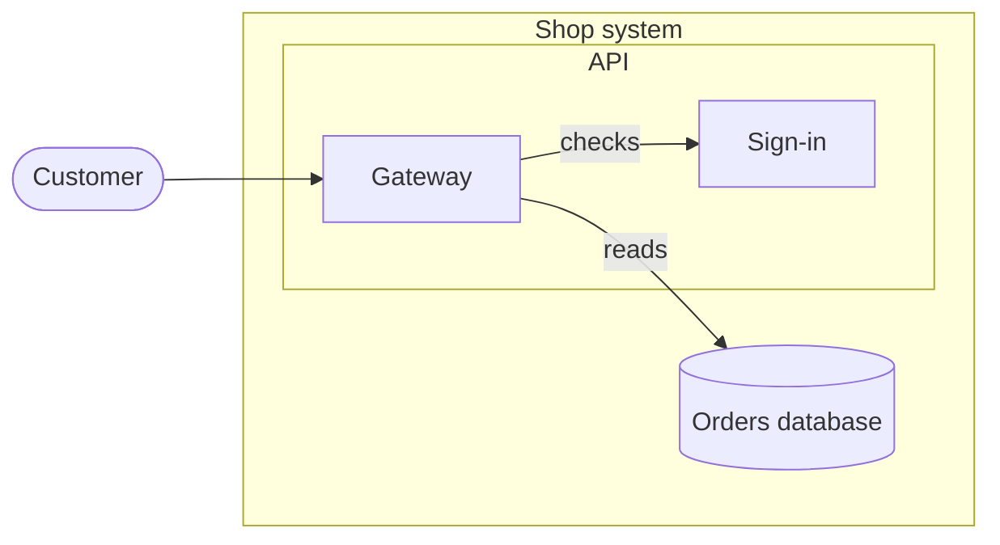
````

- **Direction**: `flowchart LR` (left to right), `RL`, `TB` / `TD` (top to bottom) or
  `BT`. The top level follows it; the inside of its boxes (the main system) runs left
  to right whatever the map's line; each level further in turns 90 degrees (the
  system's boxes stack their contents top to bottom, the boxes inside those run left
  to right, and so on). A box can set its own with a `direction TB` line inside it; the boxes
  inside it turn from there. Children with no arrows between them line up across the
  way their box's arrows travel, unless the box sets its own direction: then they
  follow it too.
- **Order**: where the layout has nothing else to go on, the order of lines decides.
  Children of one box with no arrows among them sit in the order they are first named,
  along their line; arrows that leave or enter a node's box take their places on the
  node's side in the order they are written. Elsewhere the layout orders things by
  their arrows to cut crossings. So reordering lines can untangle arrows without
  changing what the map says.
- **Boxes**: `subgraph <id> [<Title>]` ... `end`, nested to any depth. `subgraph
  "<Title>"` and `subgraph <Title words>` also work. Arrows may start or end at a box.
- **Nodes**: `<id>` followed by any shape from the list above (`["…"]`, `[("…")]`, …);
  a bare `<id>` is a node labelled with its id. A node belongs to the box it is first
  named in.
- **Arrows**: Mermaid's (see `## Relations`), with a label as `-->|label|` or
  `-- label -->`; chains (`a --> b --> c`) and `&` (`a & b --> c`). They are the
  map's default relation view. A label (here, in a state diagram, an ER relationship, a
  sequence message and a view line) reads `**bold**` and `*italic*` as a node's label
  does, and `<br>` breaks it; a line over 40 characters wraps at a space. Two lines are
  drawn, and the gap (a message's row) makes room for them; past two, the second line
  ends in `…`, hovering the label shows it whole, and the checker warns
  (`arrow-label-lines`). Lists, pop-ups and reports give the label as one line of plain
  words.
- **Coloured lines**: give an arrow an id with Mermaid's `<from> <id>@--> <to>` and a
  class with `class <id> <name>` (Mermaid 11). A line class with a meaning (built in, or
  a line in `## Classes`) colours the line and its ends from the theme and is listed
  under "Lines" in the key; a `classDef` shapes it (dashes, width). Lines without a
  class keep the default colour. In a `## Perspective: <name>` view, end a line with
  `:::<name>`: `- orders --> payments : charge :::money`. `<id>@{ … }` lines are skipped.
- **Classes**: `class <ids> <name>` (or `<id>:::<name>`) gives a node a meaning; see
  "Classes" below. A `classDef` may shape the outline of the nodes and boxes that name
  the class themselves: `stroke-dasharray` (as written, e.g. `6 4` dashed, `2 3`
  dotted), `stroke-width` and `opacity` (0 to 1). Plain numbers only; a later class
  wins, as in Mermaid. Every other style (`fill`, `stroke`, `color`, `font-*`) is
  ignored: the theme picks colours. `stroke-width: 0` removes the box: no border and
  no fill (a box that only groups, its title kept).
  A class that only a `classDef` names (not built in, not in `## Classes`) is a style
  alone: it has no meaning, colour or colour-key row.
- **Links**: `click <id> "https://…"` is a link on the node. `click` with a callback is
  ignored (a map never runs code).
- `style` and `linkStyle` lines are ignored: a map names meanings, the theme picks
  colours. The checker warns.
- **Icons**: a flowchart has no `::icon` line, so icons go in a section outside the
  block (Mermaid would not render the block otherwise):

```
## Node icons

- db : ph database
- psp : ph credit-card status-amber
- e7 : hypothesis
```

- **Icons on arrows**: a line in `## Node icons` may name an arrow id instead of a node
  (`a e7@--> b` in the block, or `- a e7@--> b : label` in a `## Relations` view; in
  any diagram type). The icons go on every relation with that id, in every view, drawn
  after the arrow's label and before its note mark. An arrow that stands for several
  relations (merged) shows only the icons all of them carry; clicking it lists each
  with its icons. The icon filter finds arrows too (a merged arrow when any of its
  relations carries a picked icon). A line naming neither a node nor an arrow id is a
  problem.
- The map's title is the top of the tree; boxes and nodes hang below it. Notes
  (`## Details`) work by id, as in a mind map.
- **Look**: `## Look: poster` (or `outline`), a section line among the diagram's
  sections, outside its block, says which look the diagram opens in (**Contract**,
  WO-38). Outline draws boxes with coloured borders; Poster draws each node as its main
  icon with its name under it, the rest (tags, trust marks, notes, linked diagrams) in a
  pop-up on hover. The reader can still switch; their choice holds for maps that name no
  look. Flowcharts only (`look-not-flowchart`); one line per diagram (`look-twice`);
  another value is `look-unknown`. Each further diagram in the file can say its own.
  `render.py --look` overrides it for a picture.

## Classes: what a node is

A class names a meaning (a person, an external system, a database), never a colour: the
theme picks the colour, the same one for that class in every view, when drilled in, and
on every map. A box diagram is coloured by class when its map uses classes, and by its
top-level boxes when it does not (there is no "colour by" choice: the map decides); the
info panel shows a colour key. A class can also bring an icon, used when the node has
none.

- In a flowchart: `class psp external` or `psp:::external`; in a mind map: `:::external`.
- Built in: `person` (icon `ph user`), `database` (`ph database`), `external`
  (`ph globe`, drawn in the theme's muted colour, as C4 tools draw external systems);
  and the planned-change classes `added`, `changed`, `removed` (below), which are not a
  node's class.
- `person` and `external` nodes are drawn as **figures**: no border, a large icon with
  the label under it, in both diagram types, whatever bracket shape the node has. Only
  nodes that name the class themselves (an open box stays a box). A map may change
  their icon (`## Classes`, or `## Node icons` for one node); the figure stays.
- A map defines or changes classes in a section outside the block:

```
## Classes

- queue : ph tray : Message queue
- external : ph cloud : Partner system
- draft : - : Not built yet
```

  Each line: the class, its icon codes (`-` for none) and its label for the colour key.
- A class flows down: everything inside a box (or under a branch) has the box's class,
  until a node names its own. The colour flows down; the class's icon goes only on
  nodes that name the class themselves (a box shows it in its title strip).
- A node with several classes takes the first that has a meaning. Nodes with no class
  share one neutral colour. A mind map's `:::left` / `:::right` pins are not classes.

## Planned changes: `added`, `changed`, `removed`

A plan (a proposal, before it is made: a refactor, a migration) marks what it adds,
changes and removes with three built-in classes, on nodes and on arrows by their id:

```
class charge,ledger added
class payh,e1 removed
class ord changed
```

(In a mind map: `n9("Compost"):::added`; on a relation view line: `- a --> b :::added`.)

- Each stays on the node or arrow that names it: nothing flows down or up. A new box
  and the new things in it are marked one by one (`class pay,charge,ledger added`); a
  box marked `removed` does not remove what is inside it (its children may move to
  another box: say where in the box's note). A move is told in a note; there is no
  moved state.
- They stay apart from a node's own class: `class ledger database` and
  `class ledger added` both hold (its icon and colour key stay the database's).
- What is removed stays in the text, so it can be drawn.
- The viewer always draws them, in any colouring, in print and in exported pictures: a
  ringed +, ~ or − at a node's top-left corner, and on an arrow before its label or at its
  middle (List mode puts it before the row's label). A closed box, a collapsed branch or a closed List row that
  hides marks says so. The info panel's legend names the marks ("Planned changes") and the
  icon filter lists Added, Changed and Removed first.
- They also colour the **Changes** colour-by (the viewer's Colour by menu offers it when
  the diagram has planned changes): added in the theme's good colour, changed in warn,
  removed in bad, the rest muted. A plan map opens in its usual colouring; a link with
  `colourBy=changes` (or `show.py --colour-by changes`) opens it in Changes.
- Problems: two different change classes on one node or arrow (`plan-class-twice`, the
  later is used); a `## Classes` line or `classDef` named `added`, `changed` or
  `removed` (`plan-class-reserved`, ignored). Both are warnings.
- The checker keeps a plan's marks consistent: an arrow marked added ending on a removed
  node, or marked removed between two added nodes (`plan-arrow-contradicts`, an error);
  an unmarked arrow touching a removed node (`plan-arrow-to-removed`); a box marked
  removed whose children are not all removed and that has no note (`plan-removed-keeps`);
  everything inside a box removed and the box not marked (`plan-all-removed`). The last
  three are warnings.
- Sequence diagrams have no classes, so no planned changes.

What changed since a reader last looked is not written in the map: the viewer works it
out on its own (`docs/map-viewer-api.md`, "Changes since you looked").

## Several diagrams in one file

Every Mermaid block stays valid Mermaid on its own; Mermaid cannot put one kind of
diagram inside another, so a file holds several blocks and links them.

````markdown
# Shop

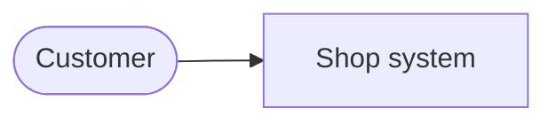

## Shop system containers

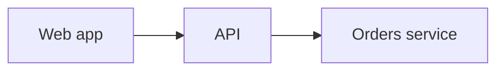

## Perspective: Data flow
- web --> ord : orders

## Order ideas

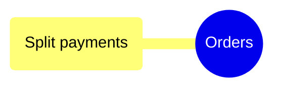
````

- The file opens to its first block, whatever its type (a file may be only a
  sequence). Each further block is a diagram of its own, named by the
  heading right above it (any of `##` to `######`, not a section name such as
  `## Relations`). A further block with no heading right above it is not read (a
  warning).
- The sections after a diagram's block, up to the next diagram's heading, belong to
  that diagram (its own relation views, notes, node icons). `## Classes` of the first
  diagram hold for all of them.
- A flowchart node links into another diagram with Mermaid's own
  `click <id> "#<anchor>"`, the anchor of the diagram's heading as GitHub makes it
  (lower case, punctuation dropped, spaces to hyphens). On GitHub it is a working link
  to that heading. A link to no diagram of the file is a warning.
- Every further diagram must be reachable from the first by links: a `click`, a link in
  a note (`[t](#anchor)`, below), or a sequence's `## Plays over` (from the diagram it
  plays over). Chains count (context, then containers, then components). One that is
  not reachable is a problem (`diagram-unreachable`); the viewer still lists it in its
  picker and the atlas with the other diagrams (no heading of its own).
- A node may link to several diagrams: one `click` line each. Links are grouped by
  diagram type, preserving the authored order within each type.
  Mermaid itself keeps only the last, so the block still renders.
- A state diagram has no `click`: there, a link in a state's note to another diagram
  of the file (`[Payment retry ideas](#payment-retry-ideas)`, in `## Details` or the
  state's own note) links the state to it as a `click` does. In other diagram types a
  note's link stays a link in the note.
- The viewer draws an individual quick-link icon for each linked diagram, using
  that diagram type's icon. Boxed nodes place these on a second row beneath the
  label, with content icons on the left and the note icon on the right, vertically
  centered. Clicking a diagram icon opens that diagram directly; the crumbs lead
  back to the drawing. The note icon opens the node's page (below), which also shows
  the linked diagrams as thumbnails.

## Deployments: `## Deployment: <env>`

Where a box diagram runs, per environment. Only the deployment differs between
environments, so the diagram and its relation views stay single and each environment
is one more placement of the same nodes. Each is a flowchart block of its own (valid
Mermaid) under a `## Deployment: <env>` heading after the diagram it places; one heading
may name several environments that are the same (`## Deployment: Staging, Test`).

````markdown
## Deployment: Production

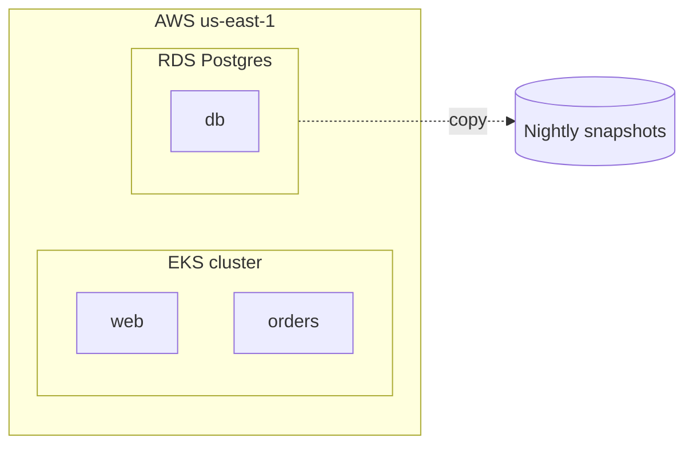
````

- A bare id that is a node of the diagram is that node; what is inside it comes with it
  (code inside a service runs where the service runs). A part of it named on its own
  elsewhere in the block moves there.
- A new id is infrastructure, owned by that deployment: a subgraph, or a node with a
  label. A new id with no label is a warning (a stale id), not a box.
- What the block does not name stays where the diagram has it (people and outside
  systems need no listing); a box the block empties goes.
- Arrows between infrastructure are drawn (replication, a backup). Arrows touching the
  diagram's nodes are ignored with a warning: the diagram's own arrows hold.
- `class`, `## Classes` and `## Details` notes work for infrastructure ids as for nodes.
- So the same things look the same in every view: a box keeps the direction it has in
  the diagram, and a new box holding the diagram's nodes runs the way the box they came
  from runs. New boxes at the top take the place of the first diagram node they hold;
  those holding none go last.
- Warnings keep environments in step: a bare id that is no node, and a node placed in
  some environments but not in others.
- The viewer lists the environments in its picker under their diagram, as deployments. A
  deployment shows the diagram's own arrows and every node it places; switching
  glides the same nodes to their new places. A node's page says where it runs in each
  environment.
- Deployments are for box diagrams; under a mind map they are not read (a warning).

## Sequences: a `sequenceDiagram` block

How something moves through a system, step by step: Mermaid's own sequence diagram. A
file may hold only a sequence (it opens as its lifelines), or a sequence may be a
further diagram that plays over a box diagram's view.

````markdown
## Checkout

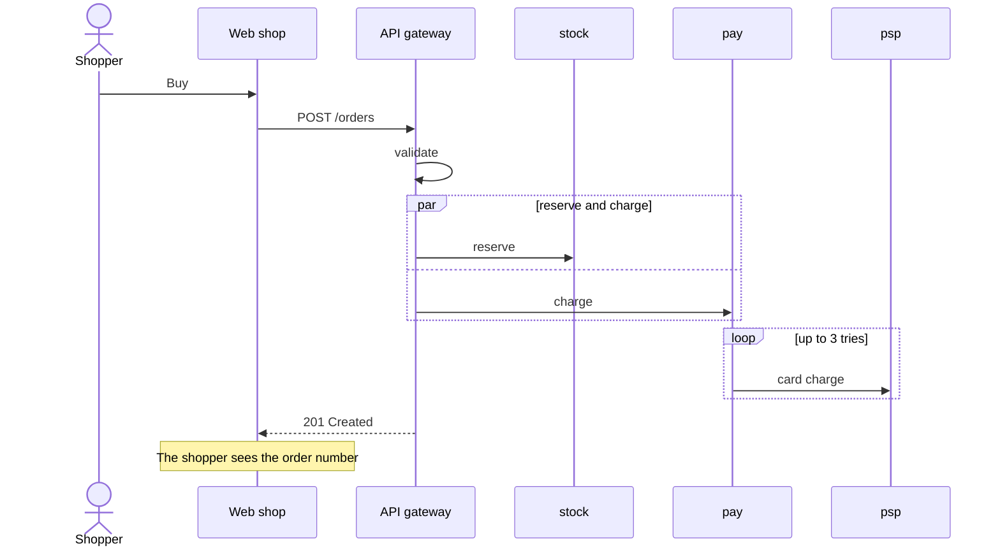

## Plays over

- #shop-platform : Checkout (synchronous)

## Details

### <a id="m-post"></a>POST /orders

The basket id and the delivery slot, with an idempotency key.
````

- **Participants**: `participant id as Label`, `actor id as Label` (drawn as a person);
  an id used in a message and declared nowhere is a participant labelled with its id.
  `box Name` ... `end` groups participants (the colour Mermaid allows there is left to
  the theme).
- **Messages**: `->>` (a call), `-->>` (a reply), `->` and `-->` (no arrow head), `-x`
  and `--x` (a cross), `-)` and `--)` (async), `<<->>` and `<<-->>` (both ways); a label
  after `:` (bold, italic and two lines, as an arrow's label). A dotted message is a reply. `autonumber`, `title` and `destroy` are read and ignored.
- **Activations**: a bar on the called lifeline for a call with a matching reply, or from
  a `+` on a message (`a->>+b`) or an `activate b` line until a `-` from that lifeline
  (`b-->>-a`) or a `deactivate b` line; one never closed runs to the end. A call with no
  reply and no mark, and a one-way `-)`, get no bar: replies stay optional. Played over a
  view, the caller of an open call shows a bar on its box's edge.
- **Numbers**: calls are numbered in order; a reply takes the number of the call it
  answers (the nearest earlier call the other way between the same two that no reply
  has taken), shown `3↩`. A reply that answers nothing gets a number of its own.
- **Blocks**: `loop`, `alt` ... `else`, `opt`, `par` ... `and`, `critical` ... `option`,
  `break`, `rect` ... `end`. Each message is a step; the branches of a `par` play
  together (their first messages one step, their second the next, ...); every branch of
  an `alt` plays, in file order, with its condition as the caption; a `loop` plays once
  and ends in a "repeat" step.
- **Notes**: `Note over a,b: text` (also `left of`, `right of`) is a caption of the step
  before it (of the first step when none comes before).
- **Message ids**: a comment line `%% id: <id>` right before a message names it; its
  details are a `## Details` entry keyed by that id, as for nodes and arrows. Mermaid
  ignores the comment. An id used twice, or one with no message after it, is a problem.
- `## Details` and `## Icons` work as for any diagram; relation views and deployments do
  not apply.

### `## Plays over`: the views a sequence plays over

After a sequence's block, one line per view: `- #<diagram anchor> : <view name>`. The
anchor is that diagram's heading's (the first diagram's is its `# Title`'s); the view
is one of its relation views (`Relations` is the block's own arrows). The first line is
the default. A line that names no box diagram or no view of it, or a section after a
diagram that is no sequence, is a problem.

The checker (and the viewer) hold a linked sequence to its view: every participant is a
node the view shows (`sequence-not-in-view`) and every message runs along one of the
view's arrows, either way (`sequence-no-arrow`); a message to itself needs none. So
playing needs no layout of its own: it plays on the view the reader knows. A line that
fails is not used.

The viewer (docs/map-viewer-api.md, "Playing a sequence"): a play button beside the view
picker while a linked view is shown; the sequence played over it step by step, numbered,
calls and replies in their own colours, what is not reached yet grey; a timeline, step
controls and a side panel with each step's details; the same sequence as lifelines.

## State diagrams: a `stateDiagram-v2` block

How one thing changes over its life: Mermaid's own state diagram, drawn as a box
diagram (states are boxes, composite states boxes holding boxes, transitions the arrows,
its own default relation view).

````markdown
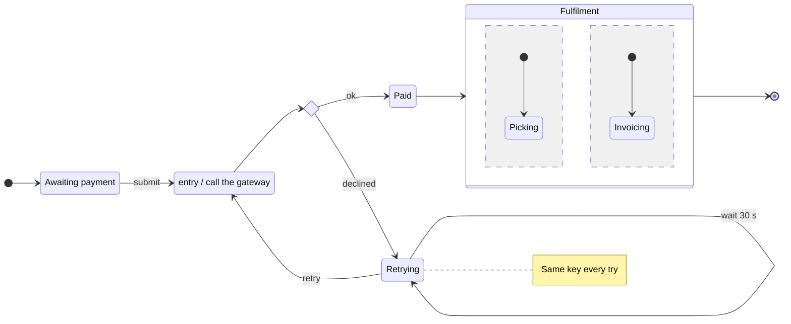
````

- **States**: an id (`Pending`), labelled with `state "Label" as Id`. `Id : text` adds a
  description line, drawn under the name below a rule (UML's internal behaviour).
- **Start and end**: `[*]` is a filled dot as a source, a ringed dot as a target; one of
  each per composite state (or region), as in Mermaid.
- **Marks**: `state x <<choice>>` a small rhombus, `<<fork>>` and `<<join>>` a bar
  across the flow. Other `<<...>>` are a problem (`state-mark-unknown`).
- **Composite states**: `state X { ... }`; `--` inside splits it into concurrent
  regions, drawn as dashed parts of the box. `direction` inside a composite sets its
  flow; otherwise it flows as its parent does.
- **Transitions**: `a --> b : label`; a transition to itself is a loop round the state's
  top-right corner.
- **Notes**: `note left of X : text` or `note right of X` ... `end note`: the state's
  note (a `## Details` entry for the same id wins).
- **Classes**: `classDef`, `class a,b name`, `a:::name`, as in a flowchart. `style`
  lines are ignored (a warning in the checker).
- **Paths**: when the diagram has a start dot at the top, a state no path from it
  reaches is a warning (`state-unreachable`); a state no transition leaves (nor a
  composite round it) that is no end is a warning too (`state-dead-end`). The viewer
  marks such a state with a red "!" at its bottom-left corner.
- Mermaid has no history, entry or exit points, junction, terminate or signal states;
  nor does Avagahana. Mermaid's state diagrams have no `click`: a state links to another
  diagram (a sub-machine, say) through a link in its note (see "Several diagrams in one
  file").

## ER diagrams: an `erDiagram` block

A data model: Mermaid's own entity-relationship diagram, drawn as tables laid out hub
and spoke, with straight lines behind them.

````markdown
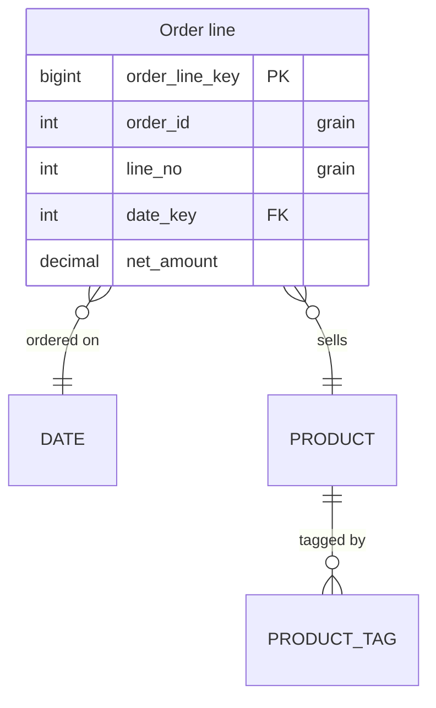
````

- **Relationships**: `A <left><line><right> B : label`. Ends: `|o` zero or one, `||`
  exactly one, `}o` zero or more, `}|` one or more (mirrored on the right: `o|`, `||`,
  `o{`, `|{`). `--` is identifying (a solid line), `..` not (dotted). The label may be
  `""`. Each end is drawn with its crow's-foot mark; the line's hover and popover say it
  in words ("Each Customer places zero or more Order. Each Order goes with exactly one
  Customer."). Mermaid's word forms (`one or more`, ...) are not read.
- **Entities**: an id, labelled with `ID["Label"]`; columns in `{ ... }`, one per line:
  `type name [PK, FK, UK] ["comment"]`. A type ending in `?` may be empty
  (`string? middle_name`, as Mermaid 11.16 and later read it). A column name is a word
  (letters, digits, `_`, `-`; Mermaid takes no quoted or spaced names).
- **Emphasis**: the table's label and a column's comment read `**bold**`, `_italic_`
  and `<br>` as a node's label does, as Mermaid draws them: the title strip grows a line
  per `<br>`; a comment shows them on the table's page (WO-22 follow-up).
- **Grain**: the comment `"grain"` marks the columns that together say what one row is
  (others call it the alternate or composite key; Mermaid has no such mark, so the
  comment carries it). Selecting a table with a grain says it: "One row per order and
  line no".
- **What a table shows**: its name (the mind map's level-1 type), its primary key
  columns (a gold key) and its grain columns (a diamond; `FK` when also a foreign key)
  always. With up to 15 columns, every column is visible and there is no expand control.
  Above 15, PK, grain, FK and explicitly connected columns stay visible; remaining
  columns sit behind a `+ N columns` row that opens the table. Zoomed far
  out, rows too small to read are bars. The node's page lists every column.
- **Looks**: Flat uses a uniform fill with subtle row dividers; Zebra alternates
  row fills. These are the ER names for the shared look preferences.
- **Table classes** (WO-44): a table's class says what it is; the viewer guesses
  nothing. Six are built in, as `person` and `database` are, each with a fixed colour and
  key label in ER diagrams, so no `## Classes` line is needed: `fact` (Fact), `dimension`
  (Dimension), `bridge` (Bridge) for a warehouse; `master` (Master data), `transaction`
  (Transaction), `lookup` (Lookup, drawn in the muted colour) for an application's data.
  A table with one wins over its other classes; two on one table is an error
  (`er-table-class-twice`; the viewer uses the later). A map may change their label or
  icon in `## Classes`; their colour stays. Outside ER diagrams they are ordinary class
  names. An ER diagram is coloured by class (the map decides, as in a box diagram); a
  table with no class takes the one plain colour (the theme's `accent`), and with no
  classes at all there is no colour key.
- **Groups**: Mermaid's ER `subgraph` (Mermaid 11.17 and later): `subgraph id [Title]`,
  `subgraph "Title"` (its id too) or `subgraph word`, closed by `end`; groups nest. A group
  is a box holding its tables, as a flowchart's subgraph: framed, closed by its dot (a
  closed group is one box; the lines of its tables meet it, one per table or group they
  reach), drilled into, given a note by its id. A table belongs to the group it is first
  named in. A relationship to or from a group is not drawn (`er-group-relationship`); a
  `direction` inside a group is not used (`er-group-direction`); a group not closed is an
  error (`er-group-not-closed`).
- **Layout**: the tables with most relationships are hubs; a table joined to one hub
  rings it, one joined to several sits between them, and places are then refined so
  lines cross as little as possible, pass behind no table and have room for their
  labels. All tables in the current view use the width needed by its widest table.
  Endpoint channels are allocated across all connections on each table side, and
  layout reserves their space. Tables line up where they can. A group is laid out on its
  own and then placed as one table. A line meets a table at its column's row; in each
  view the viewer draws a table's foreign keys (among themselves, and the grain's among
  themselves) in the order their lines leave it, top to bottom, so they do not cross at
  the table; the node page and the grain sentence keep the file's order. Not set in the
  map, but tables with as many relationships as each other are placed in file order.
- Problems: `er-line-syntax`, `er-attr-syntax`, `er-not-closed`, `er-attr-twice`,
  `er-table-class-twice`, `er-group-not-closed`, `er-group-relationship`,
  `er-group-direction`; for
  `## Renames`, `rename-syntax`, `rename-unknown-column`, `rename-stale` (viewer only).

## ER column relationships and perspectives

Mermaid blocks stay valid Mermaid. Define column connections in Markdown after the
block; use each definition once. Existing Mermaid relationships remain table-level,
attached at the header rather than suggesting a particular column.

```markdown
## Relations
- ORDER.tenant_id order-tenant@}o--|| TENANT.id : belongs to
- ORDER.billing_address_id billing@}o--|| ADDRESS.id : billed to
- ORDER.shipping_address_id shipping@}o--|| ADDRESS.id : shipped to

## Perspective: Order details
- order-tenant
- ORDER_LINE.(tenant_id,order_id) line-order@}o--|| ORDER.(tenant_id,id) : belongs to
```

- Declare all tables and referenced columns in the Mermaid block. A column endpoint
  is `TABLE.column` or `TABLE.(column1,column2)`. Lists must be nonempty, contain no
  repeated columns, and have matching lengths; columns pair by position.
- Column relationships under `## Relations` or `## Perspective: <name>` require a stable `id@` and ER
  cardinalities, as in Mermaid's table relationships. Composite relationships are
  allowed when explicitly declared; no relationship is inferred from names or joins.
  The unnamed section adds to the default Relations view without repeating native
  Mermaid relationships. Named relationship sections define other model views.
- A named `## Perspective: <name>` may reuse a model relationship as `- <connection-id>`
  or declare a column relationship with its actual model cardinality. References may
  precede definitions. This describes the model, not a SQL operation. Query joins
  belong in `## Query: <name>` SQL, including their join type and full conditions.
- Definition IDs are unique within their diagram, independent of labels and file order.

### `## Renames`: a column renamed since the earlier version

When a map is compared with an earlier version (Before and After), columns are matched
by name in each table: a different name reads as one column removed and another added.
A column that was renamed says so in the later file, new name first:

```markdown
## Renames
- ORDER.customer_id was cust_id
```

- The new column must be in the table (`rename-unknown-column`); a line that cannot be
  read, a column renamed twice, or Renames after a diagram that is not ER is
  `rename-syntax`. One `## Renames` section per diagram.
- Compared, the column reads as one column renamed (its sign in both Before and After),
  and a column connection on it is not changed by the rename. A line that does not fit
  the earlier version (its old name is not there, or is still a column in this one) is
  ignored with a viewer warning, `rename-stale`. With no earlier version the section is
  checked and otherwise unused; remove it once the change has landed.
- Renames are never guessed. Procedure (backfills, step order) belongs in a note.
  Reusing an ID in another view refers to the original object; it does not redefine it.
  Use existing `## Details` anchors (`### <a id="billing"></a>Billing address`) and
  `## Node icons` to annotate connection IDs. Names of views must be distinct,
  ignoring case. Empty perspectives are reported unless they select Columns explicitly.
- Each mapped line leaves and enters its column row horizontally, normally in three
  segments. Parallel connections keep separate routes. Composite connections draw
  each column pair, sharing the connection's identity and one label. Self connections
  use an outside return; ordinary middle segments remain straight and may pass
  behind other tables. Label spacing, end clearance and collision placement are
  shared with flowcharts; ER does not use their full router.
- Invalid connection syntax, duplicate IDs, unknown tables/columns/references and
  unequal column-list lengths are checker errors (`relation-syntax`). The viewer skips
  invalid definitions and reports problems while drawing valid content.

## Scenario: `## Scenario: <name>`

A path through a state or ER diagram that an agent writes to tell a story: how an order
gets stuck, how a query joins its tables. Played over the diagram like a sequence.

````markdown
## Scenario: Payment fails twice

- [*] --> Pending : The order is placed and waits for payment.
- Pending --> Charging : The shopper submits the card.
- Charging --> check : The gateway answers.
- check --> Retrying : Declined. The order waits and tries again.
````

- After a state or ER diagram's block, one section per scenario, a step per line:
  `- A --> B : what happens`. In a state diagram a step is a transition, its way round
  (`[*]` for a start or end dot); in an ER diagram, a relationship, either way (a join).
  A step not in the diagram is a problem (`scenario-not-step`); a step that does not start
  where the last ended is a warning (`scenario-gap`).
- Select a specific connection with `- A connection-id@--> B : explanation`.
  A table-only step must identify exactly one connection; missing or ambiguous
  selections are checker errors (`scenario-not-step`), never a first-match fallback.
  Use `## Scenario: <name> | <view name>` to scenario a named model perspective;
  otherwise the default Relations view is used. The viewer skips invalid steps and
  reports problems.
- The viewer offers each scenario on the play button. Playing greys the diagram and lights
  each step's states or tables and its line in turn (a numbered step, the transition's
  event or the relationship's label), with the step's words in the side panel. A step
  in an ER scenario that reaches the many side of a relationship adds "Rows multiply here".
- A scenario is a further diagram of the file, anchored `<diagram anchor>-scenario-<scenario name
  anchor>` (`seq=` in links and `POST /api/show`).

## Walkthrough: `## Walkthrough: <name>`

A story for one audience (a security review, a new joiner) over the map's own items: its
diagrams, perspectives, deployments, scenarios, joins and sequences. It belongs to the
file, not to one diagram: write it after any diagram's sections (the usual place is the
end of the file). The order is the order written. The reader moves through it with
Previous and Next in the walkthrough panel; nothing plays by itself. Exploring inside a
stop (a box opened, a node's page, another mode) stays on it; opening another stop's place
moves to that stop; opening any other place is off the path, with Return to the stop.

Each stop is a `### <Kind>: <name>` heading, with its note as Markdown underneath:

- `Diagram` a diagram by its heading (or the `# Title` of the first one).
- `Perspective` a relation view, `## Perspective: <name>`.
- `Deployment` an environment, `## Deployment: <env>`.
- `Scenario` a scenario, `## Scenario: <name>`.
- `Sequence` a sequence diagram, by its heading.

```markdown
## Walkthrough: Payments for the security team

### Diagram: Shop platform

Start with the whole system. Card data leaves the shop only on its way to Payments.

### Perspective: Checkout (synchronous)

The calls on the way to payment, and which of them wait for an answer.
```

The name after the colon must be an item of this map, spelled as its heading. The note is
plain Markdown (links, emphasis, lists); raw HTML is not shown. Several walkthroughs may
share a map, one section each. Checker problems: `walkthrough-empty`, `walkthrough-twice`,
`walkthrough-stop-kind`, `walkthrough-stop-unknown`.

An optional introduction precedes the first stop. After each stop's explanation,
one optional subsection supplies narrative metadata:

```markdown
#### Stop options
- Title: Start with the payment boundary
- Label: Boundary
- Notes: orders, charge
- Diagram: Shop platform
```

Title is the section/panel title (default: destination name). Label is the short
reading-document navigation and section-eyebrow label (default: Title/name). Notes lists existing
note-bearing node, arrow or message IDs from the destination's owning diagram; these
notes and their evidence appear visibly in the reading document. Repeated IDs are
included once. Diagram optionally qualifies a destination name that occurs in several
diagrams; unqualified old files keep their first-match resolution. An invalid explicit
qualifier never falls back to another diagram. Field/subsection names are case-insensitive;
duplicate, empty or unknown fields are `walkthrough-options`; invalid Diagram/Notes
references are `walkthrough-reference`. Invalid stop metadata leaves that stop
unavailable, rather than opening a different destination.

`Point to` names one part of a query for a perspective stop whose `Focus` is a query box: `FROM`,
`JOIN 2`, `WHERE`, `GROUP BY` and the query's other clauses, `Subquery 1` (a query inside an
expression, numbered through the SELECT list, then the joins, then the clauses), `Subquery d` (the
derived table `d`), `Output`, and for a set operation `Input 1` and its operator (`UNION ALL`). A path
reaches further in: `Input 1 / WHERE`. Case does not matter. The stop opens that part, fits it and dims
the rest; moving or clicking in the picture lifts this, and returning to the stop brings it back. The
reading document shows that part. A name the query does not have is `walkthrough-reference`.

While the walkthrough panel is showing, a fit frames the picture in the uncovered part of the
canvas, unless that would leave too little to draw in. The next heading of level
four or shallower (or enclosing section end) ends options. Blank lines do not end them;
fenced headings stay literal. Optional metadata never appears in the explanation.

The walkthrough panel's **Export walkthrough** icon makes one offline HTML reading
document from the authored stops, independent of the current camera or expanded boxes.
It freezes the viewer's effective theme/appearance, embeds SVGs and fonts, keeps the
footer visible and pins the horizontal section strip after the introduction scrolls
away. All content is available by scrolling; zoom/pan/Fit are optional inspection.
Sequences show their complete native lifelines, even when live playback runs over a
perspective. Scenarios show the static highlighted path and all ordered explanations,
including ER fan-out warnings. No PDF, Word or paper pagination is implied.

## The node's page

Clicking a node's note icon grows the node into a page, in the node's own outline,
over the faded drawing. Double-clicking a leaf node with linked diagrams also opens
its page. Its label, class and note, then pictures:

- **Connections**: the node in the middle, drawn as on the map, what reaches it on the
  left and what it reaches on the right, with the arrows' labels, lines and note marks
  (a mark opens that arrow's note under the strip). A box's arrows are the ones crossing
  its border; its parts are drawn inside it and the arrows land on them. A mind map node
  has its parent on the left, its children on the right, related links as arrows. One
  box per far end; past five a side, "+N more". On a phone the strip runs top to
  bottom. A click on a neighbour goes to it; on a part, opens its page.
- **Opens**: a thumbnail of each diagram it links to; a click grows it into that diagram.
- **In views**: each relation view the node takes part in, drawn small with the node
  marked (the rest faded) and the shown one outlined; a click shows it there.
- **Runs on**: where it runs, environment by environment side by side, as nested
  frames; a click shows that environment.
- **In sequences**: each sequence linked to this diagram that the node (or something
  inside it) sends or receives in, drawn small as lifelines, with the steps it is in; a
  click plays the sequence over its view from the first of them.

The page does not zoom or pan. It is a step of the crumbs; Escape, a click outside it
or an earlier crumb closes it. A diagram opened from the page is the next step, after
`#` (as its link is written); going back from it stops at the page. Hovering the note
icon shows the note alone, for a quick look. A node with neither icon has no page;
double-click still drills into a box.

## Box diagram modes

- **Boxes**: the layout above. Drilled into a box, the outside ends of the view's
  arrows into it are drawn round it, faded, as they are: each inside its outer boxes
  (up to the outermost that does not hold the drilled box), and those boxes show only
  the ends the arrows reach. They sit along its parent's line, their arrows crossing
  its border; arrows between two outside things are not drawn. Drilling into a system
  reads as its container diagram, into a container as its component diagram.
- **Layers**: the top level as bands stacked top to bottom, ranked by their arrows as in
  Boxes (bands with no arrows between them share a row), every row as wide as the
  widest (a row's bands share the room), each band running left to right (inside, the
  direction turns as usual). A group with `stroke-width: 0` in its `classDef` has no
  box at all (no border, no fill), e.g. a row of people across the top.
- **List**: as for mind maps.

## Sources and claim evidence

**Contract** (WO-46, addition). All source metadata is standard Markdown outside
Mermaid fences. A `## Sources` section is a file-wide registry (available to every
diagram). Repository and revision aliases must be unique, lower-case letters,
digits and hyphens, starting with a letter.

```markdown
## Sources

### Repository: service

- Name: Shop service
- URL: https://github.com/example/shop

Checkout implementation.

#### Revision: service-reviewed

- Branch: main
- Commit: <full 40- or 64-character hexadecimal Git object ID>
- Reviewed: 2026-11-03
```

One repository may have several revisions. Name defaults to its alias; Version control
defaults to `git`. Every Git repository requires a revision with a full Commit.
Branch is optional for detached HEAD. URL is optional for local-only repositories.
For an unversioned folder use `- Version control: none` at repository level, with
Reviewed there and no revisions/branch/commit. Dates are ISO dates or UTC timestamps.
Descriptions are Markdown beneath the relevant heading. No source files are bundled.

A node's or named arrow's existing Details note may contain one `#### Evidence`
section. The Evidence section ends at the next heading of level four or above.

```markdown
### <a id="checkout"></a>Checkout

Coordinates order creation and payment.

#### Evidence

- Source: [Shop service](#revision-service-reviewed)
  - File: src/checkout.py
  - Lines: 42-68
  - Supports: Creates an order before requesting payment.

- Source: [Shop service](#revision-service-reviewed)
  - File: src/payments.py
  - Lines: 105-128
  - Supports: Leaves a failed payment available for retry.
```

Evidence may include ordinary Markdown explaining the trust judgment. When citing
artifacts, each Source bullet has optional indented File, Lines, Supports, URL and
SHA-256 fields.
Multiple references may name the same revision and/or file; UI groups them by source
revision. For Git, Source must resolve to `#revision-<alias>`; for non-Git use
`#repository-<alias>`. Lines is a positive integer or ordered inclusive range and
requires File. File is relative, with no empty or `..` path segments. Supports is
Markdown explaining what that evidence establishes. SHA-256 is an optional full
64-character hexadecimal file digest; it identifies bytes without preserving them.
Repository-only references are permitted but do not imply file-level support.

GitHub.com, GitLab.com and Bitbucket.org file/line links use the captured commit.
Unknown hosts require an explicit pinned evidence URL for a clickable citation;
without it the metadata remains readable. Git evidence's explicit URL must contain
the recorded commit as a path segment, or be an Azure Repos or TFS Git file link pinned
by its query: a `_git/<repo>` path with `path` and `version=GC<commit>`, and otherwise only
`line`, `lineEnd`, `lineStartColumn`, `lineEndColumn`, `lineStyle` and `_a=contents`, each
once. A branch (`GB`), tag (`GT`), another commit or any other parameter is an error. A query
is only accepted in this pinned form, so non-Git evidence, including TFVC, stays query-free.
Other source URLs must be HTTP(S), without user credentials or query strings; repository
URLs also have no fragment. SVG and PNG exports carry none of these links. The viewer
never fetches repository content. Malformed authored sources/evidence and unpaired marks/verification text are checker
errors. The viewer warns without refusing to draw. Evidence may contain ordinary
Markdown explaining a trust judgment, with or without structured references.
A Sources registry is required only when a structured reference uses it. A valid citation does not prove
an agent's interpretation, remote access, or present-day freshness.

Trust visibility is a runtime preference, not a map section. Interactive HTML keeps
the reader's current selection separately from the unchanged source text. SVG, PNG and print
are static diagrams with no clickable evidence links, popups, source lists or extra
printed URLs. Use HTML or the source Markdown to retain the complete evidence.

## SQL query pictures: `## Query: <name>`

A Query section after a **flowchart** expands the overview's existing boxes. One
fenced SQL block holds the original query; expressions, ON conditions, WHERE
filters, bind parameters and set operations are not rewritten to fit a diagram.
The agent authors the overview and schema/mappings; SQL structural parsing and
generation of internal query scopes remain in the viewer.
Declare physical tables/columns once in a further ER diagram, referenced by anchor.
The overview and schema remain valid Mermaid; the expansion metadata is Markdown.

````markdown
# Order report

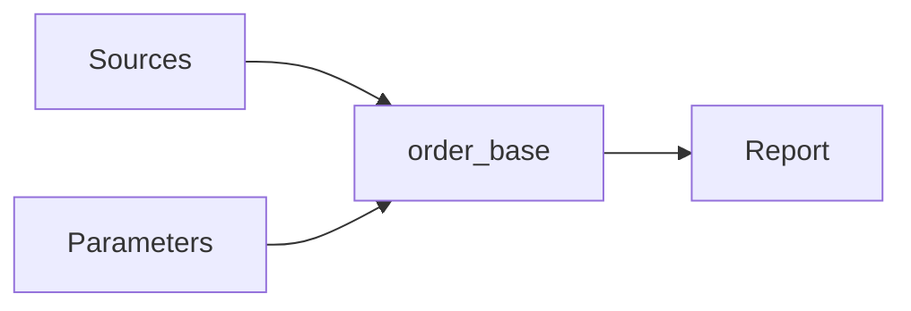

## Query: Orders

#### Query options
- Schema: #definitions
- Schema visibility: hidden
- Into: report
- Sources: source
- Binds: parameters

#### Scopes
- order_base: base

```sql
WITH order_base AS (
  SELECT o.id, o.amount FROM orders o WHERE o.amount >= :minimum
)
SELECT b.id, b.amount FROM order_base b
```

#### Physical names
- orders: ORDERS

## Definitions

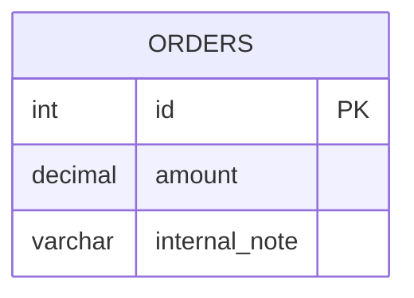
````

`Schema`, `Into` and `Sources` are required. `Binds` is an optional overview node
holding **individual** parameter inputs. Without it, parameters live with Sources.
`Schema visibility` is `visible` (default) or `hidden`: hidden definitions are omitted
from navigation but remain reachable by each occurrence's ER control. Physical-name
mappings resolve to IDs inside that schema. `Scopes` maps SQL CTE names to overview
node IDs; a matching CTE/node ID needs no bullet. Unmapped CTEs get overview boxes.
All references and option names are checked; failed queries publish no partial graph.
An existing primary ER diagram can also be the shared schema: reference its title
anchor in Schema and keep it visible. Its ER controls return to that primary
diagram. Use a separate ER section when the catalogue should be hidden.

The circle opens/closes a CTE in place; double-click uses existing focus and
breadcrumbs. The expansion toolbar operates on this same hierarchy within the
current focus. Each CTE contains its source occurrences, visible SQL operation
blocks and its named output. Query inputs/output connections use flowchart routing,
ports and channels, with no crow's-foot encoding or per-join navigation. The original
overview dependencies remain while boxes are closed; opening them exposes exact
source/output endpoints. Focusing fits the CTE itself, not its outside neighbours.
Focused query context uses only table-style boundary cards and individual binds,
without the authored overview containers or their internal graphs. On entry,
outside tables and CTE outputs start with columns closed, even if previously
expanded. Their +/− controls reveal only columns; double-clicking a CTE boundary
focuses its definition. Incoming context is one column ordered binds, physical
tables, then CTE outputs in Boxes; Layers transposes it to a row above the focus.

Local source occurrences have distinct aliases and query contexts, reference the same ER
definition, and expose only relevant columns through their circle. Relevant includes
SELECT, ON/USING, filters, grouping, ordering and expression dependencies. Full schema
columns remain available in the ER definition. Outside physical-source cards and
the Sources catalogue expose all columns in that definition; outside CTE cards
expose all outputs of that CTE. Local Inputs show only fields used by the current
query, so they are a projection rather than another full source listing. Sources
expands into occurrences grouped by consuming scope. Each bind is separate; an IN
collection input is never represented as a CROSS JOIN or a synthetic parameter table.
Physical source cards and their source groups consistently use the theme's blue
swatch; bind parameters and their group use its green swatch. These come from
`appearances.*.icons.blue/green` (including their defaults), with the existing
contrast selection for header ink. CTE inputs/outputs retain their scope colors.

The Joins section begins with a solid scope-colored `0 · FROM` card naming the
first source and its alias. Every join then has one visible, numbered SQL block
containing its actual JOIN and condition. Bind cards use a solid theme-green fill
through their full height, with no empty body strip. WHERE, GROUP BY, HAVING and
ORDER BY have their own visible blocks;
ON and WHERE are never combined. Operations show composition, not an optimizer's
physical execution order. Output mappings start expanded and show the source
expression and output name, with a narrow ƒ column identifying calculations. Simple
column aliases do not get the marker; inherited calculated columns retain it.
Long calculations show a preview; selecting a row opens
the exact SQL and source-column links. Unnamed complex expressions are labelled as
unnamed, rather than pretending the SQL supplied an alias.

Optimizer hints have a separate visible metadata card in their query scope.
Recognized comment hints are Oracle `/*+ ... */` and `--+ ...` immediately after
SELECT; misplaced hint-looking comments and ordinary comments are not promoted.
Explicit SQL Server `WITH (...)` table hints and final `OPTION (...)` query hints
are also retained, with set-level OPTION kept outside the last UNION input.
Hints are displayed literally, without claiming the database honored them or
treating index/hint names as column dependencies. Ordinary comments and commented
SQL lines are excluded from generated clause/expression displays; quoted strings
and identifiers retain their literal contents. The original fenced SQL is unchanged.

Inputs are ordered with local binds first, physical tables next, then CTE/derived
inputs, preserving SQL source order within each group. Boxes input cards share
one width; Layers input cards share one height. Numbered JOIN blocks retain SQL
join order. Each parameter crosses into a scope once and fans out locally. Clauses
are grouped as Joins, Filter (WHERE), and Other clauses (GROUP BY/HAVING/ORDER BY).
Nested SELECTs are positioned with their consuming clause or result. Display-only
predicate line breaks retain the original SQL tokens and BETWEEN bounds. JOIN,
ON and Boolean connectors occupy a separate narrow column; multiword keywords
such as LEFT JOIN stack vertically. Explicit Boolean parentheses indent their
contents, without splitting function arguments, CASE expressions or BETWEEN bounds.

In Boxes, CTE composition and clause sections run LR and Inputs stack TB.
In Layers, clause sections flow TB. Layers transposes the
query's LR/TB container directions, including within focused CTEs: Inputs becomes
an LR band above the clauses/result, with external source/bind context above.
Query looks are Flat and Zebra, using the existing outline/poster preference values;
the latter stripes table rows and clause bodies (one stripe per wrapped logical
line) rather than using icon-poster geometry. Header ink
consumes the theme's contrast choice. Ordinary flowchart looks remain unchanged.

#### What the reader understands

The grammar is structural: expressions stay literal text, and this is not execution
or a claim to validate a dialect. `map-viewer/test/fixtures/query-cases.json` is the
contract: viewer and checker are both held to its results.

| Area | Read |
|---|---|
| Composition | `WITH` (including `MATERIALIZED`), nested CTEs, FROM subqueries with or without an alias, derived column lists, `UNION`, `INTERSECT`, `EXCEPT`, `MINUS` at any level, parenthesized branches |
| Joins | `INNER`, `LEFT`, `RIGHT`, `FULL OUTER`, `CROSS`, `NATURAL`, `SEMI`, `ANTI`, comma joins, Oracle `(+)`, `CROSS APPLY`, `OUTER APPLY`, `LATERAL`, `ON`, `USING` |
| Sources | Tables with schema and `@dblink`, CTEs, table functions, `TABLE(:x)`, `UNNEST`, `VALUES` with a column list, `@table` variables, `dual`, no `FROM` |
| Clauses | `WHERE`, `START WITH`, `CONNECT BY`, `GROUP BY` (with `ROLLUP`, `CUBE`, `GROUPING SETS`), `HAVING`, `QUALIFY`, `WINDOW`, `ORDER BY`, `LIMIT`, `OFFSET`, `FETCH`, `FOR`, `TOP`, `DISTINCT ON` |
| Expressions | Scalar, correlated, `EXISTS` and `IN` subqueries; `CASE`; window functions; every operator; any function |
| Parameters | `:name`, `@name`, `$1`, and `?`, numbered by position |
| Names | Quoted names in every style, including ones that are keywords; non-ASCII names; `sql sqlserver` also reads `alias = expression` |

Not read yet, and reported as `query-unsupported`: recursive CTEs, parenthesized join
trees, dynamic or XML PIVOT, UNPIVOT with several value columns, `SELECT INTO`,
`TABLESAMPLE`, Oracle `SAMPLE`, `PARTITION (...)` on a table, flashback `AS OF`, and
statements other than SELECT. This is a warning: the map still passes and opens, the
overview stays, and the SQL as written is on the Into box's note. Keep the SQL as it
is and explain the query in a note. `query-syntax` is a mistake to fix: a misplaced
part of the section, unbalanced SQL, or a reference that resolves to nothing.

References are checked against the ER definition and CTE outputs, in the scope SQL
gives them. An unknown or ambiguous column is an error, and so is an ON clause naming
a table joined later. Inside a function's arguments an unknown bare word is left alone,
as it may be a keyword of that function (`DATEADD(day, 1, x)`). Two schema-qualified
names that would share one ER definition must each be mapped under Physical names. A
table function has no declared columns: it takes the ones the query names.

Each output card says in words how many rows it leaves. A JOIN block says what it does
to row counts only where the ER keys prove it: equality on the whole primary key or on
a unique key. A window function's note says it keeps the row count. The Into box's note
holds the query exactly as written. Generated node IDs come from where a node sits
(`enriched--inputs--c-customers`), so they survive changes to the reader. See
`examples/maps/query-expansion.md` for a complete public example.

A box the author draws around query boxes (a stage holding CTEs, say) starts closed with
them, so a query map opens on readable names. A perspective's `Focus` and `Open` still decide
its own picture.

#### The section's Markdown

The parts may come in any order. Options use level 4 headings; each is `- name: value`
bullets, and fenced code inside is skipped. Any other line there is an error. The SQL
is the one fenced block labelled `sql`, `plsql`, `tsql` or `pgsql` (any case), with
backticks or tildes, optionally followed by a dialect word such as `oracle`. Prose
directly under `## Query:` is ignored. `Schema` takes `#<anchor>`. Each query needs its
own Into box. These rules are shared with the format's other option sections and are
held in `map-viewer/test/fixtures/query-markdown-cases.json`.

Fixed-column `PIVOT (aggregate FOR column IN (...))` is supported with any aggregate
call, with `value AS name` values, with several named aggregates (each output is
`<value>_<aggregate name>`) and with or without an alias. The surrounding query sees a table occurrence
with the pivot's exposed columns. On PIVOT and UNPIVOT occurrences, the top-left
+/− control shows/hides columns; the independent top-right circle expands/collapses
the transformation in place, including from an expanded overview. Its internals
start closed. Double-click that occurrence to focus on an
isolated pivot view: its input, aggregate/FOR/IN operation and output mappings,
without outside context. Input columns other than the aggregate dependencies and
pivot column are the implicit grouping keys. Pivot outputs carry ƒ and exact
aggregate notes. Nested pivots need a named CTE between them; dynamic columns are
not inferred or executed. See `examples/maps/query-pivot.md`.

Queries also accept fixed, single-value
`UNPIVOT [INCLUDE|EXCLUDE NULLS] (value_column FOR name_column IN (source_column, ...))`. The listed
input columns become one value column and one column-name column; other input
columns carry through to every generated row. Source columns and exposed output
names must be unique and resolve unambiguously. NULL-valued source cells produce
no rows unless INCLUDE NULLS asks for them, while zero values remain. No aggregation is performed and an earlier
pivot's aggregation is not undone. Double-click the UNPIVOT occurrence for the
same isolated input/operation/output focus; input definitions, output lineage,
Boxes/Layers, expansion and export remain available. Multi-value tuples and
dynamic column lists are not supported. See `examples/maps/query-unpivot.md`.

A Query section after an ER diagram is retired and reports `query-legacy-format`,
with the steps to migrate it. The ER diagram still opens; no query picture is drawn.

### ER perspective column selection

An ER perspective may define explicit initially visible columns:

```markdown
## Perspective: Customer lookup

#### Perspective options
- Columns: ORDER.customer_id, CUSTOMER.id, CUSTOMER.name
```

Columns must resolve to declared `TABLE.column` names. Unlike ordinary automatic
ER collapsing, this explicit selection can hide PK/grain/FK rows too. The remaining
columns stay available through the table's expand control. Listed tables and those
used by the perspective's connections appear; a Columns-only perspective can show
a single table or disconnected tables. Leaving the perspective restores ordinary
column visibility. ER options accept Columns; flowchart options keep Open/Focus.

Notes also render fenced code as literal text (including SQL), with no raw HTML
injection or interpretation of links inside the code fence.

### Migrating retired `## Joins:` sections

Authored `## Joins:` sections and their old equality-view drawings are retired.
The checker reports `joins-retired`; the viewer diagnoses the section and does not
create its former view. This is an intentional format change, not an automatic
compatibility translation.

When updating a map, inspect any old Joins section. If it explains a query, replace
it with `## Query: <name>` after a flowchart, with the actual SQL, then update its links
and walkthrough stops to that flowchart. Equality pairs alone do not specify INNER
versus LEFT/RIGHT/FULL, selected outputs, filters or grouping: recover these from
source SQL or confirmed intent. Ask for the missing intent instead of inventing it.

If the old view only selects genuine model relationships, make it an ER Perspective
and reuse their IDs. Do not promote a query-only equality to a declared model
relationship or invent cardinality. Model scenarios can still traverse those actual
relationships. Old saved `view=` links to retired views need new destinations.
SQL pictures require a viewer version that supports Query sections.
