# Avagahana architecture

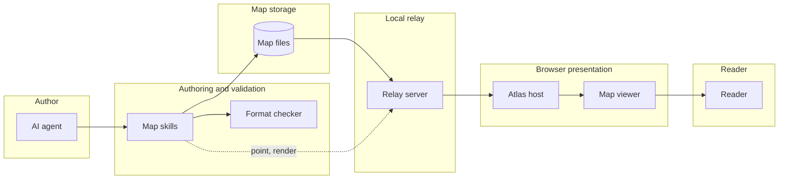


## Details


### <a id="av"></a>Authoring layer and reading guide

Code review of the local repository on 2026-10-27, updated 2026-10-30 for the contents bar (WO-30), change marks (WO-31), rendering for documents, the layout report and the maps folder's themes (WO-32, with its follow-up: underscores kept in labels, each box's outline in the report), and narrow screens and the keyboard outline (WO-17). This map describes the current implementation, rather than treating older work orders as current facts. The top-level bands are Author, Authoring and validation, Map storage, Local relay, Browser presentation, and Reader. These group workflow responsibilities; the map folder and people sit outside the installed product. Start with the components, then open linked diagrams. Five supported Mermaid families are included, with relation views, deployment placements, a sequence overlay and state/ER walks. Changes colouring is a planning feature, not a sixth diagram family; no unapproved future work is presented as implemented.


### <a id="agent"></a>AI agent

Writes Markdown on disk and invokes the skill commands. The product is a one-way explanation channel: the reader does not edit maps and the relay sends no reader feedback to the agent. A render is the agent's own request, answered by the open page with a picture file; it carries nothing the reader did. Evidence: skills/illuminate-concept/SKILL.md; docs/relay-server-api.md.


### <a id="files"></a>Map files

External maps folder. Relative slash-separated paths identify .md and .mmd files. Hidden files and directories are excluded. Content is Markdown plus Mermaid and extension sections; there is no application database. Evidence: relay-server/serve_maps.py scan and safe_join; atlas/sources.js.


### <a id="skill"></a>Shared map skills

Two skills. illuminate-concept writes one map: it reads AVAGAHANA_MAP_DIR or the plain-text ~/.config/avagahana/maps-dir setting, then writes, checks, shows and points; its references cover each family, and two more are read only when needed: render.md (pictures for documents, render.py, the layout report) and themes.md (a brand or house style, themes.py). trace-architecture reviews a whole project into one map file and builds on illuminate-concept. Evidence: skills/illuminate-concept/SKILL.md and references/; skills/trace-architecture/SKILL.md; docs/deploy-targets.md.


### <a id="checker"></a>Standalone format checker

Python 3.9+ standard library checker. Validates syntax, extension sections, identifiers, cross-map targets, diagram reachability, sequence overlays and walks. Shares problem codes with the JavaScript viewer. Evidence: format/check_map.py and format/problems.json.


### <a id="relay"></a>Optional relay

Local Python HTTP bridge. Serves atlas and viewer files, reads maps, streams changes and broadcasts agent pointers. Passes the agent's render requests to one open page and returns the picture (render.py), and serves the maps folder's .themes/ (themes.py lists, checks and derives them). It never writes map contents. Bound to 127.0.0.1. Evidence: relay-server/serve_maps.py. In the static-folder deployment it is shown on disk as an available tool, not as a running process; that runtime uses browser folder access instead. Direct embedding also needs only viewer assets and a host page, with text supplied by that host.


### <a id="atlas"></a>Atlas owns the outside world

Imports mount/applyTheme through map-viewer/index.js. Owns location, document.title, file selection and source callbacks. Supplies text and optional host capabilities to the viewer. Its quick-links bar above the viewer lists what the map holds, from viewer.contents(). Mounts the viewer with the maps folder's themes, and answers the agent's renders in a hidden second viewer. Evidence: atlas/app.js, atlas/bar.js, atlas/themes.js, atlas/render.js; docs/map-source.md.


### <a id="viewer"></a>Embeddable viewer

mount(element, options) returns load, setState, on, ready, contents, export, theme and preference controls, slot and destroy. All viewer imports stay inside map-viewer/. No API URLs or location ownership. Assets resolve from import.meta.url; CSS is scoped to .mmv. Evidence: map-viewer/index.js, viewer.js, base.css; docs/map-viewer-api.md.


### <a id="reader"></a>Reader interaction

Drill, select, search, filter icons, open notes and node pages, change view/deployment, play sequences, inspect changes, export and print. Multiple viewer instances can coexist; only read-only caches are shared. Evidence: viewer.js, page.js, player.js, export.js.


## Node icons

- av : verified
- skill : verified
- checker : verified
- relay : verified
- atlas : verified
- viewer : verified
- files : verified

## Relations: Runtime

- files --> relay : reads
- relay --> atlas : HTTP and SSE
- atlas --> viewer : mount and load
- viewer --> reader : read-only view

## Relations: Authoring

- agent --> skill : invokes
- skill --> files : writes Markdown
- skill --> checker : validates
- skill --> relay : serve and show
- relay --> atlas : show event
- atlas --> viewer : setState

## Deployment: Local relay

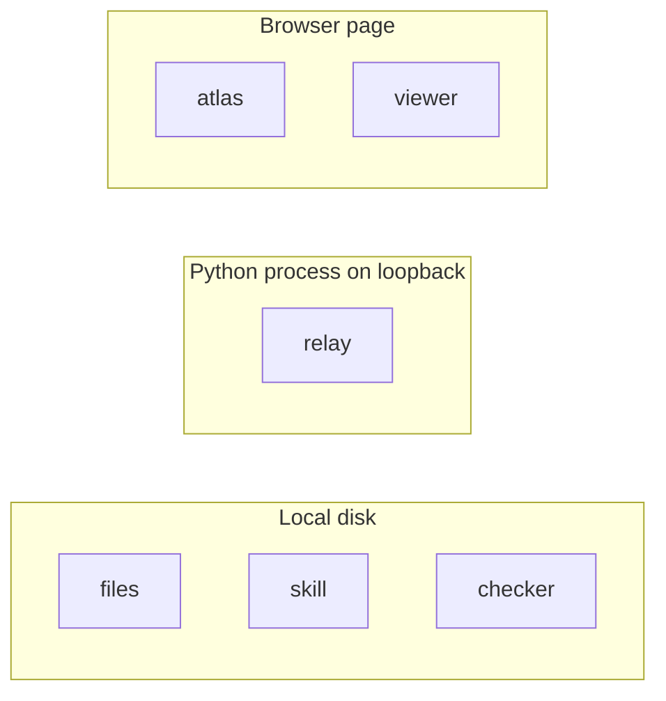

## Deployment: Static folder mode

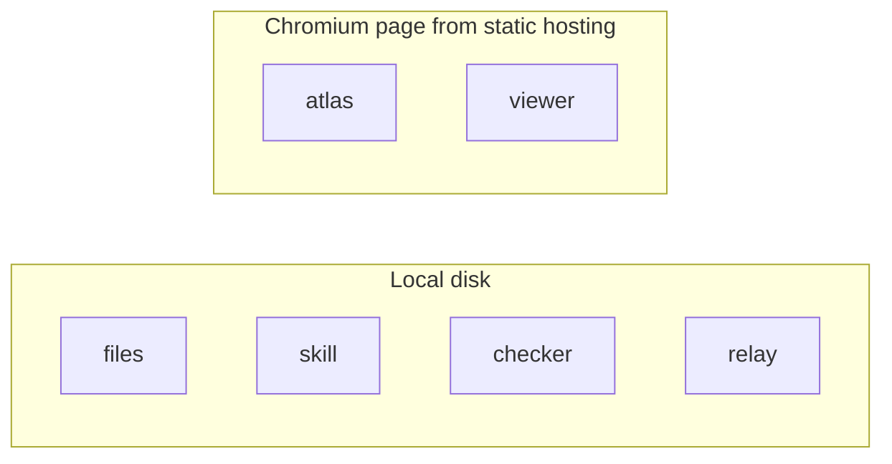

## Project breakdown

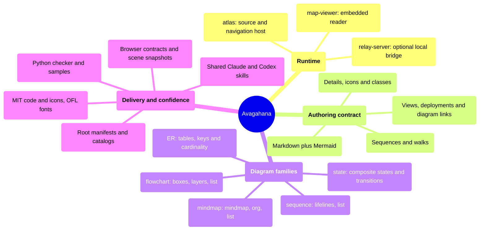


## Details


### <a id="n1"></a>Source overview

Evidence: README.md; docs/map-format.md; diagrams/index.js; scripts/check.sh. All five families are custom parsers and renderers, using a supported Mermaid subset rather than a bundled Mermaid runtime. Their modes reuse shared viewer infrastructure.


## Viewer components

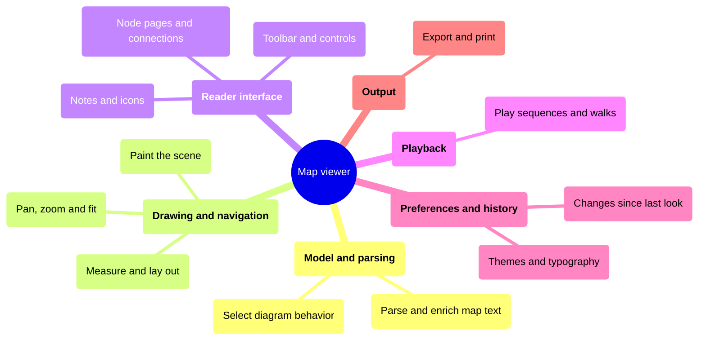


## Details


### <a id="v"></a>Map viewer

Responsibility breakdown, not an import graph: branches group related jobs rather than execution order. viewer.js coordinates them. See [Render pipeline](#render-pipeline) for the drawing flow.

Per-instance closure coordinates model, state, DOM, redraw and event subscriptions. mount only throws for a programming mistake such as a missing Element. Minimum mount size is 320 by 280 (a phone in landscape); smaller mounts show a size message. Options title: false and viewPicker: false leave out the title and view picker for a host that lists them itself. Evidence: viewer.js.


### <a id="m"></a>model/map.js

Shared parseMap orchestrates type parsing, notes, classes, relations, deployments, further diagrams, walks and sequence linkage. Evidence: model/map.js.


### <a id="p"></a>paint.js

Scene to layered SVG: edges, frames/nodes, relation lines and marks. Selection and search update marks; relation updates have their own layer. Theme appearance and colour changes mostly restyle via CSS classes. Geometry changes lay out and repaint. Evidence: paint.js.


### <a id="s"></a>stage.js

Mount-relative camera, pan, pointer zoom, fit and semantic level of detail. Wheel/drag work is batched with requestAnimationFrame. Zoom is bounded 0.4 to 4; fit avoids unreadable giant maps. Evidence: stage.js.


### <a id="pg"></a>page.js and aspects.js

Node pages show note, connections, linked diagrams, views, deployment placement, sequence participation and change removals. A page is a modal dialog: it takes focus, keeps Tab inside and gives focus back on close. aspects.js supports these derived views. Evidence: page.js and aspects.js.


### <a id="pl"></a>player.js

Timeline, step/play/pause/stop, camera movement, view/lifeline switching and overlay steps. Reader pan/zoom pauses playback. Speed is 2 to 5 seconds in half-second increments. Evidence: player.js, viewer.js.


### <a id="sn"></a>seen.js

Summarizes model and compares with this reader baseline. localStorage keeps the most recent 50 map paths; over 2000 comparison items uses visit-only comparison. storageKey null disables persistence. One sparkle marks a new or changed thing, only the topmost new one: what is inside a new node and a whole new diagram carry no marks of their own. A closed box carries no mark; the expand button and the diagram icons (link icons, page thumbnails, list icons, atlas chips through contents() changed) take a small sparkle instead. Marks clear on acknowledgement; a new thing clears with everything new inside it, a whole new diagram when it is opened. Option since compares with an older map text for every reader (nothing kept); marks false shows none. Evidence: seen.js; model/changes.js; docs/map-viewer-api.md.


### <a id="th"></a>themes/theme.js

Validates theme objects, fills defaults, manages shared CSS and FontFace data. Category/level/role colours are data; each diagram defines meaning. An optional frame group colours the host chrome (the atlas bar); without it, values derive from the surface colours. Default theme includes Atkinson Hyperlegible Next; it is used after all, with a warning, when the host turned it off and no other theme can be used. Different font geometry triggers remeasurement. Every slot and its use: format/theme-slots.json; format/theme-samples/ keeps this check and themes.py alike. Evidence: themes/theme.js.


### <a id="ex"></a>export.js

viewer.export() returns SVG text or PNG bytes (the toolbar's buttons download them); print uses the same drawing. Files name what they show (role img, a root title; data-id and a title on every node, box and line), hold no links, and leave out change marks, selection and controls. With report: true, report.js reads the drawing for cut labels, overlaps, crossings, lines under 2 px apart, the smallest text and each box's fill, outline and why. Picture state (expand, close, highlight, crop) shapes what is drawn. Evidence: export.js, report.js; docs/map-viewer-api.md.


### <a id="nt"></a>notes.js and icons.js

Notes become DOM through a Markdown subset, never raw map HTML. safeHref allows http, https, mailto and internal heading anchors. Phosphor symbols are bundled and loaded as needed. Evidence: notes.js; icons.js.


### <a id="d"></a>Select diagram behavior

`diagrams/index.js` registers the five diagram families and selects their parsers, modes, layouts and scene builders. See [Diagram extension hooks](#diagram-extension-hooks).

### <a id="layoutNode"></a>Measure and lay out

`measure.js` caches text measurements; `geometry.js` determines node dimensions. Type-specific layout modules place nodes before scene construction and painting. These are shared and type-specific responsibilities, not additional modules imported under one name.

### <a id="c"></a>Toolbar and controls

`chrome.js` supplies the viewer's static interface markup, control collection, UI icons and shortcut definitions. `viewer.js` wires controls to viewer state and behavior. Below 480 px wide, or when the top row does not fit (viewer.js fitTop, class is-narrow), Export and Search are left out. Every control shows a focus ring. Map text is not inserted into this static markup as raw HTML.

## Render pipeline

```mermaid
flowchart LR
  text["Markdown text"]
  split["Split diagrams and sections"]
  parse["Type-specific parser"]
  model["Shared model enrichment"]
  links["Resolve diagram links and walks"]
  measure["Measure text and shapes"]
  layout["Type layout"]
  scene["Build scene"]
  paint["Paint layered SVG"]
  stage["Camera and interaction"]
  text --> split
  split --> parse
  parse --> model
  model --> links
  links --> measure
  measure --> layout
  layout --> scene
  scene --> paint
  paint --> stage
```


## Details


### <a id="split"></a>Split diagrams and sections

model/map.js discovers fenced Mermaid blocks. The first block is main; further blocks require headings. Deployment blocks belong to the preceding diagram. The main class legend is shared across parts.


### <a id="parse"></a>Type-specific parser

diagramForHeader selects one of five plugins. parseBody returns a common rooted node model, optional relations and diagram-specific extra data.


### <a id="model"></a>Shared model enrichment

Labels and depth; icons and notes; semantic class slots; inherited planned-change class; named relation views; infrastructure deployment placements; warnings. IDs index nodes through byId.


### <a id="links"></a>Resolve diagram links and walks

click and supported note links become inners. State and ER walks compile to synthetic sequence parts. Plays over validates participant visibility and edges. Reachability checks flag orphan diagrams.


### <a id="measure"></a>Measure text and shapes

measure.js caches text widths; geometry.js derives shapes and sizes. Layout uses font and node geometry, not raw label character counts alone.


### <a id="layout"></a>Type layout

viewer.js calls diagram().layout with mode, root, visible children, size and relation/selection/collapse/sequence context. Flowcharts and state share graph concepts; ER has its own hub placement and refining pass.


### <a id="scene"></a>Build scene

Each type buildScene produces declarative drawing data consumed by paint.js. Contract/scene tests verify output; this separation avoids diagram-specific logic in camera handling.


### <a id="stage"></a>Camera and interaction

Semantic zoom changes detail when labels cross thresholds. ResizeObserver works from the mount, supporting embedded and multiple viewers.


## Diagram extension hooks

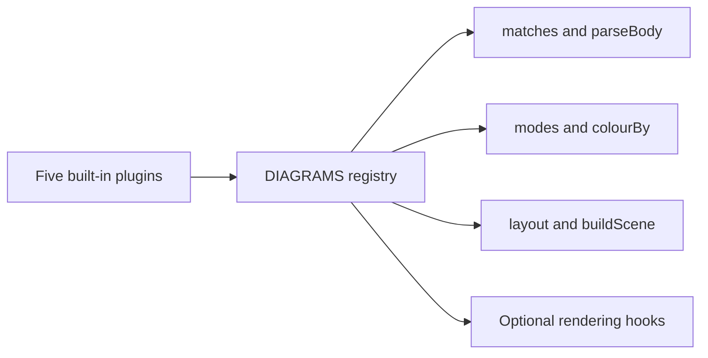


## Details


### <a id="registry"></a>DIAGRAMS registry

map-viewer/diagrams/index.js imports mindmap, flowchart, sequence, state and er modules. diagramForHeader selects by header; diagramOf chooses by model type.


### <a id="parseHook"></a>matches and parseBody

Every type supplies type, label, header recognition and parseBody. Separate parse.js modules parse the supported syntax.


### <a id="modesHook"></a>modes and colourBy

Types declare modes, colour encodings, branch ordering and initial collapse behavior. Shared list rendering (list.js) is a keyboard and screen-reader tree: rows read in full, notes open in place, arrows as rows. It is replaceable; sequences provide sequence/list.js.


### <a id="layoutHook"></a>layout and buildScene

mindmap/layout.js, flowchart/layout.js, sequence/layout.js and er/layout.js define placement. State uses graph layout with state scene/check support.


### <a id="custom"></a>Optional rendering hooks

nodeGeometry, paintNode, categoryOf/categoryKey, icons, drawsSelection, fansOut, pageSections and noteLinks are optional. ER uses custom table geometry/paint, role inference and fan-out detection; state enables note links.


### <a id="types"></a>Five built-in plugins

Evidence: diagrams/index.js and every diagrams/*/diagram.js. New diagram families require parser/render integration and equivalent checker support; a registry entry alone does not establish format validity.


## Atlas and sources

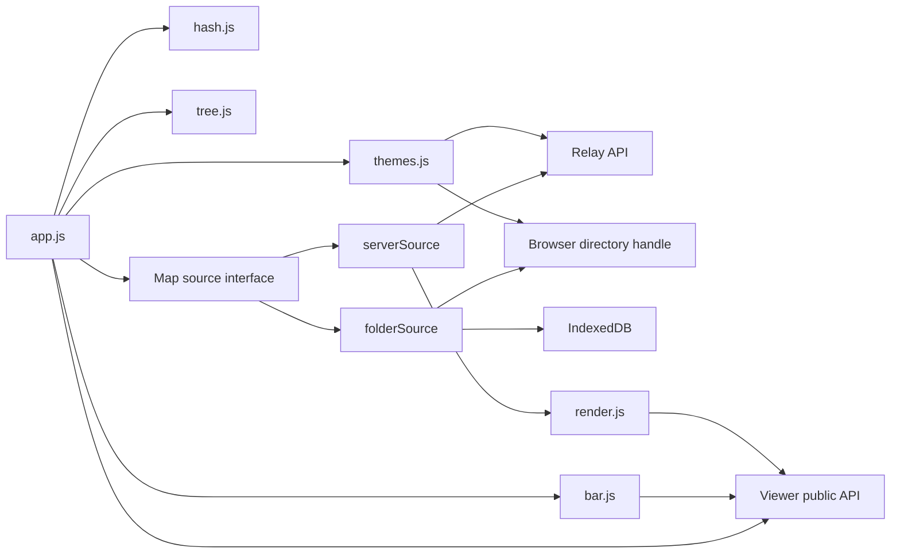


## Details


### <a id="app"></a>app.js

detectServer probes api/info; valid tree capability selects server source, otherwise folder onboarding. load/state events update document title and URL. An incrementing open counter rejects stale asynchronous opens. Evidence: atlas/app.js.


### <a id="hash"></a>hash.js

parseHash/buildHash own #/path and mode, part, focus, node, page, view, env, seq, step and optional preferences. Back/Forward restores viewer state. Evidence: atlas/hash.js.


### <a id="tree"></a>tree.js

Map picker mounts in viewer.slot; while the viewer's toolbar is narrow its button hides and the bar's map name opens it. Rebuilds folders from source path prefixes; selection opens maps through atlas rather than viewer filesystem knowledge. Evidence: atlas/tree.js.


### <a id="interface"></a>Map source interface

list -> state/maps, read(path) -> raw text, watch -> stop function. Optional onShow, onRender with claimRender and answerRender, shutdown and openExternal. Capabilities determine available host features. Evidence: docs/map-source.md.


### <a id="server"></a>serverSource

Fetches tree and map, subscribes to EventSource tree/show/render. SSE errors start 2.5-second polling; open/tree events stop fallback polling. show subscribers receive agent pointers. Evidence: atlas/sources.js.


### <a id="folder"></a>folderSource

Read-only recursive File System Access traversal in Chromium. Polls at 2.5 seconds. Title cache keyed by lastModified and size; path validation rejects hidden or traversal segments. No shutdown capability. Evidence: atlas/sources.js.


### <a id="idb"></a>IndexedDB

Remembers picked directory handle. Permission is checked/requested on revisit; a browser user gesture may be needed. This stores a handle, not uploaded map content. Evidence: atlas/sources.js.


### <a id="bar"></a>bar.js

The quick-links bar, 44 px above the viewer. The logo (outside the scroller) is a picture only. When the viewer's toolbar is narrow (is-narrow), the map's name beside the logo opens the map list and the word mark and label go; the scroller holds the word mark, the "Quick links" label and a chip per diagram, view, deployment and play, built from viewer.contents() and refreshed on its contents event. The current chip is marked; a chip whose contents changed takes the viewer's small sparkle (changeMarkSvg). Fades and arrows show more, no scroll bar. Colours from the theme's frame group. Evidence: atlas/bar.js; atlas/atlas.css.


### <a id="themesJs"></a>themes.js

The maps folder's own themes (.themes/): from the relay (api/themes, font files from api/theme-file) or an opened folder. Each <id>.json becomes a viewer theme whose font faces load their bytes on demand; settings.json gives builtIn, default and logo. A folder that brings themes mounts the viewer again before any map is shown. Evidence: atlas/themes.js; docs/map-source.md.


### <a id="pageRender"></a>render.js

Answers the agent's render: claims it (a focused page at once, others after 0.6 s), mounts a hidden second viewer with the state asked for (no marks, nothing selected), exports, posts the file back and destroys it. The reader's viewer never moves. Evidence: atlas/render.js; docs/relay-server-api.md.


### <a id="viewerHost"></a>Viewer public API

Host callbacks readMap/openMap/openExternal/shutdown mediate effects. Missing optional callback hides its feature; viewer emits state instead of changing location. contents() lists what a host can open; events load, state, contents and theme keep it current. Options since, sinceLabel and marks set the change baseline. export() returns the picture as a file. Evidence: docs/map-viewer-api.md.


## Relay internals

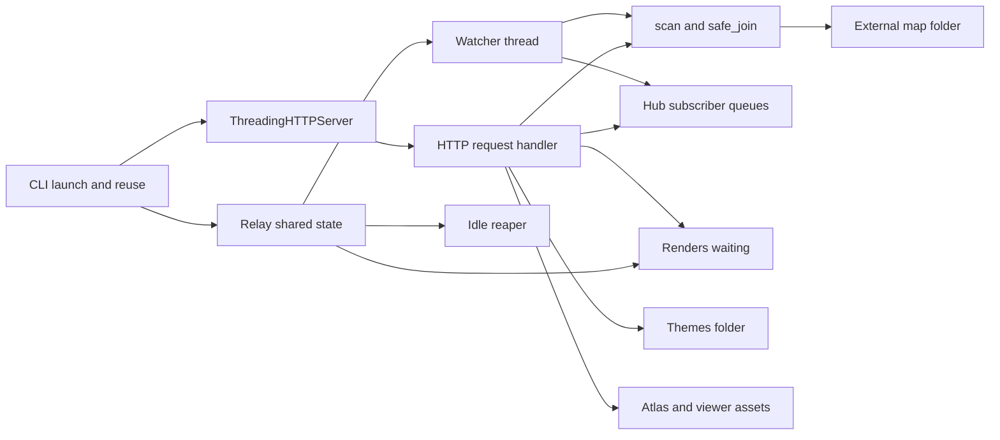


## Details


### <a id="cli"></a>CLI launch and reuse

serve_maps.py resolves --maps-dir or AVAGAHANA_MAP_DIR. Probes existing matching root; otherwise tries ten ports starting at 18300. Detached child by default, foreground optional. One-line STATUS/URL or ERROR output is a skill contract.


### <a id="relayObj"></a>Relay shared state

Holds root paths, capabilities, last_request, tree_state, stopping Event and Hub. Runtime state stays in memory; no server-side record of what a reader has seen.


### <a id="handler"></a>HTTP request handler

GET info/ping/tree/map/events/themes/theme-file and static files. POST show/render/open/shutdown, and a page's render claim and answer. show validates path and fields then broadcasts without storing the pointer. open uses webbrowser for allowed schemes. Capability flags can forbid open and shutdown.


### <a id="renders"></a>Renders waiting

POST /api/render checks the fields, sends a render event and waits: a page claims it within 3 s (else status none) and answers within 30 s (else 504). The first claim wins; a claimer quiet for 5 s may be replaced. Nothing is kept once it is answered. Evidence: serve_maps.py Renders.


### <a id="themesDir"></a>Themes folder

<maps folder>/.themes/: <id>.json per theme, settings.json and font files. Hidden from the map list. read_themes serves them; theme_file serves only font files in that folder. Evidence: serve_maps.py read_themes, theme_file; relay-server/themes.py.


### <a id="scan"></a>scan and safe_join

Lists only .md/.mmd non-hidden files and computes tree state from metadata. safe_join confines resolved paths beneath the selected root, including traversal/symlink containment checks. Evidence: serve_maps.py.


### <a id="hub"></a>Hub subscriber queues

Thread-safe subscribers each receive a queue. Broadcast returns number delivered, which /api/show reports. Closing sends stream termination to subscribers.


### <a id="watch"></a>Watcher thread

Scans about once a second only while at least one event client listens. Changes broadcast tree state; an open stream counts as activity. Initial tree event and 15-second keep-alives maintain streams.


### <a id="reap"></a>Idle reaper

Default 240 idle minutes; active requests and open pages prevent idle termination. shutdown closes streams and ends server. Evidence: run() and Relay.watch().


### <a id="http"></a>ThreadingHTTPServer

Bound to 127.0.0.1. Host must be loopback host/port; POST Origin when present must match. Request timeout 10 seconds. Responses use no-store, nosniff and self-only CSP. Static types are allow-listed.


## Author check show

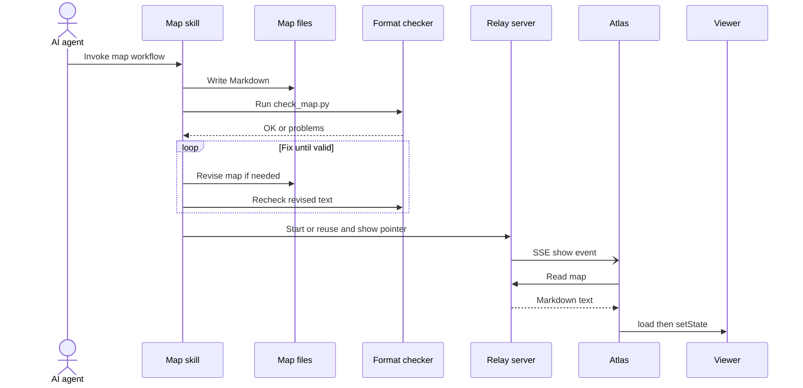


## Plays over

- #avagahana-architecture : Authoring

## Render for a document

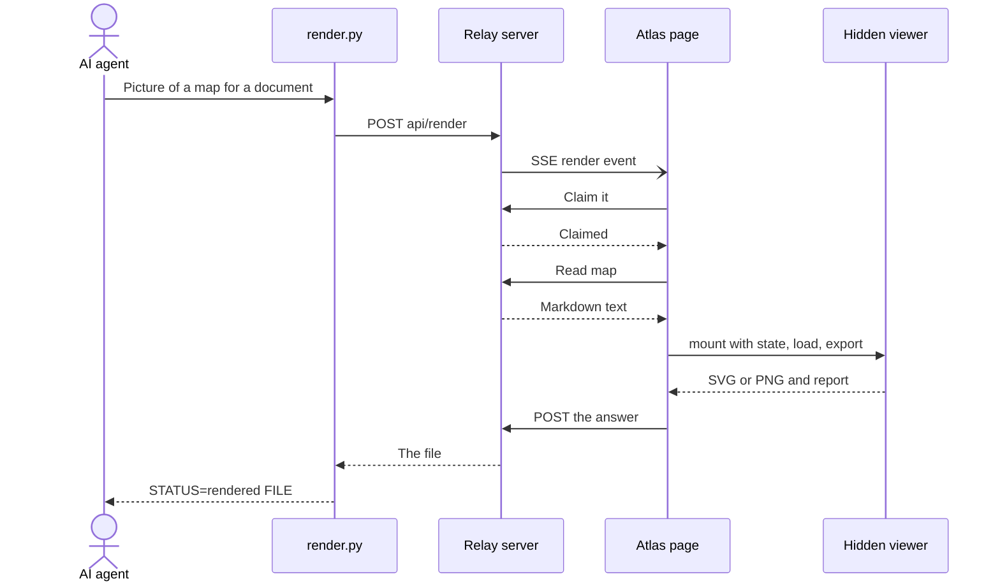


## Details


### <a id="hidden"></a>Hidden viewer

A second viewer, off screen, mounted for one render and destroyed after it: the reader's viewer, its place and marks, never move. No headless browser: the open page draws. Evidence: atlas/render.js; docs/relay-server-api.md.


## Live reload

```mermaid
sequenceDiagram
  actor writer as Agent or editor
  participant disk as Map folder
  participant watch as Relay watcher
  participant hub as Event hub
  participant source as Atlas source
  participant app as Atlas app
  participant render as Viewer
  writer->>disk: Save file
  loop About once a second with subscribers
    watch->>disk: Scan metadata
  end
  watch->>hub: Broadcast changed tree state
  hub-)source: SSE tree event
  source->>app: onChange
  app->>source: list
  source-->>app: Current paths and metadata
  opt Shown map metadata changed
    app->>source: read shown path
    source-->>app: Updated text
    app->>render: load same path
    render->>render: Preserve place and compare seen baseline
  end
  Note over source: SSE failure uses polling; show pointers require the event channel
```


## Viewer load lifecycle

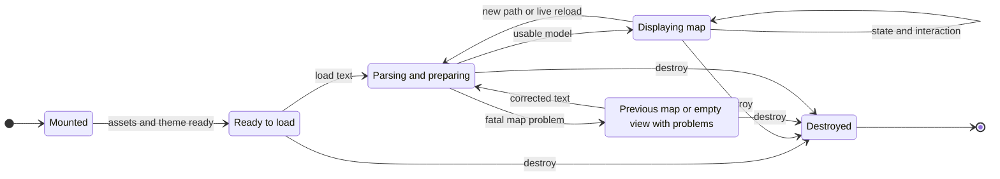


## Details


### <a id="Loading"></a>Conceptual lifecycle

These are explanatory states derived from mount/load/destroy behavior, not literal enum values. Evidence: viewer.js load and public object; docs/map-viewer-api.md. Same-path loads preserve focus, selection and open branches; a new path initializes a new place.


### <a id="Rejected"></a>Recoverable map errors

Fatal parse errors leave the previous map displayed and report map problems. Theme/host issues are also events and console messages; default showProblems displays map issues. Corrected input can be loaded again.


## Walks: Edit and recover

- [*] --> Mounted : Host calls mount.
- Mounted --> Ready : Initial assets become ready.
- Ready --> Loading : First Markdown arrives.
- Loading --> Displaying : Parsed map draws.
- Displaying --> Loading : A rewrite arrives at the same path.
- Loading --> Rejected : Invalid map reports a problem and keeps the old drawing.
- Rejected --> Loading : Agent fixes the text.
- Loading --> Displaying : Updated map is shown.

## Object ownership

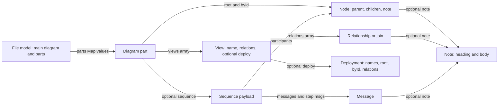

## Details

### <a id="file"></a>The main diagram is the file model

parseMap returns the first diagram's model, enriched with a parts Map containing the further diagram models. The file and its main diagram are not two separately stored records. A further part has anchor and title. Evidence: model/map.js parseMap and parsePart.

### <a id="diagram"></a>Ownership is not an equality join

root and byId refer to node objects; views contains view objects; a view contains its relations and may carry a deployment object. These are JavaScript collections and object references, not foreign-key columns. They belong in this ownership picture, not on invented column joins in the ER picture. The first diagram's view and node IDs are scoped to that diagram; they are not global database keys.

### <a id="sequence"></a>Sequence payload and linked indexes

A sequence diagram part holds sequence.participants, sequence.messages, sequence.steps and sequence.groups. Steps refer to message objects through msgs. A box diagram's separate sequences index holds anchor/view/title descriptors for sequences that play over it. State and ER walks compile into synthetic sequence parts. Evidence: diagrams/sequence/parse.js and model/map.js addWalks/linkSequences.

### <a id="deployment"></a>A deployment is attached to a view

The built deployment has names, root, byId and relations. A view's deploy property holds that object; its environment names are not a stored environment primary-key column. Node copies preserve the diagram's IDs in a different placement. Evidence: model/deployments.js buildDeployment and model/map.js.

### <a id="note"></a>Notes have several possible owners

attachNotes creates a note with heading and body and assigns it to its target's note property. Targets can be nodes, identified relationships/joins, sequence messages or deployment infrastructure. There is no note owner ID field or note primary key. Evidence: model/sections.js attachNotes.

## Logical map model

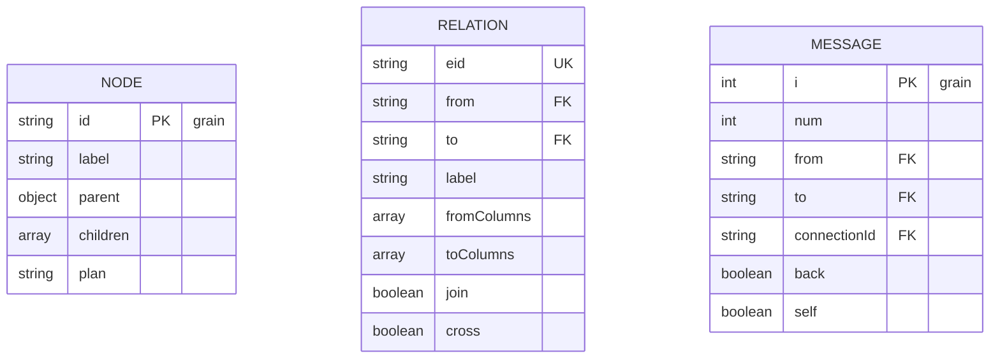

## Relations

- RELATION.from relation-source@}o--|| NODE.id : starts at
- RELATION.to relation-target@}o--o| NODE.id : has local target
- MESSAGE.from message-source@}o--|| NODE.id : sent by
- MESSAGE.to message-target@}o--|| NODE.id : received by
- MESSAGE.connectionId message-connection@}o--o| RELATION.eid : selects when present

## Joins: Message routing

- message-connection
- relation-source
- relation-target
- message-source
- message-target
- MESSAGE.(from,to) message-endpoints@--- RELATION.(from,to) : same directed endpoints

## Walks: Resolve a message | Message routing

- MESSAGE message-connection@--> RELATION : A generated walk message carries connectionId, selecting a declared connection by eid in its selected view. Ordinary messages can omit it.
- RELATION relation-source@--> NODE : Follow that connection's source ID within its diagram.

## Details

### <a id="NODE"></a>IDs are scoped, not global database keys

This picture shows actual ID-bearing fields in the in-memory model, not a SQL schema or a serialization contract. byId indexes nodes by id within one diagram. A sequence's from/to IDs identify its participant nodes. A Plays over link validates corresponding participant IDs in a selected target diagram and view. Matching IDs from unrelated diagrams is not a valid join. The PK and UK marks describe uniqueness within those owning scopes; no new scope-key fields are implied.

### <a id="RELATION"></a>Optional identity and local versus cross-map targets

from is a source node ID in the owning diagram. For a local connection, to is a target node ID in that same diagram. A cross-map relation instead stores a map path and optional node fragment in to, so that end has zero matching local nodes. eid is optional on native Mermaid relationships; explicit column relationships and joins have stable IDs. An ID reused in another view refers to the same connection, not a second definition. fromColumns and toColumns store the optional column lists used by the new ER format.

### <a id="MESSAGE"></a>Message identity is i, not its displayed number

i is the message's zero-based position in sequence.messages and is unique within that sequence. num is a display number: a call and its reply can share it, so num does not identify a message. Generated state/ER walk messages may have connectionId; normal sequence messages can omit it. Evidence: diagrams/sequence/parse.js numberMessages and model/map.js addWalks.

### <a id="message-connection"></a>A selected connection is optional

For an ID-bearing generated walk step, MESSAGE.connectionId resolves to RELATION.eid in the walk's selected view. Some source connections have no eid, and ordinary sequence messages carry no connectionId. The relationship is therefore optional at the connection end, not a claim that every message references exactly one identified relationship. The owning diagram and selected view provide the lookup scope; the model does not store invented diagram_id or view_id columns.

### <a id="message-endpoints"></a>Endpoint equality does not establish relationship identity

Within a specific Plays over target diagram and view, equal from/to IDs can find candidate directed relationships. Multiple relationships can have those same endpoints, so this two-column equality is an additional join, not a unique foreign-key relationship. Reverse traversal also reverses the endpoint comparison; this example compares only the directed case. Use connectionId when a walk selects one identified connection exactly.

## Plugin and quality

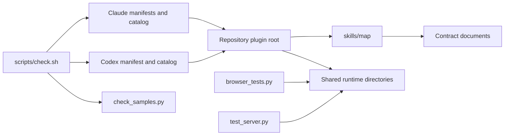


## Details


### <a id="root"></a>Repository plugin root

Current packaging installs the complete root for both clients. There is no deploy bundle or generation step. Evidence: docs/deploy-targets.md and root .claude-plugin, .codex-plugin, .agents/plugins manifests.


### <a id="check"></a>scripts/check.sh

Dependency imports, forbidden terms from an external file, example/problem samples, emoji forms (check_emoji.py: no character a system may draw as an emoji) and plugin structure. Runs Claude plugin validation when CLI exists. Repository rule requires this before each commit.


### <a id="samples"></a>check_samples.py

Every example must pass; every coded problem has a sample; fixtures assert expected code sets. Viewer browser tests mirror this catalog. Evidence: scripts/check_samples.py; format/samples/; format/problems.json.


### <a id="browserTests"></a>browser_tests.py

Browser contract and scene snapshot runner. Covers viewer and atlas pages, map format agreement and scene output. These tests are available verification infrastructure; this map does not claim to have rerun them. Evidence: scripts/browser_tests.py; map-viewer/test/; atlas/test/.


### <a id="serverTests"></a>test_server.py

Standard-library server endpoint, security guard, SSE, capability and CLI lifecycle tests. Evidence: relay-server/test_server.py.


### <a id="docs"></a>Contract documents

docs/map-format.md, map-viewer-api.md, map-source.md and relay-server-api.md define seams. Deliberate contract changes require a Contract entry in CHANGELOG.md. Sources and checked implementation take priority over historical planning text.


## Validation boundaries

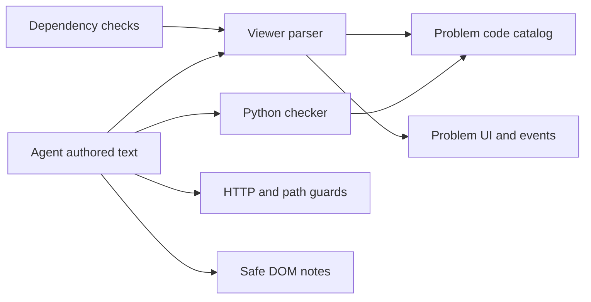


## Details


### <a id="pythonCheck"></a>Python checker

check_map.py plus check_common.py, check_state.py, check_er.py, check_walks.py. Strict problems fail; ignored Mermaid styling/unsupported presentation syntax can produce passing warnings. It also resolves cross-map references from map location upward.


### <a id="jsParse"></a>Viewer parser

Independent browser parser, not a call to Python. Same format and problem catalog, checked with fixtures. Large maps over 5000 nodes warn but still draw; label limits are 150 per line and 1000 total. Evidence: model/map.js, labels.js.


### <a id="problemUI"></a>Problem UI and events

Problem shape contains level, source, code, message, where. Map issues show by default; host/theme issues log and emit events unless showProblems all is chosen. Evidence: problems.js; docs/map-viewer-api.md.


### <a id="httpGuard"></a>HTTP and path guards

Relay refuses hidden/traversal paths, wrong Host/Origin and disallowed link schemes. Viewer is independent of these guards and can be embedded without relay. Evidence: serve_maps.py.


### <a id="notesSafe"></a>Safe DOM notes

Map text is rendered as safe text and supported elements. Raw HTML never enters notes; allowed links pass through host callbacks. This is distinct from the viewer own static chrome HTML. Evidence: notes.js; chrome.js.


### <a id="checks"></a>Dependency checks

scripts/check.sh enforces import boundaries, the absence of API URLs in viewer files and no emoji-capable characters. It does not enforce every documented behavior with static checks; contracts and browser tests cover additional seams.

