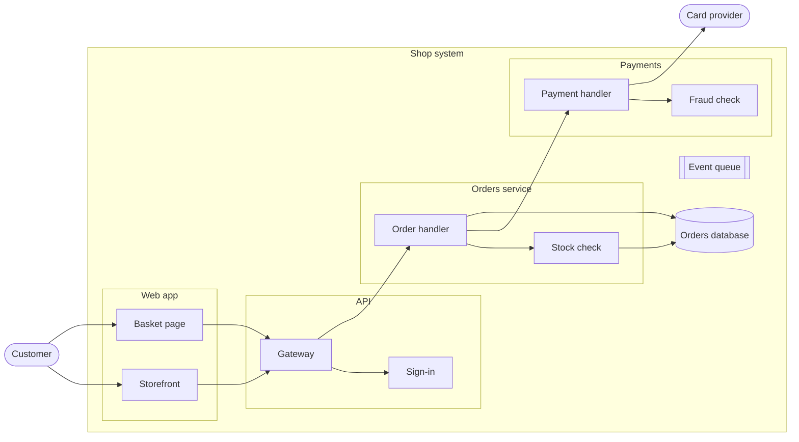
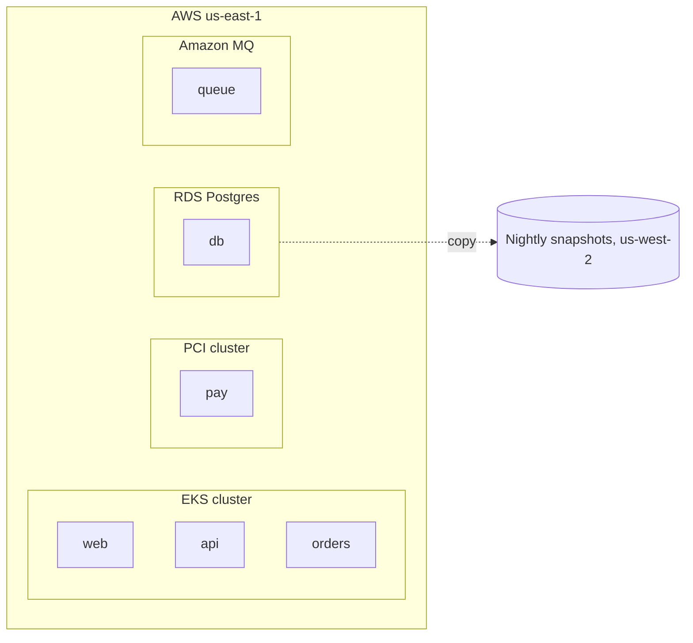
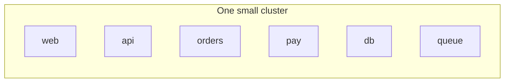

# Shop system

## Perspective: Data flow

- customer --> cart : basket
- cart --> gw : order
- gw --> ord : order
- ord --> db : order rows
- db --> stock : stock levels
- payh --> psp : card token
- psp --> payh : payment result

## Perspective: Events

- ord -.-> queue : order placed
- queue -.-> payh : charge requested
- payh -.-> queue : payment taken
- queue -.-> ord : mark paid
- queue -.-> ui : order status

## Deployment: Production

## Deployment: Staging, Test

## Classes

- web-app : ph browser : Web app
- api-gateway : ph door-open : API gateway
- business-service : ph gear-six : Business service
- queue : ph tray : Message queue

## Details

### Shop system

An online shop, as a C4 container diagram. Three views: calls (the arrows in the
diagram), data flow and events. Open a container to see its components. Production,
Staging and Test show where the containers run.

### Event queue

Messages between services, so a slow card provider never holds up an order.

### EKS cluster

Three nodes across two zones. The services scale on CPU.
