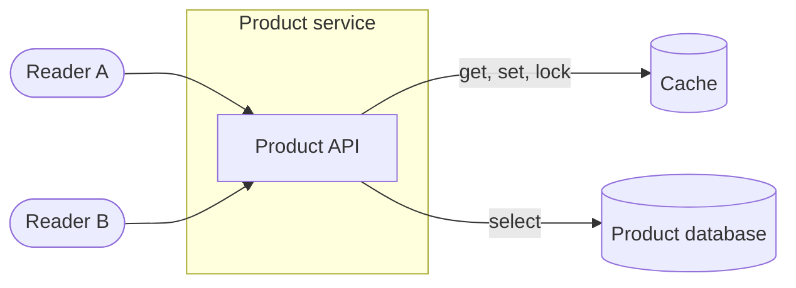
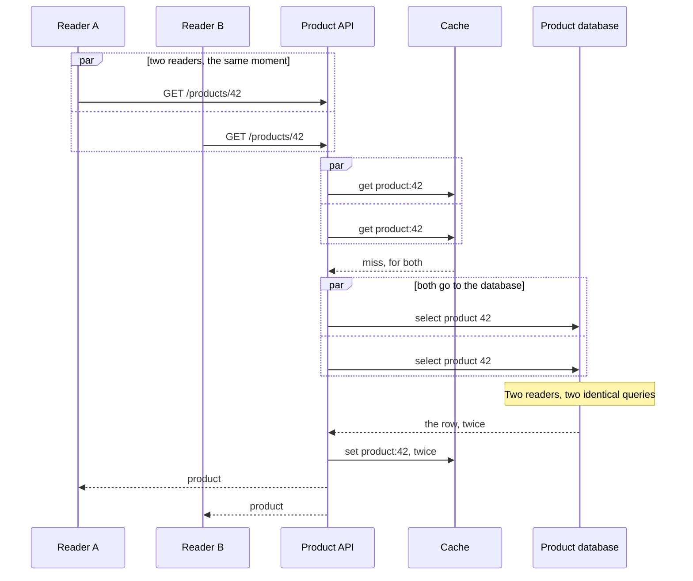
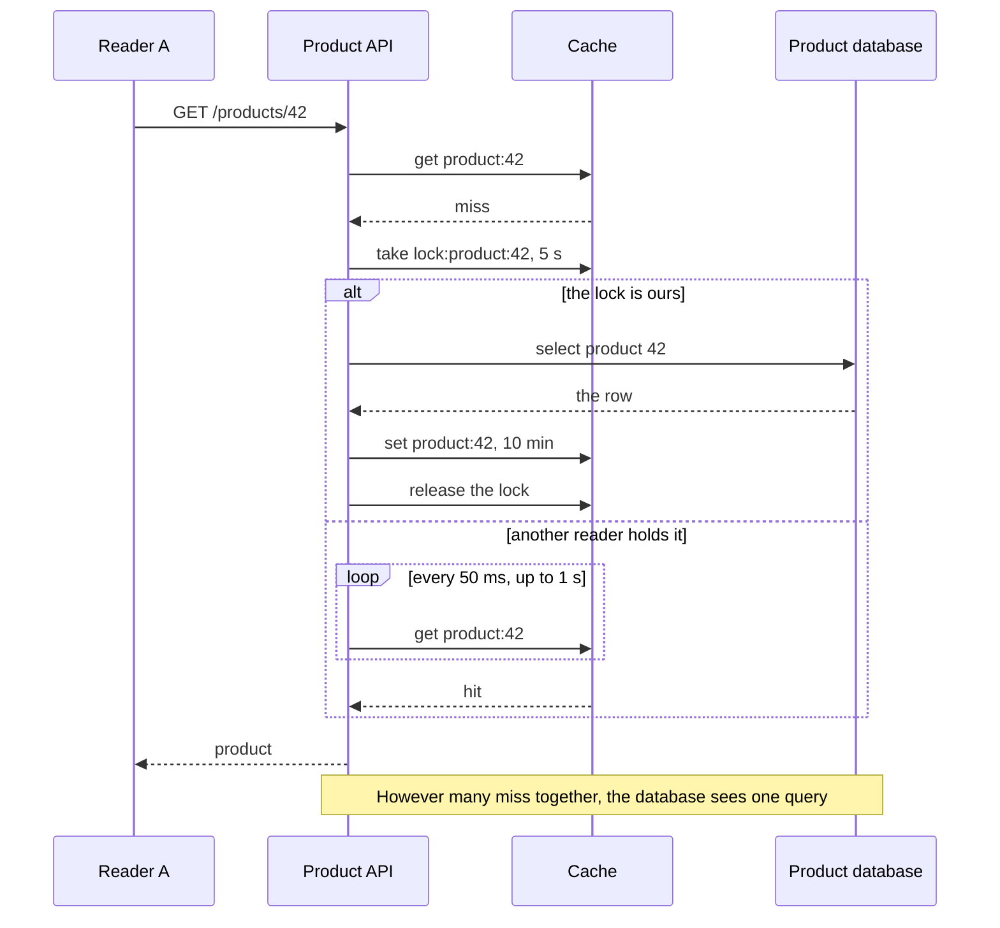

# Product cache

A product page reads through a cache. Most reads are hits and never reach the
database. This map is about the moment they are not.

## Details

### Cache

Entries live for ten minutes. A lock is an entry of its own, `lock:product:42`, set
only if absent, gone after five seconds even if its holder dies.

## When many miss at once

## Plays over

- #product-cache : Relations

## Details

### The same query, again

Nothing here is wrong on its own. Each reader did the sensible thing. Together, at
the moment an entry expires on a busy page, they send the database as many queries as
there are readers.

## One rebuild, the others wait

## Plays over

- #product-cache : Relations

## Details

### Take the lock

Set only if absent, so one reader wins. The five seconds are a promise that a reader
which dies holding the lock does not hold it forever.
