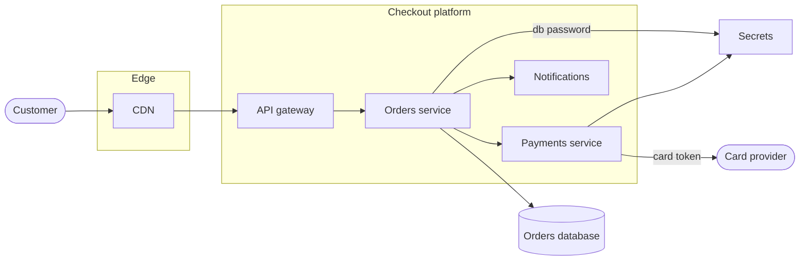
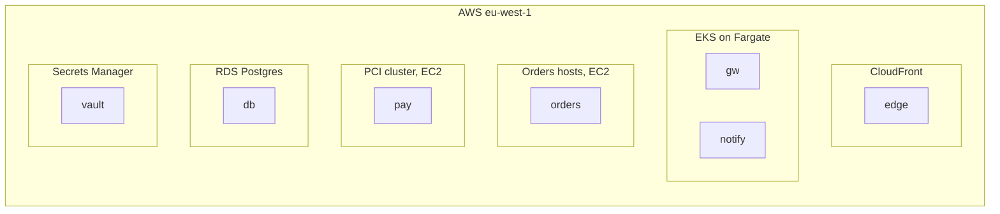

# Checkout platform, release 1.5

## Deployment: Production

## Classes

- secrets : ph key : Secrets
- fargate : aws fargate : Serverless containers
- ec2 : aws ec2 : Virtual machines
- cloudfront : aws cloudfront : CDN
- rds : aws rds : Managed database
- secrets-manager : aws secrets-manager : Secrets store

## Details

### Checkout platform

Takes an order from the basket to a paid order. Release 1.5: the web firewall is gone
(the CDN's own rules replace it), the orders service moves to EC2 hosts, and it reads
its database password from the secrets store itself.

### Payments service

Charges the card through the card provider. Card tokens are kept 90 days, so refunds
work for the whole return period.

### Orders hosts, EC2

Two hosts behind the gateway, moved off Fargate for steady load and cheaper long-running
work. Outside PCI scope.

### PCI cluster, EC2

The only hosts in scope for PCI: hardened images, no shell access, patched monthly.
