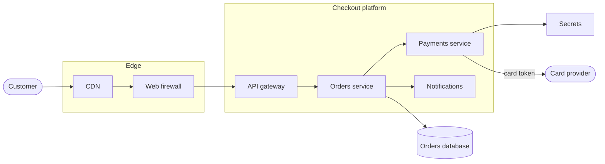
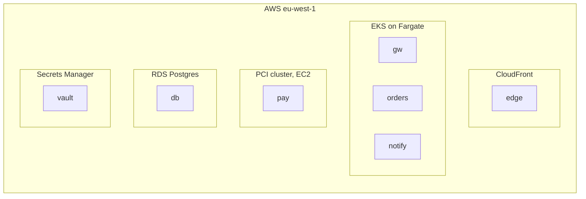

# Checkout platform, release 1.4

## Deployment: Production

## Classes

- secrets : ph key : Secrets
- fargate : aws fargate : Serverless containers
- ec2 : aws ec2 : Virtual machines
- cloudfront : aws cloudfront : CDN
- rds : aws rds : Managed database
- secrets-manager : aws secrets-manager : Secrets store

## Node icons

- waf : aws waf

## Details

### Checkout platform

Takes an order from the basket to a paid order. Release 1.4, as it runs today.

### Web firewall

Managed rules in front of the API gateway: common exploits, bad bots, a rate limit
per client.

### Payments service

Charges the card through the card provider. Card tokens are kept 30 days for refunds.

### PCI cluster, EC2

The only hosts in scope for PCI: hardened images, no shell access, patched monthly.
