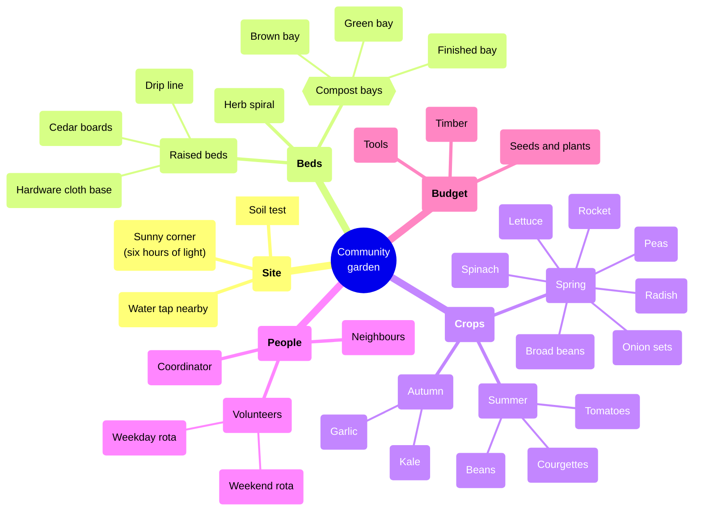

# Community garden

## Icons

- thinking = ph brain : #7048e8 / #b197fc : Planning
- ph drop : #1c7ed6 / #74c0fc : Water

## Details

### Soil test

- Send a sample to the extension office
- *pH* and **lead** first
- [How to take a soil sample](<https://example.com/soil-sample>)

### Herb spiral

A spiral of stone, wet at the bottom and dry at the top. Mint goes low, rosemary high.

### Coordinator

- Holds the key to the shed
- `rota.xlsx` lives in the shared folder
- Contact: [email](<mailto:garden@example.com>)

### Neighbours

- [Street newsletter](<https://example.com/newsletter>)

## Relations

- n4 --> n10 : feeds
- n13 --> n7 : compost for
- n35 --> n17 : sows
- n41 --> tools.md#n2 : see the tool list
