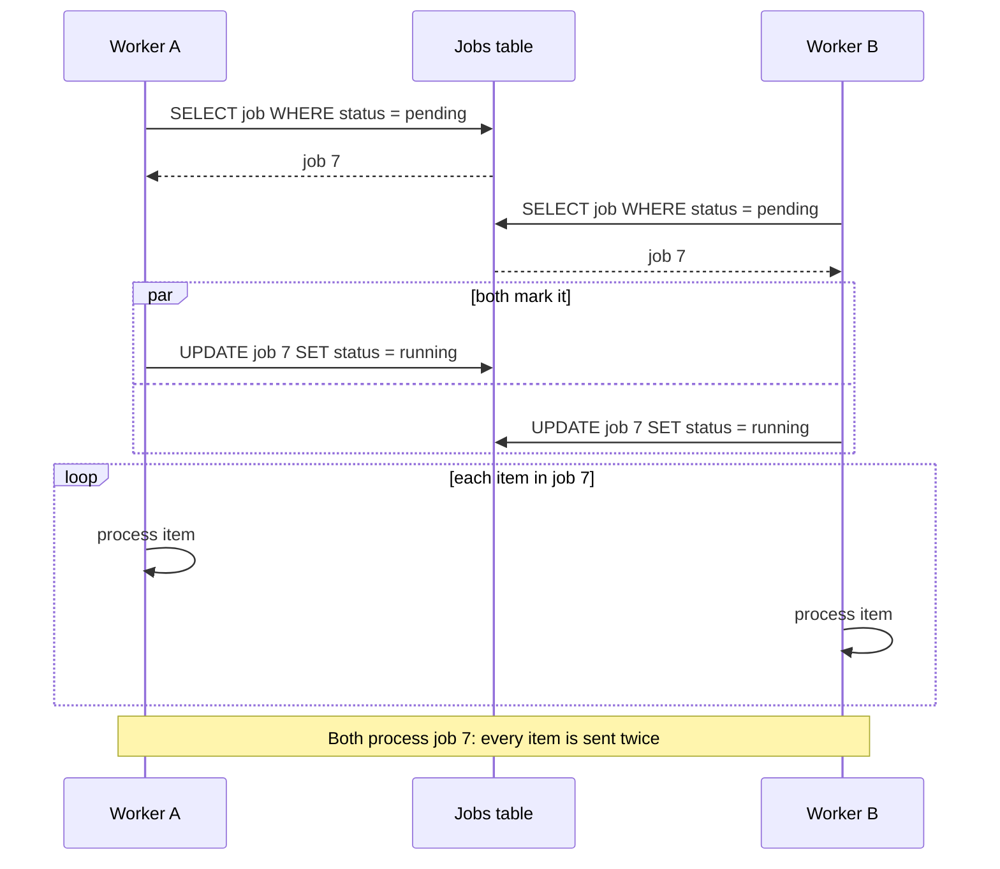

# Job queue race

Two workers pick up the same job: both read it as pending before either marks it
running.

## Details

### Read without a lock

The select takes no lock and the update does not check the status it read, so the
read and the update are not one step. `SELECT ... FOR UPDATE SKIP LOCKED` or an update
that checks `status = pending` closes the gap.
