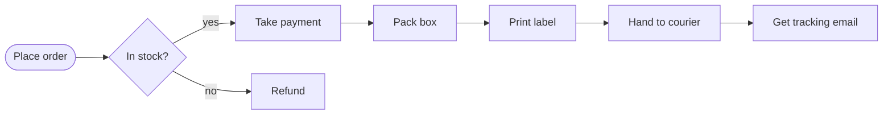

<!-- Avagahana map: change it with the illuminate-concept skill -->

# Order fulfilment lanes

## Lanes

### Rows
- customer : Customer
- shop : Shop
- warehouse : Warehouse
- finance : Finance

### Columns
- ask : Request
- check : Approve
- make : Prepare
- send : Deliver

### Parent rows
- company : Our company : ops, finance
- ops : Operations : shop, warehouse

### Parent columns
- after : After the order : approval, fulfil
- approval : Approval : check
- fulfil : Fulfilment : make, send

### Placement
- order : customer : ask
- stock : shop : check
- pay, refund : finance : check
- pack, label : warehouse : make
- ship : warehouse : send
- track : customer : send

## Perspective: Money

- stock --> pay : yes
- stock --> refund : no
- pay --> pack

## Details

### In stock?

The shop checks stock before any money moves, so a refund only happens when the
item is gone.
