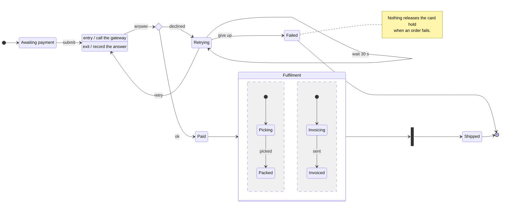

# Order lifecycle

How an order moves from placed to delivered, and where a payment that keeps failing
ends up.

## Scenario: Payment fails twice

- [*] --> Pending : The order is placed and waits for payment.
- Pending --> Charging : The shopper submits the card.
- Charging --> check : The gateway answers.
- check --> Retrying : Declined. The order waits and tries again.
- Retrying --> Retrying : Thirty seconds pass.
- Retrying --> Charging : The second attempt.
- Charging --> check : The gateway answers again.
- check --> Retrying : Declined again.
- Retrying --> Failed : No retries left: the order gives up.
- Failed --> [*] : The scenario ends, and the card hold is still in place.

## Scenario: Happy path

- [*] --> Pending : The order is placed.
- Pending --> Charging : The shopper submits the card.
- Charging --> check : The gateway answers.
- check --> Paid : Accepted.
- Paid --> Fulfilment : Picking and invoicing start together.
- Fulfilment --> done : Both are done.
- done --> Shipped : The parcel leaves.
- Shipped --> [*]
