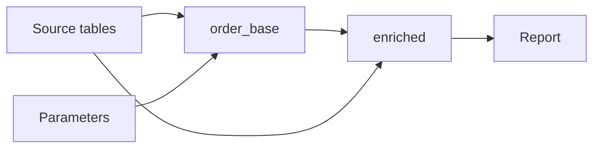
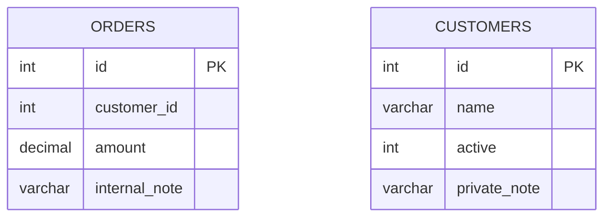

<!-- Avagahana map: change it with the illuminate-concept skill -->

# Understand an order report



## Query: Order report

#### Query options
- Schema: #table-definitions
- Schema visibility: hidden
- Into: report
- Sources: sources
- Binds: binds

#### Scopes
- order_base: base
- enriched: enriched

```sql
WITH order_base AS (
  SELECT o.id AS order_id, o.customer_id, o.amount
  FROM orders o
  WHERE o.amount >= :minimum_amount
), enriched AS (
  SELECT b.order_id, c.name AS customer_name,
         CASE WHEN b.amount >= :large_amount THEN 'Large' ELSE 'Standard' END AS size
  FROM order_base b
  LEFT JOIN customers c
    ON c.id = b.customer_id
   AND c.active = 1
  WHERE b.amount > 0
)
SELECT e.order_id, e.customer_name, e.size FROM enriched e
```

#### Physical names
- orders: ORDERS
- customers: CUSTOMERS

## Table definitions


