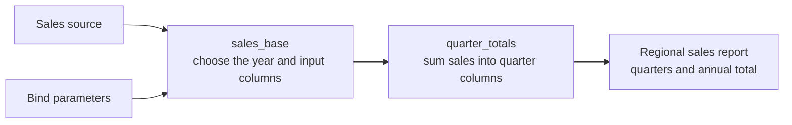
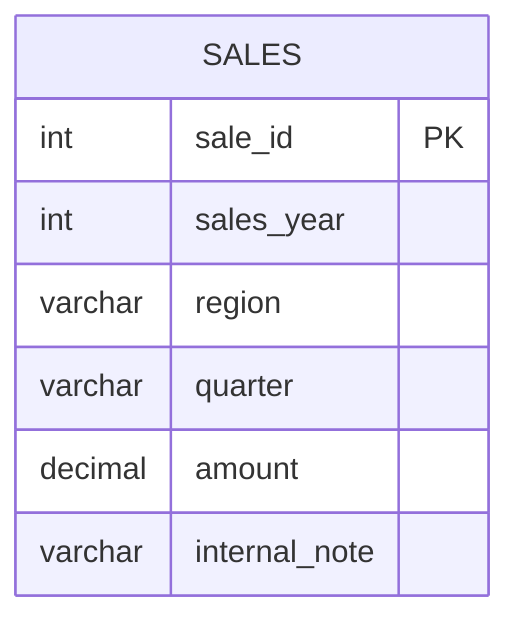

<!-- Avagahana map: change it with the illuminate-concept skill -->

# Quarterly sales with a pivot

Start with the overview. Expand quarter_totals using its circle. On **p · pivot**,
the top-right circle expands the pivot in place; the top-left +/− independently
shows its columns. Double-click the card to focus on the pivot alone: its input
columns, aggregation, fixed quarter headings and output mapping.

The input grain is one sale. The pivot groups by region and sums amount for each
quarter. Missing quarters remain NULL until the final report replaces them with 0.



## Query: Regional sales report

#### Query options
- Schema: #table-definitions
- Schema visibility: hidden
- Into: report
- Sources: sources
- Binds: binds

#### Scopes
- sales_base: base
- quarter_totals: pivoted

```sql
WITH sales_base AS (
  SELECT s.region, s.quarter, s.amount
  FROM sales s
  WHERE s.sales_year = :sales_year
), quarter_totals AS (
  SELECT p.region, p.[Q1], p.[Q2], p.[Q3], p.[Q4]
  FROM sales_base
  PIVOT (
    SUM(amount)
    FOR quarter IN ([Q1], [Q2], [Q3], [Q4])
  ) p
)
SELECT q.region,
       COALESCE(q.[Q1], 0) AS q1_total,
       COALESCE(q.[Q2], 0) AS q2_total,
       COALESCE(q.[Q3], 0) AS q3_total,
       COALESCE(q.[Q4], 0) AS q4_total,
       COALESCE(q.[Q1], 0) + COALESCE(q.[Q2], 0)
         + COALESCE(q.[Q3], 0) + COALESCE(q.[Q4], 0) AS annual_total
FROM quarter_totals q
```

#### Physical names
- sales: SALES

## Table definitions


