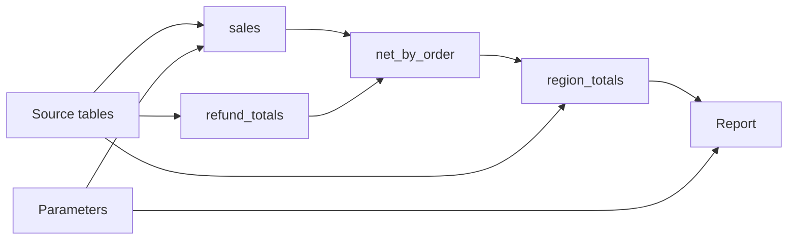
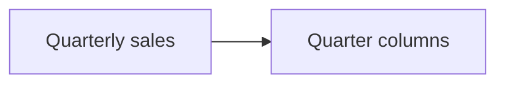
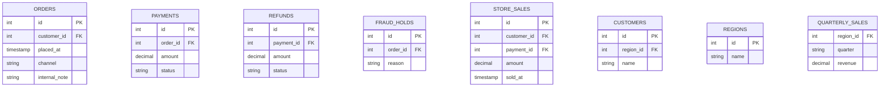

# Net revenue report

How a monthly report gets from raw orders to one line per region. Each box is a step
of the SQL below it: open **net_by_order** or **Report** in place with the circle at its
top right, or double-click one to focus on it. Nothing here runs the query. The picture
is read from the SQL as written, and the tables are defined once, at the end of this file.



## Query: Net revenue by region

Online and store sales are put together first, then refunds are taken off. Refunds are
added up to one row per payment **before** they are joined: a payment with two refunds
would otherwise appear twice, and its revenue would count twice.

#### Query options
- Schema: #table-definitions
- Schema visibility: hidden
- Into: report
- Sources: sources
- Binds: params

```sql
WITH sales AS (
  SELECT o.id AS order_id, o.customer_id, p.id AS payment_id, p.amount AS paid
  FROM ORDERS o
  JOIN PAYMENTS p
    ON p.order_id = o.id
    AND p.status = 'captured'
  WHERE o.placed_at >= :period_start
    AND o.placed_at < :period_end
    AND NOT EXISTS (
      SELECT 1
      FROM FRAUD_HOLDS h
      WHERE h.order_id = o.id
    )
  UNION ALL
  SELECT s.id AS order_id, s.customer_id, s.payment_id, s.amount AS paid
  FROM STORE_SALES s
  WHERE s.sold_at >= :period_start
    AND s.sold_at < :period_end
),
refund_totals AS (
  SELECT r.payment_id, SUM(r.amount) AS refunded
  FROM REFUNDS r
  WHERE r.status = 'settled'
  GROUP BY r.payment_id
),
net_by_order AS (
  SELECT s.order_id, s.customer_id,
         s.paid - COALESCE(t.refunded, 0) AS net
  FROM sales s
  LEFT JOIN refund_totals t
    ON t.payment_id = s.payment_id
),
region_totals AS (
  SELECT g.name AS region,
         SUM(n.net) AS net_revenue,
         COUNT(DISTINCT n.order_id) AS order_count
  FROM net_by_order n
  JOIN CUSTOMERS c
    ON c.id = n.customer_id
  LEFT JOIN REGIONS g
    ON g.id = c.region_id
  GROUP BY g.name
  HAVING SUM(n.net) > 0
)
SELECT t.region, t.net_revenue, t.order_count,
       RANK() OVER (ORDER BY t.net_revenue DESC) AS revenue_rank,
       CASE WHEN t.net_revenue >= :monthly_target THEN 'Met'
            ELSE 'Below' END AS target_status
FROM region_totals t
ORDER BY revenue_rank
```

## Perspective: Inside sales
- sources --> sales
- params --> sales

#### Perspective options
- Focus: sales

## Perspective: Inside refund_totals
- sources --> refund_totals

#### Perspective options
- Focus: refund_totals

## Perspective: Inside net_by_order
- sales --> net_by_order
- refund_totals --> net_by_order

#### Perspective options
- Focus: net_by_order

## Details

### <a id="sources"></a>Source tables

The tables this report reads. Open a table in the query to see its columns, including
the ones this query leaves out.

### <a id="refund_totals"></a>refund_totals

One row per payment, and only settled refunds. This is what keeps the next join from
multiplying rows.

### <a id="net_by_order"></a>net_by_order

The LEFT JOIN keeps sales with no refund at all. For those, `refunded` is empty and
COALESCE turns it into 0, so `net` is simply what was paid.

### <a id="report"></a>Report

One line per region, ranked. For the same revenue split into quarters, see
[Revenue by quarter](#revenue-by-quarter).

## Revenue by quarter



## Query: Revenue by quarter

Sales turned on their side: each quarter listed in the PIVOT becomes a column, filled by SUM(revenue). The columns
come from that fixed list, not from whatever quarters the data holds.

#### Query options
- Schema: #table-definitions
- Schema visibility: hidden
- Into: quarter_report
- Sources: quarter_source

```sql sqlserver
SELECT pv.region_id, pv.Q1, pv.Q2, pv.Q3, pv.Q4,
       COALESCE(pv.Q1, 0) + COALESCE(pv.Q2, 0) AS first_half
FROM (
  SELECT region_id, quarter, revenue FROM QUARTERLY_SALES
) src
PIVOT (
  SUM(revenue) FOR quarter IN ([Q1], [Q2], [Q3], [Q4])
) pv
```

## Table definitions



## Relations
- ORDERS.customer_id order_customer@}o--|| CUSTOMERS.id : customer
- PAYMENTS.order_id payment_order@}o--|| ORDERS.id : order
- REFUNDS.payment_id refund_payment@}o--|| PAYMENTS.id : payment
- FRAUD_HOLDS.order_id hold_order@}o--|| ORDERS.id : order
- STORE_SALES.customer_id store_customer@}o--|| CUSTOMERS.id : customer
- STORE_SALES.payment_id store_payment@}o--|| PAYMENTS.id : payment
- CUSTOMERS.region_id customer_region@}o--o| REGIONS.id : region
- QUARTERLY_SALES.region_id quarter_region@}o--|| REGIONS.id : region

## Walkthrough: Read the report

### Diagram: Net revenue report

Start with the shape: sales and refunds come in separately, meet in net_by_order, and
are rolled up by region before the report ranks them.

### Perspective: Inside sales

Two SELECTs joined by UNION ALL. In the first, NOT EXISTS leaves out orders on a fraud
hold. Parameters feed the date filters of both.

#### Stop options
- Point to: Input 1 / WHERE

### Perspective: Inside refund_totals

GROUP BY makes one row per payment, and only settled refunds count. This is what makes
the next join safe.

#### Stop options
- Point to: GROUP BY

### Perspective: Inside net_by_order

The LEFT JOIN keeps sales with no refund, and COALESCE turns their empty total into 0.
Because refund_totals has one row per payment, no sale is counted twice.

#### Stop options
- Point to: JOIN 1

### Diagram: Revenue by quarter

A second query on one schema. Open the pivot: region stays as the row, each listed
quarter becomes a column, and first_half is worked out from two of them.
