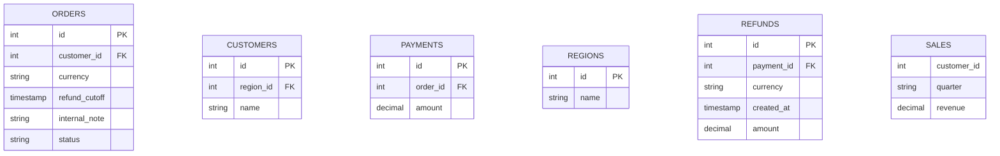

# Order query



## Relations
- ORDERS.customer_id customer@}o--o| CUSTOMERS.id : customer
- PAYMENTS.order_id payment@}o--|| ORDERS.id : order
- CUSTOMERS.region_id region@}o--o| REGIONS.id : region
- REFUNDS.payment_id refund@}o--|| PAYMENTS.id : payment

## Perspective: Order columns
- ORDERS --> CUSTOMERS : customer

#### Perspective options
- Columns: ORDERS.id, ORDERS.customer_id, CUSTOMERS.id, CUSTOMERS.name

## Query: Refund eligibility

One join can depend on several earlier inputs. Join 4 has two connections, with
one identity, full ON condition and walkthrough stop. Payment/refund fan-out can
repeat the order; the picture explains the query, without executing it.

```sql
WITH order_base AS (
  SELECT id, customer_id, currency, refund_cutoff
  FROM ORDERS
)
SELECT b.id AS order_id,
       c.name AS customer,
       r.name AS region,
       p.amount AS paid,
       rf.amount AS refunded,
       p.amount - COALESCE(rf.amount, 0) AS net_amount,
       CASE WHEN rf.id IS NULL THEN 'No eligible refund'
            ELSE 'Eligible refund' END AS refund_status
FROM order_base b
LEFT JOIN CUSTOMERS c ON b.customer_id = c.id
LEFT JOIN PAYMENTS p ON b.id = p.order_id
LEFT JOIN REGIONS r ON c.region_id = r.id
LEFT JOIN REFUNDS rf ON rf.payment_id = p.id
                   AND rf.currency = b.currency
                   AND rf.created_at < b.refund_cutoff
WHERE p.amount > 0
ORDER BY order_id
```

## Query: Quarterly revenue

Each pivot opens an isolated picture of just that reshaping operation. These are
fixed output column names from the SQL, not values observed in a database.

```sql sqlserver
SELECT pv.customer_id, pv.Q1, pv.Q2, pv.Q3, pv.Q4,
       COALESCE(pv.Q1, 0) + COALESCE(pv.Q2, 0) AS first_half
FROM (
  SELECT customer_id, quarter, revenue FROM SALES
) src
PIVOT (
  SUM(revenue) FOR quarter IN ([Q1], [Q2], [Q3], [Q4])
) pv
```

## Walkthrough: Understand the refunds

### Diagram: Query: Refund eligibility

Each box is one table occurrence. Only columns used by this query start visible.
The Result exposes the selected columns; calculated columns open notes.

### Join: 4 · LEFT JOIN

Both connections belong to this join. A refund must match the payment and the
order's currency/cutoff. Unmatched left rows survive this join. The later WHERE
clause filters rows with no positive payment; inspect Result for the clause.

#### Stop options
- Diagram: Query: Refund eligibility

### Diagram: Query: Quarterly revenue

The pivot appears as a derived result table. Open its diagram to understand it.

### Diagram: Query: Quarterly revenue / Pivot pv

Keep customer as rows, turn quarter values into columns, fill cells with the sum
of revenue. The main query's joins and scalar formulas are outside this view.
