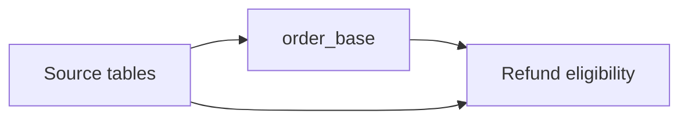
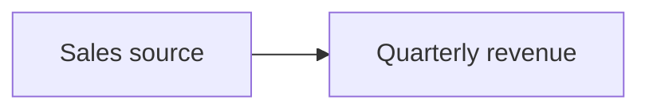
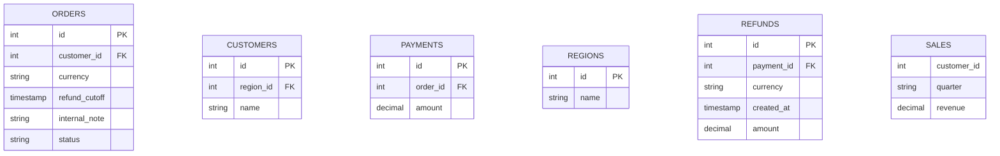

<!-- Avagahana map: change it with the illuminate-concept skill -->

# Order query

The overview shows how the refund report is built. Expand order_base or the report
in place; use +/− on an input for columns and double-click a CTE to focus on it.
The shared schema is defined once at the end of this file.



## Query: Refund eligibility

One join depends on several earlier inputs. Refund eligibility checks both the
payment and the order currency/cutoff. Payment/refund fan-out can repeat orders;
this map explains the original query without executing it.

#### Query options
- Schema: #table-definitions
- Schema visibility: hidden
- Into: report
- Sources: sources

#### Scopes
- order_base: base

```sql
WITH order_base AS (
  SELECT id, customer_id, currency, refund_cutoff
  FROM ORDERS
)
SELECT b.id AS order_id,
       c.name AS customer,
       r.name AS region,
       p.amount AS paid,
       rf.amount AS refunded,
       p.amount - COALESCE(rf.amount, 0) AS net_amount,
       CASE WHEN rf.id IS NULL THEN 'No eligible refund'
            ELSE 'Eligible refund' END AS refund_status
FROM order_base b
LEFT JOIN CUSTOMERS c ON b.customer_id = c.id
LEFT JOIN PAYMENTS p ON b.id = p.order_id
LEFT JOIN REGIONS r ON c.region_id = r.id
LEFT JOIN REFUNDS rf ON rf.payment_id = p.id
                   AND rf.currency = b.currency
                   AND rf.created_at < b.refund_cutoff
WHERE p.amount > 0
ORDER BY order_id
```

## Details

### <a id="sources"></a>Source tables

Shared source definitions back each occurrence. The separate
[quarterly revenue query](#quarterly-revenue) demonstrates a fixed pivot.

## Quarterly revenue



## Query: Quarterly revenue

Expand the report, then use the pivot's top-right circle for inline expansion or
double-click it for isolated focus. Its top-left +/− controls columns separately.
The output quarters come from the fixed SQL list, not observed database values.

#### Query options
- Schema: #table-definitions
- Schema visibility: hidden
- Into: revenue
- Sources: sales

```sql sqlserver
SELECT pv.customer_id, pv.Q1, pv.Q2, pv.Q3, pv.Q4,
       COALESCE(pv.Q1, 0) + COALESCE(pv.Q2, 0) AS first_half
FROM (
  SELECT customer_id, quarter, revenue FROM SALES
) src
PIVOT (
  SUM(revenue) FOR quarter IN ([Q1], [Q2], [Q3], [Q4])
) pv
```

## Table definitions



## Relations
- ORDERS.customer_id customer@}o--o| CUSTOMERS.id : customer
- PAYMENTS.order_id payment@}o--|| ORDERS.id : order
- CUSTOMERS.region_id region@}o--o| REGIONS.id : region
- REFUNDS.payment_id refund@}o--|| PAYMENTS.id : payment

## Perspective: Order columns
- ORDERS --> CUSTOMERS : customer

#### Perspective options
- Columns: ORDERS.id, ORDERS.customer_id, CUSTOMERS.id, CUSTOMERS.name

## Walkthrough: Understand the refunds

### Diagram: Order query

The overview shows the source catalogue, order_base CTE and final report.

Read stage0 FROM followed by the numbered LEFT JOIN blocks. The fourth join uses
both payment and order fields. WHERE keeps positive payments. Output mappings
show each source expression and alias; select a calculation to inspect its inputs.

### Diagram: Quarterly revenue

This separate query reshapes sales into fixed quarter columns.

Open the pivot in place or focus on it. Customer stays as the implicit grouping
key, quarter values become columns and SUM(revenue) fills the cells. The report's
scalar calculation remains visible in its output mapping.
