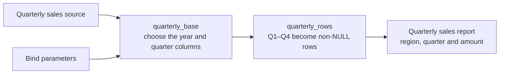
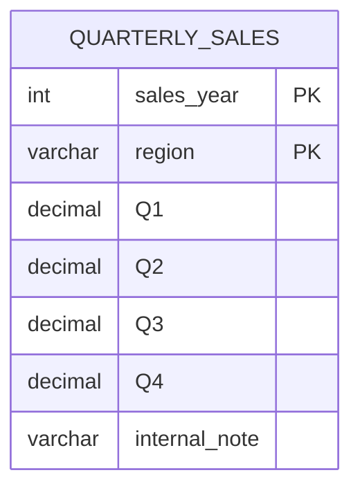

<!-- Avagahana map: change it with the illuminate-concept skill -->

# Quarterly sales with an unpivot

Expand quarterly_rows, then use the top-right circle on **u · unpivot** to expand
the column-to-row transformation in place. Its top-left +/− independently shows
columns. Double-click the card for isolated focus, or its input to visit the source.

This starts from a wide quarterly table: one row per region and year, with Q1–Q4
amount columns. UNPIVOT keeps region and turns each non-NULL quarter cell into one
quarter/amount row. A zero amount still produces a row. No aggregation occurs,
and an earlier pivot's aggregated sales cannot be recovered by unpivoting it.



## Query: Quarterly sales rows

#### Query options
- Schema: #table-definitions
- Schema visibility: hidden
- Into: report
- Sources: sources
- Binds: binds

#### Scopes
- quarterly_base: base
- quarterly_rows: unpivoted

```sql sqlserver
WITH quarterly_base AS (
  SELECT s.region, s.[Q1], s.[Q2], s.[Q3], s.[Q4]
  FROM quarterly_sales s
  WHERE s.sales_year = :sales_year
), quarterly_rows AS (
  SELECT u.region, u.quarter, u.amount
  FROM quarterly_base
  UNPIVOT (
    amount
    FOR quarter IN ([Q1], [Q2], [Q3], [Q4])
  ) u
)
SELECT q.region AS region_name,
       q.quarter AS sales_quarter,
       q.amount AS sales_amount
FROM quarterly_rows q
ORDER BY q.region, q.quarter
```

#### Physical names
- quarterly_sales: QUARTERLY_SALES

## Table definitions


