# Sales warehouse

Three fact tables, order lines, returns and stock levels, share the date and product
dimensions; order lines and returns also share the customer, and both name a currency
from a lookup.

```mermaid
erDiagram
  ORDER_LINE["Order line"] {
    bigint order_line_key PK
    int order_id "grain"
    int line_no "grain"
    int product_key FK
    int store_key FK
    int customer_key FK
    string currency_code FK
    int date_key FK
    int quantity
    decimal net_amount
    decimal discount
    decimal tax
  }
  RETURN_LINE["Return line"] {
    bigint return_line_key PK
    int return_id "grain"
    int line_no "grain"
    int product_key FK
    int customer_key FK
    string currency_code FK
    int date_key FK
    int quantity
    decimal refund_amount
    string reason
  }
  STOCK_LEVEL["Stock level"] {
    bigint stock_key PK
    int product_key FK "grain"
    int warehouse_key FK "grain"
    int date_key FK "grain"
    int on_hand
    int on_order
  }
  DATE["Date"] {
    int date_key PK
    date calendar_date
    int fiscal_week
    int fiscal_month
    int fiscal_year
    bool is_holiday
  }
  PRODUCT["Product"] {
    int product_key PK
    string sku UK
    string name
    string category
    string brand
  }
  CUSTOMER["Customer"] {
    int customer_key PK
    string email UK
    string segment
    int region_key FK
  }
  STORE["Store"] {
    int store_key PK
    string name
    int region_key FK
  }
  WAREHOUSE["Warehouse"] {
    int warehouse_key PK
    string name
    string city
  }
  REGION["Region"] {
    int region_key PK
    string name
    string country
  }
  PRODUCT_TAG["Product tag"] {
    int product_key PK, FK
    int tag_key PK, FK
  }
  TAG["Tag"] {
    int tag_key PK
    string label
  }
  CURRENCY["Currency"] {
    string currency_code PK
    string name
    int minor_units
  }
  class ORDER_LINE,RETURN_LINE,STOCK_LEVEL fact
  class DATE,PRODUCT,CUSTOMER,STORE,WAREHOUSE,REGION,TAG dimension
  PRODUCT_TAG:::bridge
  CURRENCY:::lookup
```

## Relations

- ORDER_LINE.date_key line-date@}o--|| DATE.date_key : ordered on
- ORDER_LINE.product_key line-product@}o--|| PRODUCT.product_key : sells
- ORDER_LINE.customer_key line-customer@}o--|| CUSTOMER.customer_key : bought by
- ORDER_LINE.store_key line-store@}o--|| STORE.store_key : sold at
- ORDER_LINE.currency_code line-currency@}o--|| CURRENCY.currency_code : priced in
- RETURN_LINE.date_key return-date@}o--|| DATE.date_key : returned on
- RETURN_LINE.product_key return-product@}o--|| PRODUCT.product_key : returns
- RETURN_LINE.customer_key return-customer@}o--|| CUSTOMER.customer_key : returned by
- RETURN_LINE.currency_code return-currency@}o--|| CURRENCY.currency_code : refunded in
- STOCK_LEVEL.date_key stock-date@}o--|| DATE.date_key : counted on
- STOCK_LEVEL.product_key stock-product@}o--|| PRODUCT.product_key : counts
- STOCK_LEVEL.warehouse_key stock-warehouse@}o--|| WAREHOUSE.warehouse_key : held in
- CUSTOMER.region_key customer-region@}o--|| REGION.region_key : lives in
- STORE.region_key store-region@}o--|| REGION.region_key : stands in
- PRODUCT_TAG.product_key tag-product@}o--|| PRODUCT.product_key : tagged by
- PRODUCT_TAG.tag_key tag-tag@}o--|| TAG.tag_key : tags

## Joins: Sales against stock

- line-date
- line-product
- stock-date
- stock-product
- ORDER_LINE.(date_key,product_key) sales-stock@--- STOCK_LEVEL.(date_key,product_key) : same day and product

## Details

### Order line

One row per line of an order. Amounts are in the order's currency; the reporting
currency comes from the daily rate table, which is not drawn.

### Return line

One row per line of a return. It shares the date, product and customer dimensions with
order lines (conformed dimensions), so sales and returns add up by the same day,
product or customer.

### Same day and product

Drilling across the two facts: an order line meets the stock count for the same day
and product, through the shared date and product dimensions.

## Scenario: Revenue by region

- ORDER_LINE --> CUSTOMER : Each order line joins its customer on customer_key.
- CUSTOMER --> REGION : The customer's region on region_key; sum net_amount per region.

## Scenario: Sales with tags

- ORDER_LINE --> PRODUCT : Each order line joins its product on product_key.
- PRODUCT --> PRODUCT_TAG : A product has several tags, so a sum over this join counts each line once per tag.
