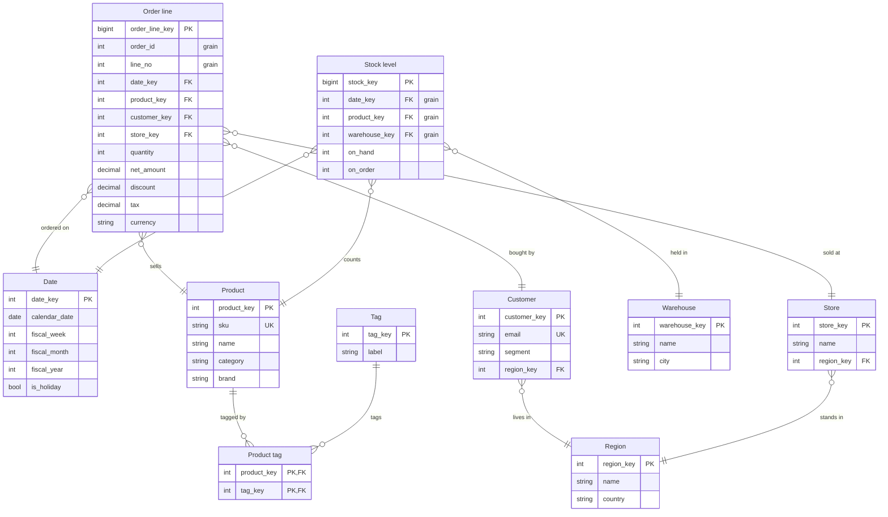

# Sales warehouse

Two fact tables, order lines and stock levels, share the date and product dimensions.

## Details

### Order line

One row per line of an order. Amounts are in the order's currency; the reporting
currency comes from the daily rate table, which is not drawn.

## Walks: Revenue by region

- ORDER_LINE --> CUSTOMER : Each order line joins its customer on customer_key.
- CUSTOMER --> REGION : The customer's region on region_key; sum net_amount per region.

## Walks: Sales with tags

- ORDER_LINE --> PRODUCT : Each order line joins its product on product_key.
- PRODUCT --> PRODUCT_TAG : A product has several tags, so a sum over this join counts each line once per tag.
