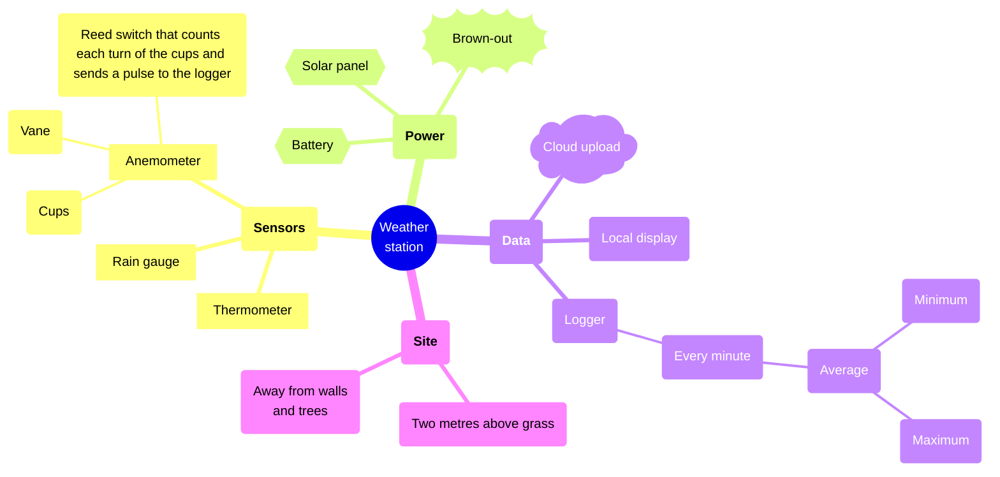

# Weather station

## Icons

- ph wind : #0B7285 : Wind
- ph cloud-arrow-up : #1971C2 : Upload

## Details

### Brown-out

The battery runs low on long cloudy spells. The logger keeps its last hour in memory.

### Logger

- Stores a week of readings
- [Logger manual](<https://example.com/logger>)

## Relations

- n10 --> n11 : charges
- n11 --> n15 : powers
- n5 --> n16 : feeds
