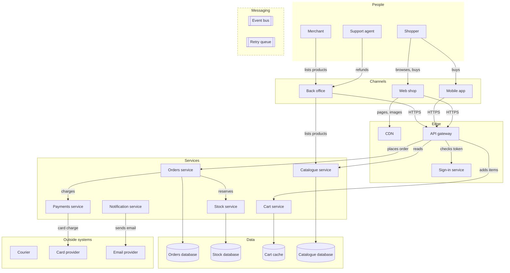
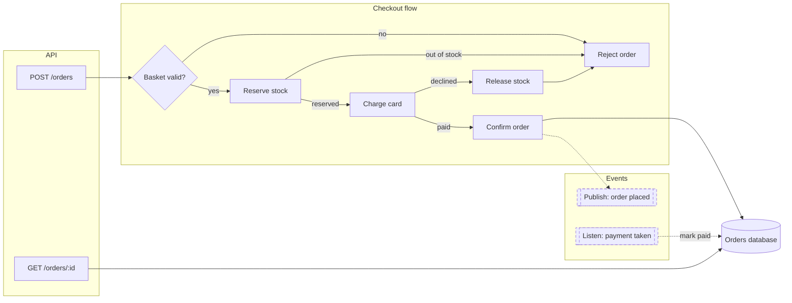
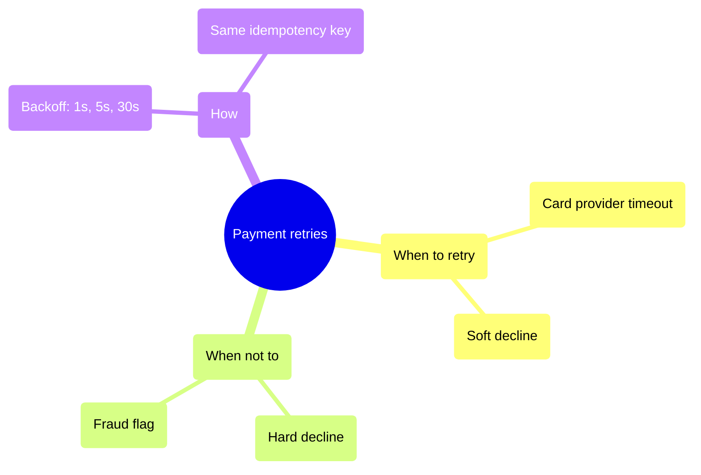
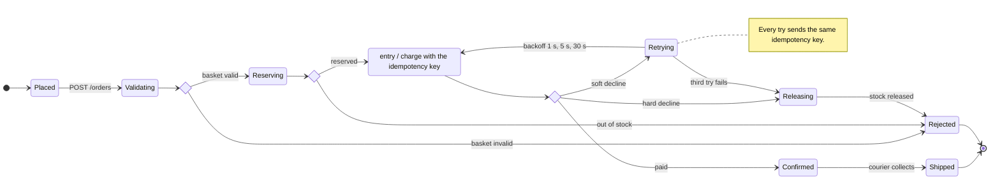
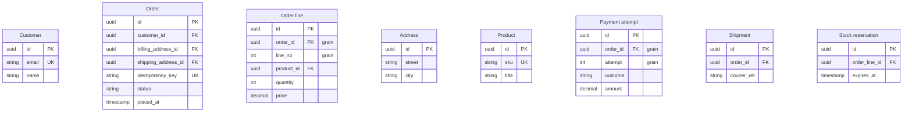
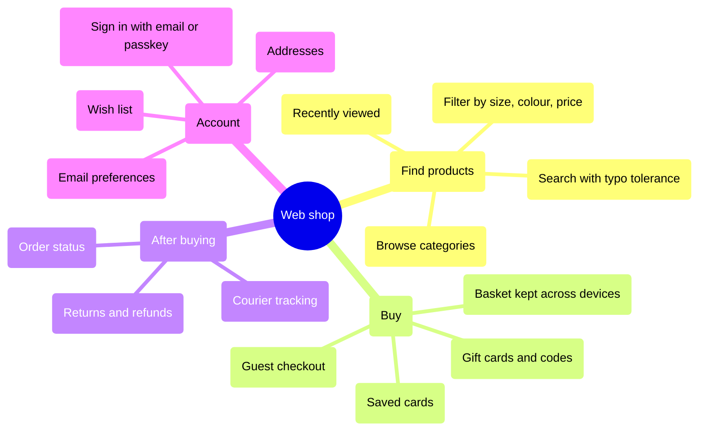
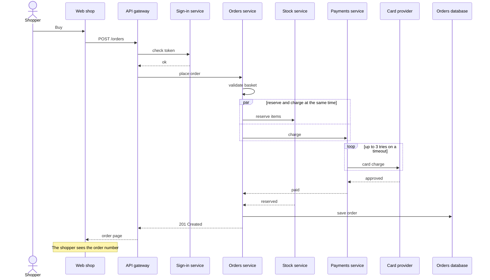

# Shop platform

## Relations: Checkout (synchronous)

- shopper --> web : buys
- web --> gateway : place order
- gateway --> auth : checks token
- gateway --> orders : place order
- orders --> stock : reserve items
- orders --> payments : charge :::money
- payments --> psp : card charge :::money
- orders --> orderdb : save order

## Relations: Events (asynchronous)

- orders -.-> bus : order placed
- payments -.-> bus : payment taken
- bus -.-> orders : payment taken
- bus -.-> stock : order placed
- bus -.-> notify : order placed
- notify -.-> retry : failed sends :::retry
- retry e3@-.-> notify : resend :::retry
- notify --> mail : sends email
- orders -.-> courier : ship order

## Classes

- channel : ph devices : Channel
- edge : ph shield-check : Edge
- money : - : Money moves
- retry : - : Retries
- service : ph gear-six : Service
- queue : ph tray : Messaging

## Details

### Web shop

The shop in a browser: where most orders start. Server-rendered pages with a little
script, so it works on slow phones and with scripts off.

- Pages and images come from the CDN; everything else goes through the API gateway.
- The basket lives in the cart service, so it follows the shopper to the mobile app.
- Checkout is three steps: address, delivery, payment. Guests can check out without
  an account.
- Target: a product page in under a second on a mid-range phone.

What shoppers can do is in [Web shop features](#web-shop-features).

### Orders service

Owns an order from the basket to the courier. It checks the basket, reserves stock,
charges the card and confirms, and tells the rest of the shop through the event bus.

- Team: Checkout
- Runs: three copies behind the API gateway

### Orders charges Payments

A synchronous call: the shopper waits for it.

- Times out after 10 seconds; the order is then rejected and stock released.
- Carries the order's idempotency key, so a retried call never charges twice.

### Retry queue resends

Failed emails come back with a growing wait: 1 minute, 10 minutes, 1 hour. After the
third try the send is dropped and logged.

## Orders service components

## Payment retry ideas

## Order lifecycle

## Details

### Charging

One call to the card provider, with the order's idempotency key, so a retry can never
charge twice. When and how to retry: [Payment retry ideas](#payment-retry-ideas).

## Walks: Soft decline, then paid

- [*] --> Placed : The shopper places the order.
- Placed --> Validating : The Orders service checks the basket.
- Validating --> valid : Every item still exists at this price.
- valid --> Reserving : The Stock service holds the items.
- Reserving --> stocked : All of them are in stock.
- stocked --> Charging : The card provider is asked to charge.
- Charging --> paid : The provider answers.
- paid --> Retrying : A soft decline: the bank asks to try later.
- Retrying --> Charging : One second later, the same key again.
- Charging --> paid : The provider answers again.
- paid --> Confirmed : Paid. The order is confirmed and published.

## Orders data

## Relations

- ORDER.customer_id order-customer@}o--|| CUSTOMER.id : placed by
- ORDER_LINE.order_id line-order@}|--|| ORDER.id : belongs to
- ORDER_LINE.product_id line-product@}o--|| PRODUCT.id : sells
- PAYMENT.order_id payment-order@}o--|| ORDER.id : pays
- SHIPMENT.order_id shipment-order@}o--|| ORDER.id : ships
- RESERVATION.order_line_id reservation-line@|o--|| ORDER_LINE.id : reserves
- ORDER.billing_address_id order-billing@}o--|| ADDRESS.id : billed to
- ORDER.shipping_address_id order-shipping@}o--|| ADDRESS.id : shipped to

## Joins: Paid amount per line

- line-order
- payment-order

## Joins: Fulfilment

- shipment-order
- order-shipping
- order-billing
- PAYMENT.order_id payment-shipment@--- SHIPMENT.order_id : attempts and shipments for the same order

## Details

### Equality is not a declared relationship

Payment attempts and shipments can be joined on order_id, but neither identifies the other. Multiple attempts and shipments can multiply rows. This join exists only in the Fulfilment view; it adds no schema relationship or cardinality.

## Walks: Payment to shipment | Fulfilment

- PAYMENT payment-shipment@--> SHIPMENT : Match order_id; this equality does not imply a foreign key between these tables.

## Walks: Paid amount per line | Paid amount per line

- ORDER_LINE line-order@--> ORDER : Each line joins its order on order_id.
- ORDER payment-order@--> PAYMENT : An order has one payment attempt per try, so a retried order's lines appear once per attempt. Filter to outcome = paid before summing.

## Web shop features

## Checkout

## Plays over

- #shop-platform : Checkout (synchronous)

## Details

### POST /orders

The browser posts the basket id and the chosen address and delivery slot. It carries an
idempotency key made from the basket id, so a double click places one order.

### Check token

The gateway checks the signed token against the sign-in service's keys, cached for five
minutes. Guests get a short-lived guest token.

### Validate basket

Prices and stock levels are read again; a changed price stops checkout and shows the new
total.

### Charge

Synchronous: the shopper waits. Times out after 10 seconds; the order is then rejected
and stock released.
