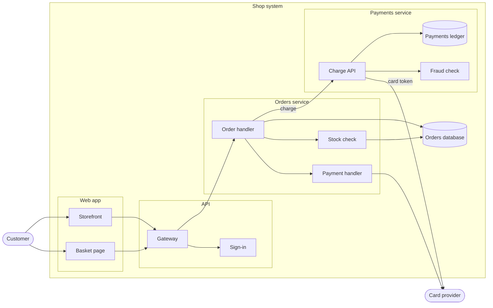

# Shop: payments split plan

## Details

### Payments service

A service of its own for taking payments, so the card data stays out of the orders
service. It keeps its own ledger. Its charge API, fraud check and ledger are new with it.

### Payment handler

Goes away: the orders service asks the payments service to charge instead.

### Order handler

Calls the payments service rather than its own payment handler, and saves only the
payment's id with the order.
