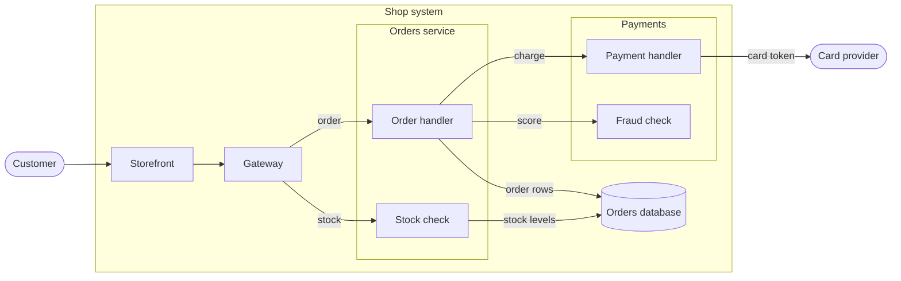

# Why checkout is slow

## Relations: Retries

- payh r1@-.-> psp : retry on timeout

## Node icons

- gw : verified
- ord : inferred
- fraud : hypothesis
- psp : unsourced
- e1 : verified
- e2 : inferred
- e3 : inferred
- e4 : verified
- e5 : hypothesis
- e6 : unsourced
- e7 : verified
- r1 : hypothesis

## Details

### Shop system

An investigation in progress: why checkout takes eight seconds. Each box and arrow
carries a trust mark: verified (read in the code or seen in a trace), inferred
(reasoned from what was read), hypothesis (a guess to test next), unsourced (heard,
not traced to anything).

### Fraud check

Suspect: it calls out to a scoring service on every order. Not yet seen in a trace.

### Order handler scores the order

Hypothesis: the order handler waits for the fraud score before charging. If so, the
two calls run one after the other, not side by side.

### Card token to the provider

Someone said the provider is slow at peak. Nobody has traced it.
