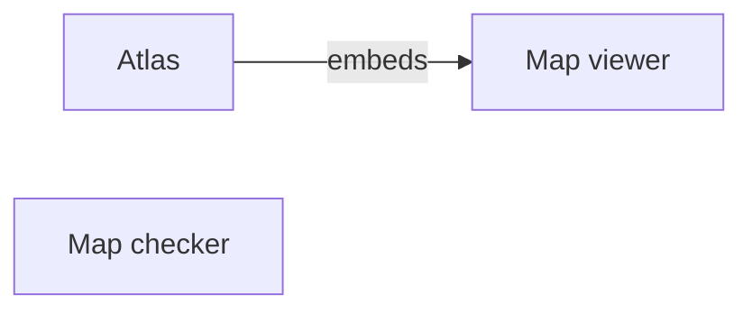

# Reading a captured revision

## Node icons

- atlas : verified
- checker : verified
- embeds : verified

## Details

### Atlas

The atlas hosts the viewer and owns page navigation.

#### Evidence

- Source: [Avagahana](#revision-reviewed)
  - File: atlas/app.js
  - Lines: 1-19
  - Supports: Imports the viewer through its public entry and supplies map sources.

- Source: [Avagahana](#revision-reviewed)
  - File: docs/map-source.md
  - Lines: 1-20
  - Supports: Describes the source interface used by the atlas.

### Map checker

The standalone checker reads the map format before a map is shown.

#### Evidence

- Source: [Avagahana](#revision-reviewed)
  - File: format/check_map.py
  - Lines: 1-29
  - Supports: Defines the checker command and its validation scope.

### Atlas embeds the viewer

#### Evidence

- Source: [Avagahana](#revision-reviewed)
  - File: atlas/app.js
  - Lines: 13-19
  - Supports: Imports mount from the viewer's public entry.

## Sources

### Repository: avagahana

- Name: Avagahana
- URL: https://github.com/nvsravank/avagahana

The source revision behind this small architectural explanation. The links stay at
that revision even as the repository moves forward.

#### Revision: reviewed

- Branch: master
- Commit: 776697f735cb844f1ff795e912c49b6c0d4c57b8
- Reviewed: 2026-11-03
