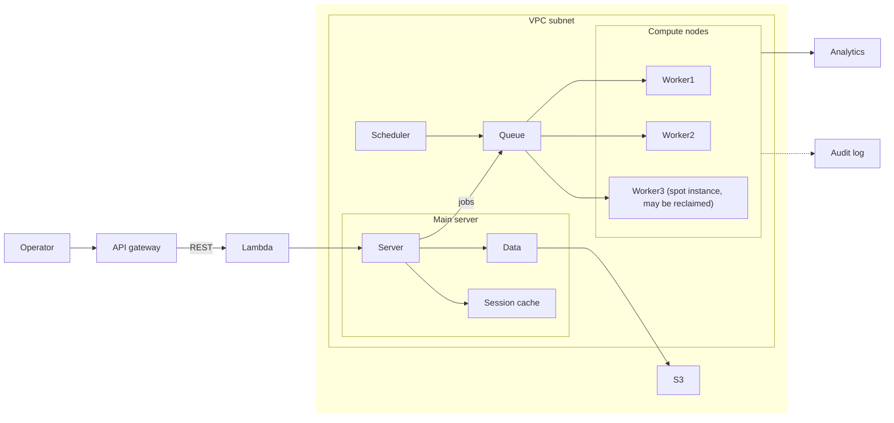
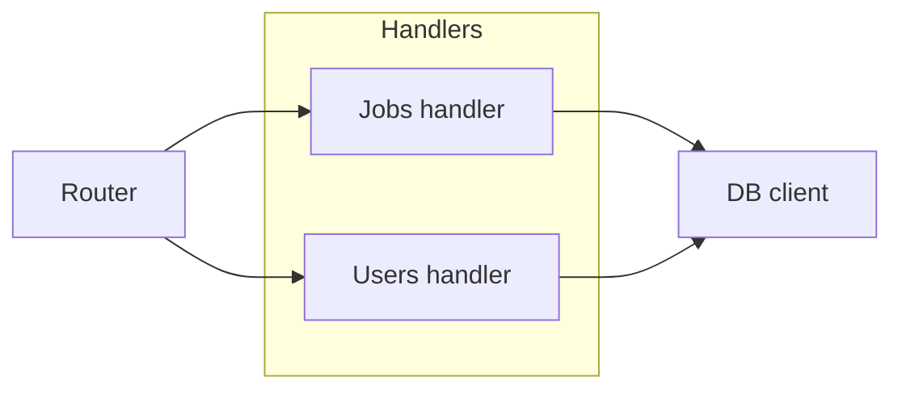
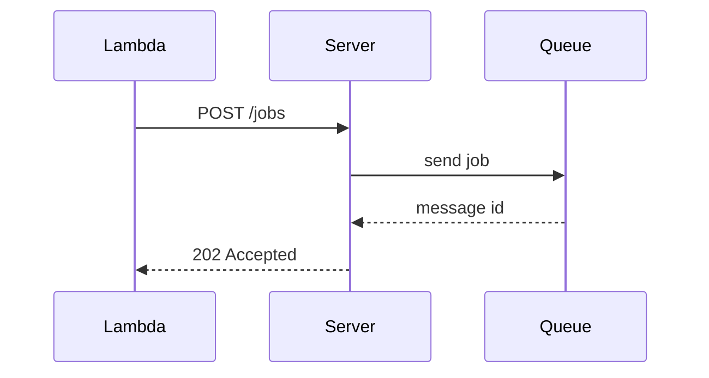
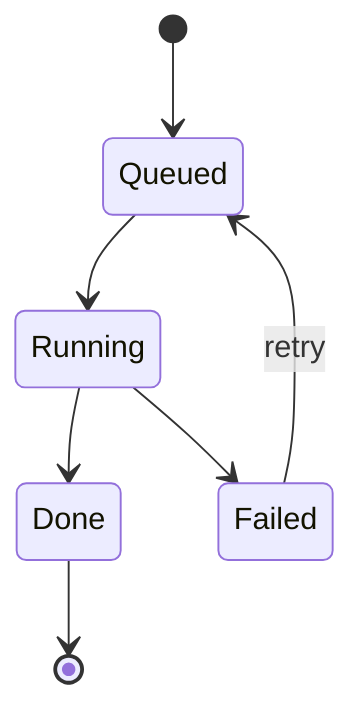

# Worker pipeline

## Look: poster

## Node icons

- api : aws api-gateway
- fn : aws lambda verified
- s3 : aws s3
- vpc : aws private-subnet
- main : main ph lock-key
- server : aws ec2 ph gear-six verified
- data : aws rds aws elasticache
- cache : main ph lightning
- queue : aws sqs hypothesis
- sched : main ph clock
- compute : aws auto-scaling-group ph cpu
- w1 : aws ec2
- w2 : aws ec2 warning
- w3 : aws ec2
- analytics : aws category-analytics ph chart-line
- e1 : ph tray

## Details

### Server

The API server. Takes requests from the Lambda, writes jobs to the queue and keeps
sessions in the cache.

### Data

Postgres on RDS, with a read cache in front. Nightly exports go to S3.

### Queue

SQS standard queue. Not yet checked whether it is FIFO.

### Main server

Everything that runs on the main host.

### Compute nodes

An auto-scaling group of workers; one is a spot instance.

### jobs

One message per job, with the job id and its input's S3 key.

## Server internals

## Node icons

- router : ph signpost
- jobs : ph queue
- db : ph database

## Submit a job

## Job states

