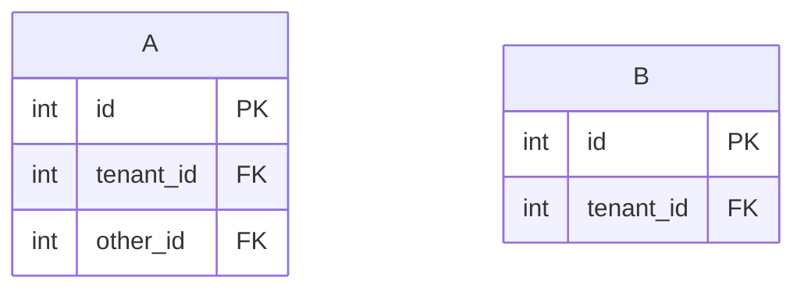

<!-- expect: relation-syntax -->
# Column connections

## Relations
- A.tenant_id tenant@}o--|| B.id : tenant
- A.other_id other@}o--|| B.id : other

## Joins: Composite
- tenant
- A.(tenant_id,other_id) composite@--- B.(tenant_id,id) : equal pairs

## Scenario: Composite scenario | Composite
- A composite@--> B : Match both columns.

## Joins: Extra
- A.id tenant@--- B.id : duplicate
- other
