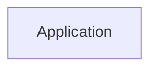

<!-- expect: evidence-syntax -->
# Azure Repos evidence links that do not pin the commit

## Node icons

- app : verified

## Details

### Application

#### Evidence

- Source: [Service](#revision-app-reviewed)
  - File: src/a.py
  - URL: https://tfs.example.test/tfs/Coll/Proj/_git/shop?path=/src/a.py&version=GBmain

- Source: [Service](#revision-app-reviewed)
  - File: src/a.py
  - URL: https://tfs.example.test/tfs/Coll/Proj/_git/shop?path=/src/a.py&version=GT1234567890abcdef1234567890abcdef12345678

- Source: [Service](#revision-app-reviewed)
  - File: src/a.py
  - URL: https://tfs.example.test/tfs/Coll/Proj/_git/shop?path=/src/a.py&version=GC1234567890abcdef1234567890abcdef12345678&version=GBmain

- Source: [Service](#revision-app-reviewed)
  - File: src/a.py
  - URL: https://tfs.example.test/tfs/Coll/Proj/_git/shop?path=/src/a.py&version=GC1234567890abcdef1234567890abcdef12345678&token=abc

- Source: [Service](#revision-app-reviewed)
  - File: src/a.py
  - URL: https://tfs.example.test/tfs/Coll/Proj/_git/shop?path=/src/a.py&version=GCabcdef1234567890abcdef1234567890abcdef12

## Sources

### Repository: app

- URL: https://tfs.example.test/tfs/Coll/Proj/_git/shop

#### Revision: app-reviewed

- Branch: main
- Commit: 1234567890abcdef1234567890abcdef12345678

