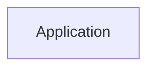

<!-- expect: -->
# Pinned Azure Repos evidence link

## Node icons

- app : verified

## Details

### Application

#### Evidence

- Source: [Service](#revision-app-reviewed)
  - File: src/a.py
  - Lines: 4-12
  - URL: https://tfs.example.test/tfs/Coll/Proj/_git/shop?path=/src/a.py&version=GC1234567890abcdef1234567890abcdef12345678&line=4&lineEnd=12&lineStyle=plain&_a=contents

## Sources

### Repository: app

- URL: https://tfs.example.test/tfs/Coll/Proj/_git/shop

#### Revision: app-reviewed

- Branch: main
- Commit: 1234567890abcdef1234567890abcdef12345678

