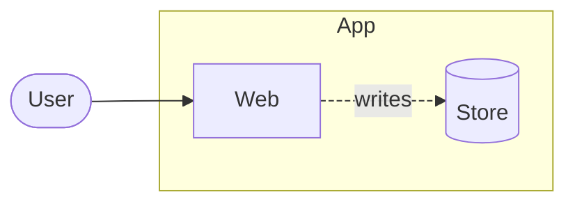
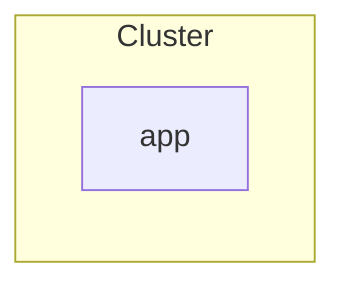

# Sample

## Details

### e1

#### Evidence

Illustrative trust assignment in this fictional example; no external source
revision is captured for this claim.

### r1

#### Evidence

Illustrative trust assignment in this fictional example; no external source
revision is captured for this claim.

### a

#### Evidence

Illustrative trust assignment in this fictional example; no external source
revision is captured for this claim.

## Perspective: Reads

- b r1@--> a : rows

## Node icons

- a : verified
- e1 : inferred
- r1 : unsourced

## Classes

- money : - : Payments

## Deployment: Prod, Test

