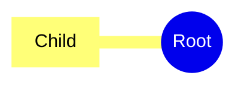

# Namespaced icons

## Details

### root

#### Evidence

Illustrative trust assignment in this fictional example; no external source
revision is captured for this claim.

## Classes
- store : ph hard-drives verified : Storage

## Icons
- ph database : #174ea6 : Database
- thinking = ph brain : #a23c8a : Thinking

## Node icons
- child : thinking ph lightning
