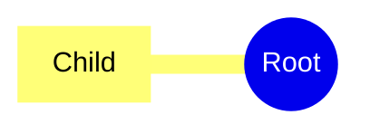

# Namespaced icons

## Classes
- store : ph hard-drives verified : Storage

## Icons
- ph database : #174ea6 : Database
- thinking = ph brain : #a23c8a : Thinking

## Node icons
- child : thinking ph lightning
