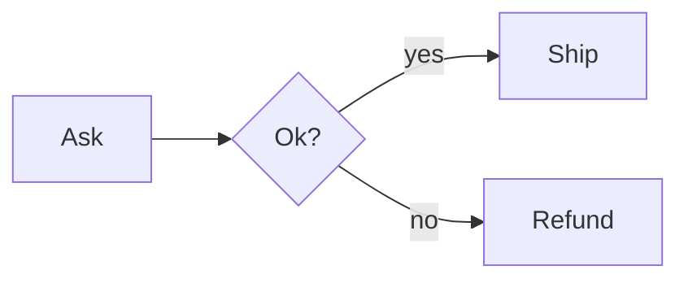

# Sample

## Lanes

### Rows
- buyer : Buyer
- shop : Shop
- money : Finance

### Columns
- before : Before
- after : After

### Parent rows
- company : Company : shop, money

### Placement
- a : buyer : before
- b : shop
- c : shop : after
- d : money : after
