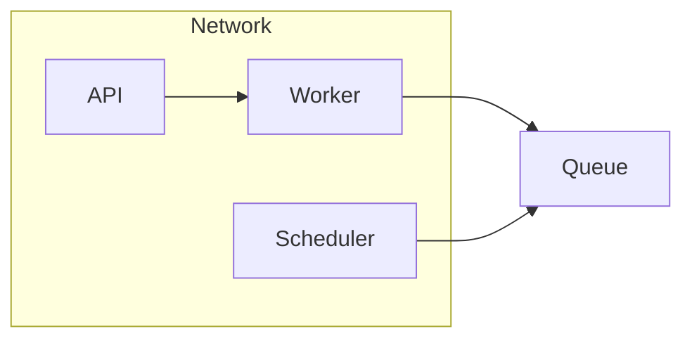

# Main icons

## Look: poster

## Classes

- queue : main ph tray : Message queue

## Node icons

- net : aws virtual-private-cloud-vpc
- api : aws api-gateway ph gear-six verified
- fn : aws lambda aws s3
- sched : main ph clock hypothesis
