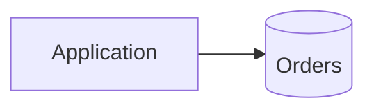

<!-- expect: -->
# Note Markdown



## Details

### <a id="app"></a>Application

A paragraph with **bold**, *italics*, ~~struck~~, `code`, a
`https://example.test/literal` URL in code and a [bracketed [draft] link](https://example.test/doc).

#### A level four heading

Steps to follow:

1. First step
2. Second step, which continues
   on the next line
   - a nested bullet
     1. nested number
   - [x] a finished task
   - [ ] an open task
3. Third step

##### A level five heading

> A quote with **bold** text.
>
> > And a nested quote.

---

###### A level six heading

| Name | Kind | Rows |
|:-----|:----:|-----:|
| orders | table with quite a long description to show how a wide cell scrolls inside its box | 1200 |
| `a\|b` | view | 3 |

```sql
SELECT 1 -- ### stays literal here
```
