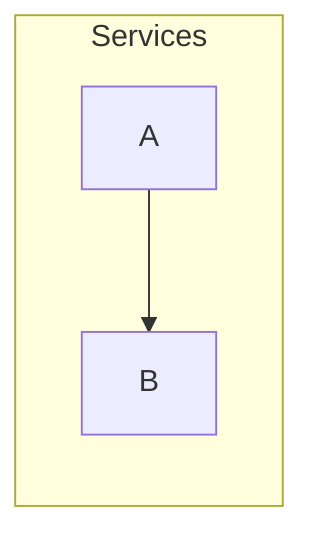

<!-- expect: -->
# Example

## Details

### A

A note.

## Perspective: Calls

- a --> b : calls

#### Perspective options

- Open: services

## Walkthrough: Read

An introduction.

### Perspective: Calls

A story.

#### Stop options

- Title: Follow a call
- Label: Calls
- Notes: a
