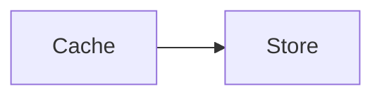

# Reasoned design

## Node icons

- cache : inferred
- tentative : hypothesis

## Details

### Cache

#### Evidence

Inferred from the documented request path; the cache implementation has not been inspected.

### Tentative lookup

#### Evidence

A proposed lookup to test in a trace. This example does not claim observed behaviour.
