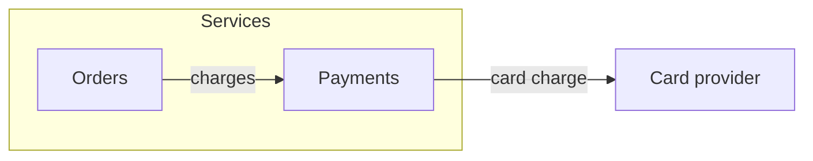

<!-- expect: -->
# Shop

## Perspective: Card data

- pay e2@--> card : card charge

## Walkthrough: Card data

What the shop is, and the walk for a security reviewer.

### Diagram: Shop

Orders asks Payments to charge; only Payments talks to the card provider.

#### Stop options

- Spotlight: pay, e1

### Perspective: Card data

The one line that carries card data out.

#### Stop options

- Spotlight: e2
