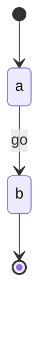

<!-- expect: -->
# Sample

## Scenario: Going round
- [*] --> a
- a --> b : go

## Walkthrough: Security

### Diagram: Sample

The state at its top. Watch where it goes.

### Scenario: Going round

Only the one way round.
