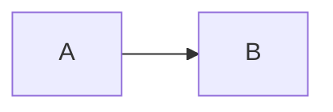

<!-- expect: main-icon-mark -->
# Sample

## Details

### a

#### Evidence

Illustrative trust assignment in this fictional example; no external source
revision is captured for this claim.

## Node icons

- a : main verified
