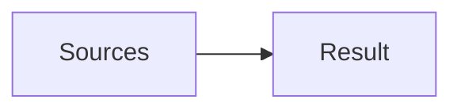
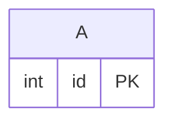

<!-- expect: query-syntax -->
# Unknown SQL scope



## Query: Missing alias

#### Query options
- Schema: #tables
- Into: result
- Sources: sources

```sql
SELECT missing.id FROM A a
```

## Tables


