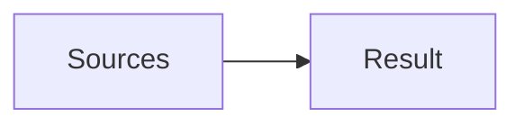
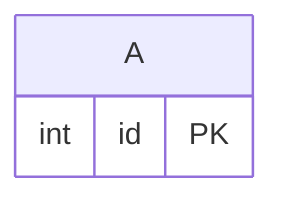

<!-- expect: query-unsupported -->
# Reader limit



## Query: Family tree

#### Query options
- Schema: #tables
- Into: result
- Sources: sources

```sql
WITH RECURSIVE tree AS (SELECT a.id FROM A a) SELECT t.id FROM tree t
```

## Tables


