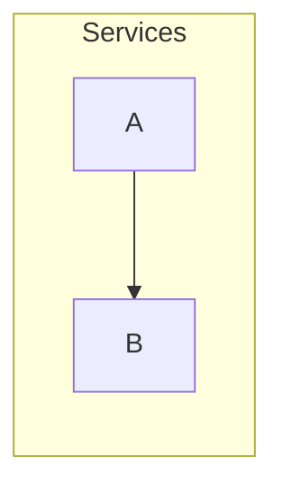

<!-- expect: walkthrough-options -->
# Example

## Details

### A

A note.

## Perspective: Calls

- a --> b : calls

## Walkthrough: Read

What the sample is, and who the walk is for.

### Perspective: Calls

A story.

#### Stop options

- Expand: 2
