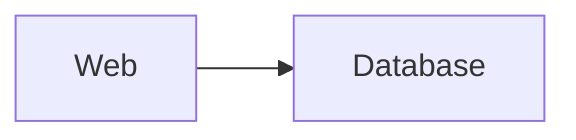
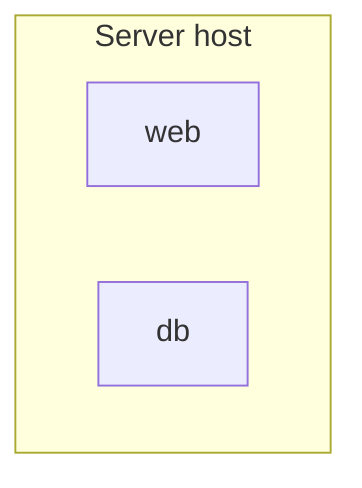
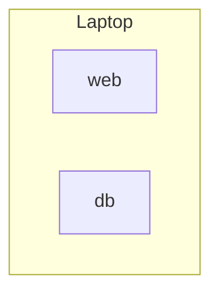

<!-- expect: walkthrough-reference -->
# Example

## Deployment: Production

## Deployment: Development

## Details

### Server host

Where production runs.

### Laptop

Where a developer runs it.

## Walkthrough: Where it runs

What the sample is: two environments of one small app. For a new joiner.

### Deployment: Production

One host runs both.

#### Stop options

- Notes: laptop
