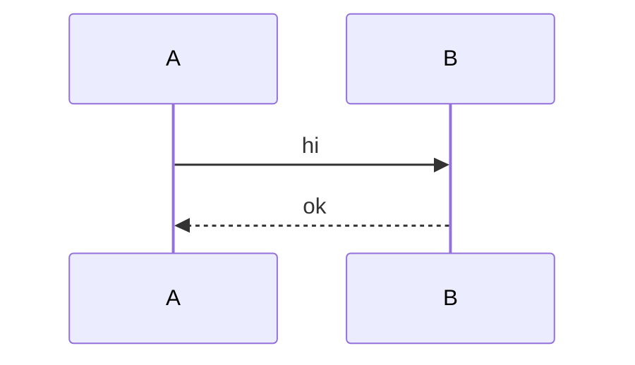

<!-- expect: walkthrough-options -->
# Talk

## Walkthrough: Read

What the sample is, and who the walk is for.

### Sequence: Talk

A sequence stop has no spotlight.

#### Stop options

- Spotlight: A
