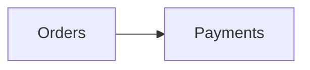

<!-- expect: walkthrough-reference -->
# Shop

## Walkthrough: Read

What the sample is, and who the walk is for.

### Diagram: Shop

A Spotlight names a node the diagram does not have.

#### Stop options

- Spotlight: orders, billing
