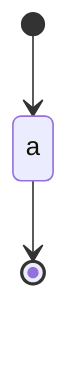

<!-- expect: walkthrough-twice -->
# Sample

## Walkthrough: Same

What the sample is, and who the walk is for.

### Diagram: Sample

One stop.

## Walkthrough: Same

What the sample is, and who the walk is for.

### Diagram: Sample

Another stop.
