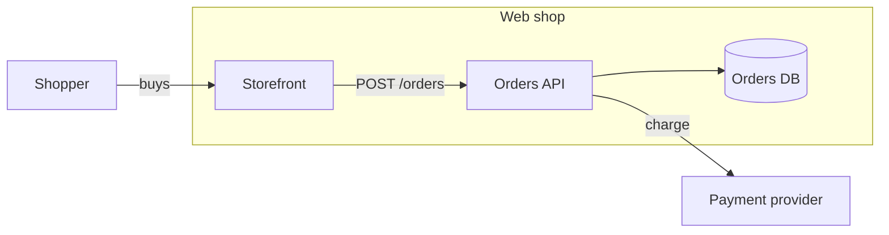

# Avagahana maps

A map is one Markdown file: a marker line, a title, a Mermaid block, and optional
sections (notes, icons, perspectives, further diagrams). The user reads it in a viewer
that redraws as the file changes. A map is how you help the user understand you: whenever you
explain something they need to understand (how something works, what you found, what
you plan or changed, the options and their trade-offs), or the explanation would take
more than about 10 lines of text, make a map as well as answering in text, unless they
ask for text only. The text answers; the map shows it.

## Locate the plugin and maps

- The plugin root is two directories above this `SKILL.md` (`skills/illuminate-concept/SKILL.md`).
  Resolve it from the absolute skill file path supplied by the agent, not from the
  current working directory. Use that installed root for every bundled command.
- Maps folder: use `AVAGAHANA_MAP_DIR` from the command environment when set; otherwise
  read the single absolute path in `~/.config/avagahana/maps-dir` as plain text, not
  shell code. If neither is configured, ask the user for an existing maps folder and
  save its absolute path in that file for future sessions. Expand `~` if supplied.
  Confirm the folder exists; do not create or move the user's maps folder.
- Put each map in `<maps folder>/<Topic>/<Name>.md`. `<Topic>` is the system, project
  or subject area the map belongs to (`Shop`, `OAuth`); reuse an existing one when it
  fits. Paths passed to the relay are relative to the maps folder, with forward slashes.
  Read existing maps before editing.
- In commands below, replace `<plugin root>` and `<maps folder>` with the resolved
  absolute paths. They are notation, not environment variables or client substitutions.
  Quote each path as a single argument. Commands need Python 3.9 or later (`python3`), tested on 3.9 and 3.15.
  Use the installed interpreter directly; no virtual environment or pip packages.

## The loop, every time you write a map

1. **Read the reference** for each kind you will draw, before writing anything: the table
   below names it (`references/<file>.md`, beside this file). The rules for each kind are
   there, not here; a map written without them misses parts the reader needs.
2. **Write** the file, with each kind's must-haves from the table. Its first line is the
   marker `<!-- Avagahana map: change it with the illuminate-concept skill -->`, then the
   `# Title`. When you change a map that has no marker, add it.
3. **Verify the text**: `python3 "<plugin root>/format/check_map.py" "<maps folder>/<Topic>/<Name>.md"`.
   It prints `OK` or one line per problem and exits 1 on any. It is strict: fix every
   problem and run it again. Warnings pass, but read them (an unknown id is usually a
   renamed node).
4. **Show** it: `python3 "<plugin root>/relay-server/serve_maps.py" --maps-dir "<maps folder>" --map "<Topic>/<Name>.md"`.
   It starts the server, or reuses a running one, and prints one line:
   `STATUS=started|reused URL=<link>`. Give the user the link (and open it with `open`
   on macOS, `xdg-open` on Linux, `start` on Windows). An open page redraws by itself
   when the file changes. `ERROR=...`: tell the user what it says (for example the maps
   folder does not exist; check `AVAGAHANA_MAP_DIR` or `~/.config/avagahana/maps-dir`).
5. **Verify the picture**, when an atlas page is open (step 4 opened it): run
   `render.py ... --report` (`references/render.md`, "Check it") for each diagram and each
   perspective, and fix what it reports: cut labels, overlaps, avoidable crossings, touching
   lines, text too small. Then read the map for what a report cannot measure: a diagram that
   shows nothing another does not (fold it into a note), or one that answers a different
   question than the user asked. `STATUS=none` with no way to open the page (no desktop, or
   the user said no browser): skip the report and say so.

You write the map; the viewer draws it. Never drive a browser (browser tools, clicks,
screenshots) to draw, export or check a map, and make no picture, snapshot or reading page
the user did not ask for. Take a screenshot only when the user says something looks wrong.

After an edit, go straight back to step 3; the open page redraws.

## Commands

Every command the plugin has, in one place. Each prints one `STATUS=...` line (the checker: `OK` or
one line per problem; `themes.py`: JSON); the reference named says the options.

| To | Run | Needs |
|---|---|---|
| Check the text | `python3 "<plugin root>/format/check_map.py" "<maps folder>/<Topic>/<Name>.md"` | nothing |
| Show the map to the user | `python3 "<plugin root>/relay-server/serve_maps.py" --maps-dir "<maps folder>" --map "<Topic>/<Name>.md"` | nothing; prints the link to open |
| Move open pages to a place | `python3 "<plugin root>/relay-server/show.py" "<Topic>/<Name>.md" --maps-dir "<maps folder>" ...` (below) | an open page |
| Check the layout | `python3 "<plugin root>/relay-server/render.py" "<Topic>/<Name>.md" --maps-dir "<maps folder>" --out "<file>.svg" --report` (`references/render.md`) | an open page |
| A picture (SVG, PNG) | `render.py`, as above, without `--report` (`references/render.md`) | an open page |
| One file to send (a snapshot) | `python3 "<plugin root>/relay-server/pack.py" "<Topic>/<Name>.md" --maps-dir "<maps folder>" --out "<file>.html"` (`references/render.md`, "Sending a map") | nothing |
| List themes | `python3 "<plugin root>/relay-server/themes.py" list --maps-dir "<maps folder>"` (`references/themes.md`) | nothing |

A walkthrough's reading page has no command: the reader makes it with the walkthrough
panel's Export walkthrough button. To send a walk, send a snapshot; it holds the walk.

## Evidence

Evidence is a cornerstone of Avagahana maps: required in many cases and recommended in
most. It backs a claim about something that exists: a code citation (repository, commit,
file, lines) for anything read in a codebase, or another citation (a specification, a
document, a log, a test run) for anything else. It goes **in the map**: each backed box or
arrow gets a **confidence mark** (`verified`, `inferred`, `hypothesis`, `unsourced`) in
`## Node icons` (`- e1 : verified`; `::icon(...)` in a mind map) and a `#### Evidence`
section in its note. The checker rejects either without the other. A source named only in
your reply is lost to the reader of the map. How to record them: `references/evidence.md`.

- **Required**: every map made with trace-architecture; every map of something real that
  you read, such as the user's code, schema or configuration, or a specification you
  opened: cite what you read; and every change mark on something that exists: a pull
  request's marks cite its commits, a proposal's `changed` and `removed` parts cite the
  current code. Mark a claim with nothing to cite `unsourced` or `hypothesis`, and say why
  in its evidence.
- **Not evidence**: a plan, ticket or design document says what is intended, not what
  exists. A proposal's `added` parts link it in their note, with no confidence mark.
- **None**: the user's own thinking, such as a brainstorm or a set of options; a general
  explanation from what you already know, with nothing read (never cite a source you did
  not open). SQL the user pasted is its own source.

## Pick the diagram

Pick the row by what the reader must see, not by the words of the request. The examples
are a guide; most subjects need more than one row.

| Examples of what the user needs to see | Draw | Must have | MUST read first |
|---|---|---|---|
| Options for X; a breakdown of a topic; my thoughts on X | `mindmap` | one centre; main branches in bold; detail in notes, not in labels | `references/mind-maps.md` |
| The parts of our system and what calls what; a picture of our services for a slide | `flowchart` | parts inside `subgraph` boxes; a short verb on each arrow; a class for each role (`person`, `external`, `database`) | `references/boxes.md` |
| Where each service runs in staging and in production; how production is set up compared with staging; what runs on which cluster, VM or cloud service | `## Deployment: <env>` after a flowchart | one box diagram for every environment, never a diagram per environment; one section per environment, naming the diagram's ids bare; infrastructure as boxes around them | `references/boxes.md`, "Deployments" |
| How login works end to end; what happens when a payment fails; how a job retries when the queue is down; how OAuth works | `sequenceDiagram`, played over the box diagram it crosses | participants named by the box diagram's ids; `alt`, `loop`, `par` for branches, retries and parallel steps; `## Plays over` | `references/sequences.md` |
| Who does what in a process with hand-offs between people, teams or systems; an approval or order process where both the decisions and who owns each step matter | `flowchart` + `## Lanes` (swim lanes) | a step in every lane (`### Placement`); rows for who, columns for stage when both matter; no subgraphs | `references/lanes.md` |
| The states a support ticket goes through; an order's lifecycle | `stateDiagram-v2` | `[*]` start and ends; a label on each transition; `<<choice>>` for decisions | `references/state-and-er.md` |
| Explain the tables in our schema and how they relate; Explain the data warehouse schema | `erDiagram` | every table with its columns and keys (`PK`, `FK`); a class per table; one `## Relations` line per relationship, column to column | `references/state-and-er.md` |
| Help me understand this SQL query; How can I answer questions from the database? | `flowchart` + `## Query:` + shared ER definitions | the SQL unchanged in a `sql` block; `#### Query options` with Schema, Into and Sources | `references/sql-queries.md` |
| What this pull request or branch changes; the proposal to split payments out; how you would build or change something | the affected parts only, with change marks | `class … added`, `changed`, `removed` on each affected node and arrow | `references/changes.md` |
| What changed since vX.Y; this version of the map against the last | the map, compared with its earlier file | the same ids in both versions | `references/compare.md` |
| A guided reading for the security team; a tour for a new joiner | `## Walkthrough: <name>` | each stop a `### Perspective:`, `### Diagram:`, `### Sequence:`, `### Scenario:` or `### Deployment:` heading naming an item of the map, with what to notice | `references/walkthroughs.md` |

Read the reference before writing that kind; the full format is
`../../docs/map-format.md` (read it for anything the references do not cover). Use
Mermaid's own syntax: a map is valid Mermaid, so GitHub draws it too.
For a whole codebase, or what a release changes across it, use the trace-architecture
skill. SQL the reader does not explain yet is a warning, not an error: keep the SQL and
explain it in a note.

## How many diagrams, and which

- Scale the diagrams to the scope. Each one must show something the reader cannot get
  from a sentence or from another diagram of the map; when it does not, say it in a
  note on the diagram it belongs to. A small subject is one diagram, a large one
  several, and the count follows what there is to show, not a set list.
- Pick the kind for the question it answers (the table above), and use the kinds the
  subject has: a system usually has structure, a few flows worth playing step by step,
  things with a lifecycle and stored data. Several box diagrams in a row usually mean a
  sequence, state or data diagram was the better picture for one of them.
- A sequence is worth drawing when the order, the hand-offs or the parallel and
  conditional paths are the point: the path a real request takes across several
  parts, with its returns, retries and failures. Pick the flows that matter (the main
  path, the one that fails in interesting ways), not every call.
- A data model is worth drawing when schema relationships, cardinalities or grain
  need seeing. To explain a query, use the SQL query map, not the data model.
- A **perspective** is a filtered view: a `## Perspective: <name>` section listing some
  of a diagram's arrows. Use one when the diagram has more arrows than one point needs,
  or to show one concern such as events (`references/boxes.md`, "Perspectives").
- Several diagrams of one subject go in **one file**, linked from the first (see
  `references/boxes.md`, "Several diagrams in one file"), unless the user asks for
  separate files.

## Icons: sparingly

Labels, shapes and classes carry most meaning; icons are for the few nodes where a
picture tells the reader something faster than the label (a person, a database, a
queue, an outside system, a confidence mark). Most nodes have none. Never give every node
an icon, never decorate a label that already says the same thing, and never use icons
to tell siblings apart. Shapes (`[("…")]`, `[["…"]]`) and the built-in classes
(`person`, `external`, `database`) come first.

## A small map

````markdown
# Checkout



## Details

### <a id="api"></a>Orders API

Checks the basket and takes payment. Retries a declined card twice.

### <a id="e1"></a>Orders API charges the payment provider

Card charge with an idempotency key, so a retry never charges twice.
````

- Every node has an id (a letter, then letters, digits, `_`, `-`); labels in quotes.
- Notes go under `## Details`, one `### <a id="<id>"></a><label>` per node or arrow id.
  Put what the picture cannot say in a note; never list the arrows again. Note bodies read
  bold, italics, `~~strikethrough~~`, code, links, nested and numbered lists, `- [ ]` tasks,
  `>` quotes, `---` rules, pipe tables and code fences. Headings inside a note are `####` to
  `######` only: `###` starts the next note. No HTML or images.
- No item limits: a big system is fine, but split it into perspectives and diagrams so
  each picture stays readable.

## Walkthroughs: a story for one audience

When a reader needs a path through the map (a security review, a new joiner), add a
`## Walkthrough: <name>` section to the file (the end of the file is fine). Each stop is a
`### <Kind>: <name>` heading, in the order written: `Diagram`, `Perspective`, `Deployment`,
`Scenario` or `Sequence`, then the item's name as its heading gives it. The Markdown
under the stop says what to notice there. Every stop on a box or ER diagram is its own
perspective, made for that stop, except an opening stop that shows the whole picture.
The reader moves through the stops with Previous and Next; nothing plays by itself. Only
items of this map can be stops, and the checker names any it cannot find. How to pick and
order stops and write the notes: `references/walkthroughs.md`.

## Move the reader's page

`python3 "<plugin root>/relay-server/show.py" "<Topic>/<Name>.md" --maps-dir "<maps folder>" [options]`
moves every open page to that place while you explain it:

- `--node <id>` point at a node; `--focus <id>` drill into a box first; `--page <id>`
  open the node's page (its note, arrows, perspectives and linked diagrams).
- `--part <heading anchor>` one of the file's further diagrams (`## Orders service` is
  `orders-service`); `--view <name>` a perspective; `--env <name>` a deployment;
  `--mode mindmap|org|list|boxes|layers|lifelines`.
- `--seq <anchor> --step N` play a sequence or a scenario at step N (see the references);
  `--colour-by changes` open a map with change marks in its Changes colouring.
- `--before <file>` compare with an earlier version of the map (`references/compare.md`).

It prints `STATUS=shown` (done), `STATUS=none URL=...` (no page is open: give the user
the link and open it), `STATUS=not_running` (run step 4 first) or `STATUS=failed
ERROR=...` (a bad map path, node id or option).

The viewer remembers what each reader has seen and marks what changed since: never add
notes or classes to say "this is new".

A picture for a document, slide or PDF (SVG or PNG), or one file to send a person who
should explore the map (a snapshot): read `references/render.md`.
The user asks for a theme, brand or house style, or a new theme: read `references/themes.md`.
Only when the user wants substantially more custom styling than the theme settings
provide, read `../../docs/theme-styling.md` for targeted CSS hooks; do not read it automatically.
