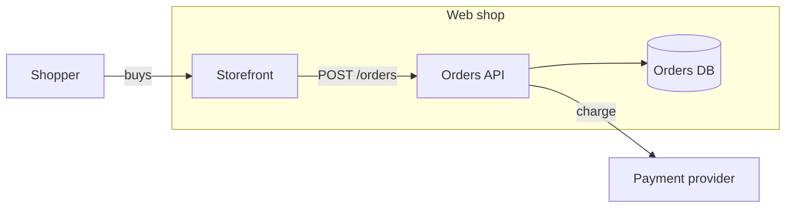

# Avagahana maps

A map is one Markdown file: a title, a Mermaid block, and optional sections (notes,
icons, relation views, further diagrams). The user reads it in a viewer that redraws
as the file changes. Text in, a picture out: prefer a map to a long explanation of how
things connect.

## Locate the plugin and maps

- The plugin root is two directories above this `SKILL.md` (`skills/illuminate-concept/SKILL.md`).
  Resolve it from the absolute skill file path supplied by the agent, not from the
  current working directory. Use that installed root for every bundled command.
- Maps folder: use `AVAGAHANA_MAP_DIR` from the command environment when set; otherwise
  read the single absolute path in `~/.config/avagahana/maps-dir` as plain text, not
  shell code. If neither is configured, ask the user for an existing maps folder and
  save its absolute path in that file for future sessions. Expand `~` if supplied.
  Confirm the folder exists; do not create or move the user's maps folder.
- Put each map in `<maps folder>/<Topic>/<Name>.md`. Paths passed to the relay are
  relative to the maps folder, with forward slashes. Read existing maps before editing.
- In commands below, replace `<plugin root>` and `<maps folder>` with the resolved
  absolute paths. They are notation, not environment variables or client substitutions.
  Quote each path as a single argument. Commands need Python 3.9 or later (`python3`).

## The loop, every time you write a map

1. **Write** the file (rules below; the detail for each kind is in `references/`).
2. **Check** it: `python3 "<plugin root>/format/check_map.py" "<maps folder>/<Topic>/<Name>.md"`.
   It prints `OK` or one line per problem and exits 1 on any. It is strict: fix every
   problem and run it again. Warnings pass, but read them (an unknown id is usually a
   renamed node).
3. **Show** it: `python3 "<plugin root>/relay-server/serve_maps.py" --maps-dir "<maps folder>" --map "<Topic>/<Name>.md"`.
   It starts the server, or reuses a running one, and prints one line:
   `STATUS=started|reused URL=<link>`. Give the user the link (and open it with `open`
   on macOS, `xdg-open` on Linux, `start` on Windows). An open page redraws by itself
   when the file changes, so after an edit go straight to step 4. `ERROR=...`: tell the
   user what it says (for example the maps folder does not exist; check `AVAGAHANA_MAP_DIR` or
   `~/.config/avagahana/maps-dir`).
4. **Point** at what you are talking about (below), then, if you have a browser tool,
   take a screenshot of the page and look at it: crossing arrows, cramped labels or a
   picture too dense to read mean the map needs another view or fewer labels.

## Pick the diagram

| The user needs to see | Write | Reference |
|---|---|---|
| A tree of ideas, a breakdown, options | `mindmap` | `references/mind-maps.md` |
| A system: parts inside parts, and what calls what | `flowchart` | `references/boxes.md` |
| Where it runs, per environment | `## Deployment: <env>` after a flowchart | `references/boxes.md` |
| How a request moves through it, step by step | `sequenceDiagram` | `references/sequences.md` |
| How one thing changes over its life | `stateDiagram-v2` | `references/state-and-er.md` |
| A data model, tables and joins | `erDiagram` | `references/state-and-er.md` |
| A plan: what will be added, changed, removed | classes `added` `changed` `removed` | `references/changes.md` |
| Two versions of a map compared (a release review: what is new, removed, moved, changed) | the same map, plus its earlier file | `references/compare.md` |
| A path through the map for one audience (a security review, a new joiner) | `## Walkthrough: <name>` with `### <Kind>: <name>` stops | `references/walkthroughs.md` |

Read the reference before writing that kind; the full format is
`../../docs/map-format.md` (read it for anything the references do not cover). Use
Mermaid's own syntax: a map is valid Mermaid, so GitHub draws it too.

## How many diagrams, and which

- Scale the diagrams to the scope. Each one must show something the reader cannot get
  from a sentence or from another diagram of the map; when it does not, say it in a
  note on the diagram it belongs to. A small subject is one diagram, a large one
  several, and the count follows what there is to show, not a set list.
- Pick the kind for the question it answers (the table above), and use the kinds the
  subject has: a system usually has structure, a few flows worth playing step by step,
  things with a lifecycle and stored data. Several box diagrams in a row usually mean a
  sequence, state or data diagram was the better picture for one of them.
- A sequence is worth drawing when the order, the hand-offs or the parallel and
  conditional paths are the point: the path a real request takes across several
  parts, with its returns, retries and failures. Pick the flows that matter (the main
  path, the one that fails in interesting ways), not every call.
- A data model is worth drawing when the joins, cardinalities or grain need seeing.
- Several diagrams of one subject go in **one file**, linked from the first (see
  `references/boxes.md`, "Several diagrams in one file"), unless the user asks for
  separate files.

## Icons: sparingly

Labels, shapes and classes carry most meaning; icons are for the few nodes where a
picture tells the reader something faster than the label (a person, a database, a
queue, an outside system, a trust mark). Most nodes have none. Never give every node
an icon, never decorate a label that already says the same thing, and never use icons
to tell siblings apart. Shapes (`[("…")]`, `[["…"]]`) and the built-in classes
(`person`, `external`, `database`) come first.

## A small map

````markdown
# Checkout



## Details

### <a id="api"></a>Orders API

Checks the basket and takes payment. Retries a declined card twice.

### <a id="e1"></a>Orders API charges the payment provider

Card charge with an idempotency key, so a retry never charges twice.
````

- Every node has an id (a letter, then letters, digits, `_`, `-`); labels in quotes.
- Notes go under `## Details`, one `### <a id="<id>"></a><label>` per node or arrow id.
  Put what the picture cannot say in a note; never list the arrows again.
- Mark how sure you are with the trust icons `verified`, `inferred`, `hypothesis`,
  `unsourced` (`## Node icons` for boxes and arrow ids: `- e1 : verified`; `::icon(...)`
  in a mind map), and put the evidence in the note.
- No item limits: a big system is fine, but split it into views and diagrams so each
  picture stays readable.

## Walkthroughs: a story for one audience

When a reader needs a path through the map (a security review, a new joiner), add a
`## Walkthrough: <name>` section to the file (the end of the file is fine). Each stop is a
`### <Kind>: <name>` heading, in the order written: `Diagram`, `Perspective`, `Deployment`,
`Scenario`, `Join` or `Sequence`, then the item's name as its heading gives it. The Markdown
under the stop says what to notice there. The reader moves through the stops with Previous and
Next; nothing plays by itself. Only items of this map can be stops, and the checker names any
it cannot find. When to write one, how to pick and order stops and how to write the notes:
`references/walkthroughs.md`.

## Point the reader

`python3 "<plugin root>/relay-server/show.py" "<Topic>/<Name>.md" --maps-dir "<maps folder>" [options]`
moves every open page to that place while you explain it:

- `--node <id>` point at a node; `--focus <id>` drill into a box first; `--page <id>`
  open the node's page (its note, arrows, views and linked diagrams).
- `--part <heading anchor>` one of the file's further diagrams (`## Orders service` is
  `orders-service`); `--view <name>` a relation view; `--env <name>` a deployment;
  `--mode mindmap|org|list|boxes|layers|lifelines`.
- `--seq <anchor> --step N` play a sequence or a scenario at step N (see the references);
  `--colour-by changes` open a plan in its Changes colouring.
- `--before <file>` compare with an earlier version of the map (`references/compare.md`).

It prints `STATUS=shown` (done), `STATUS=none URL=...` (no page is open: give the user
the link and open it), `STATUS=not_running` (run step 3 first) or `STATUS=failed
ERROR=...` (a bad map path, node id or option).

The viewer remembers what each reader has seen and marks what changed since: never add
notes or classes to say "this is new".

A picture for a document, slide or PDF (SVG or PNG), or one file to send a person who
should explore the map (a snapshot): read `references/render.md`.
The user asks for a theme, brand or house style, or a new theme: read `references/themes.md`.
