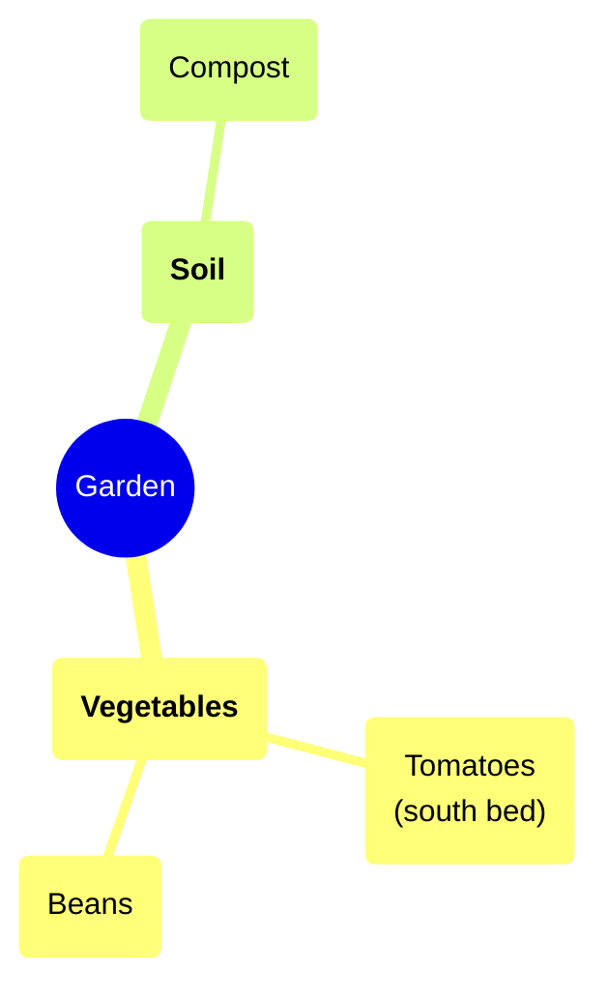

# Mind maps (`mindmap`)

A tree of ideas: a breakdown, options, a topic's parts. Modes: mind map, org chart,
list. Full rules: `../../../docs/map-format.md`, "The diagram", "Icons", "`## Relations`".

````markdown
# Garden plan



## Details

### <a id="n3"></a>Tomatoes

Need six hours of sun.

## Relations

- n6 --> n3 : feeds
````

- One node per line; indentation sets the tree. The first node is the centre, its
  children the main branches (bold by convention: `"**…**"`).
- Ids `n1`, `n2`, … in file order. Shapes: `(("…"))` the centre, `("…")` rounded
  (default), `["…"]`, `{{"…"}}`, `))"…"((`, `)"…"(`.
- Labels are plain text, `**bold**` and `<br>` only; at most 150 characters a line.
  Longer text, links and detail go in the node's note under `## Details`. A node with a
  link in its note should carry `::icon(link)`.
- `::icon(code code)` on the line under a node: named codes (`idea`, `done`, `warning`,
  `question`, `star`, `priority-1`, `status-green`, `person`, `money`, …, and the trust
  marks), any `ph <name>`, or a name from the map's `## Icons` legend.
- `:::right` / `:::left` under a main branch pins its side.
- Mermaid's mind map has no arrows: links across the tree go in `## Relations`
  (drawn dashed). `n4 --> Topic/Other map.md#n12 : see also` links to another map.
- A class on a node: `:::external` on the line under it.

Namespaced icons use two words, for example `::icon(ph database)` or
`::icon(ph cloud verified)`. The old hyphen after `ph` is unsupported. Use the same
spelling in classes, node icons, and legend definitions. Cloud icons (`aws`, `azure`,
`gcp`) work in a mind map too. `main` (a box diagram's main icon) is not for mind maps:
the checker rejects it in `::icon(...)`.
