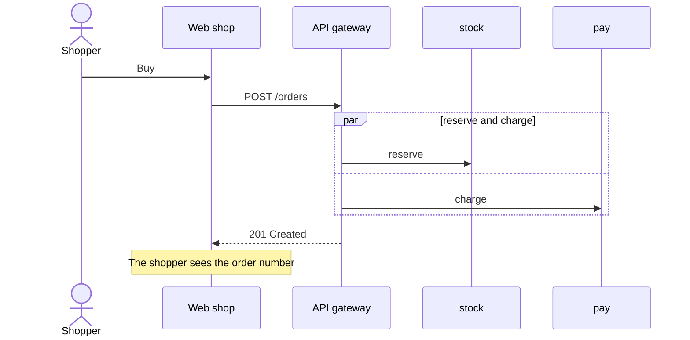

# Sequences (`sequenceDiagram`)

How something moves through a system, step by step: Mermaid's own sequence diagram.
A file may hold only a sequence (it opens as lifelines), or a sequence may be a further
diagram that plays over a box diagram's view, which is usually clearer: the reader sees
the request travel across the picture they already know. Full rules: `../../../docs/map-format.md`,
"Sequences".

````markdown
## Checkout



## Plays over

- #shop-platform : Checkout (synchronous)

## Details

### <a id="m-post"></a>POST /orders

The basket id and the delivery slot, with an idempotency key.
````

- Participants: `participant id as Label`, `actor id as Label`. To play over a view,
  use the box diagram's node ids as participant ids.
- Messages: `->>` a call, `-->>` a reply, `-)` async; a label after `:`. Blocks `loop`,
  `alt`/`else`, `opt`, `par`/`and`, `critical`, `break`. `Note over a: text` captions
  the step before it.
- `%% id: <id>` on the line before a message names it, so `## Details` can hold its
  note.
- `## Plays over`: one line per view, `- #<diagram anchor> : <view name>` (the first
  diagram's anchor is its `# Title`'s; `Relations` is the block's own arrows). Run the
  checker: every participant must be a node the view shows and every message must run
  along one of its arrows (either way), or that line is not used.

## Playing it

`seq` is the sequence's heading anchor (`## Checkout` is `checkout`), or `main` when the
sequence is the file's first diagram. `step` counts from 1 along the timeline (a `par`
is one step, a loop adds a repeat step). A link opens paused; the reader presses play.

- Over its view (the usual one): `show.py "<map>" --seq checkout --step 1`.
- As lifelines: `show.py "<map>" --seq checkout --step 3 --mode lifelines`.
- As the numbered list: `show.py "<map>" --mode list --part checkout`.
- To move a playing sequence, send `--seq <same> --step N` again. Another `--view`,
  `--part` or map stops it.

Point at a step while explaining it ("step 7 is where both workers update"), not at the
whole sequence.
